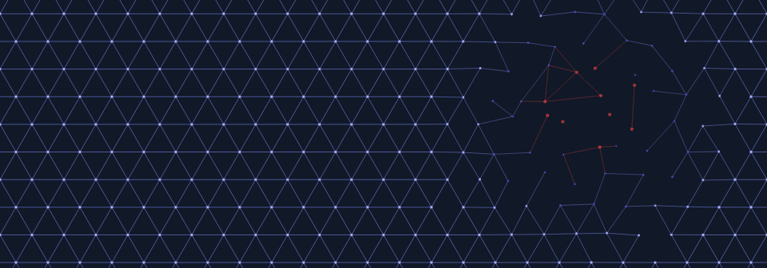
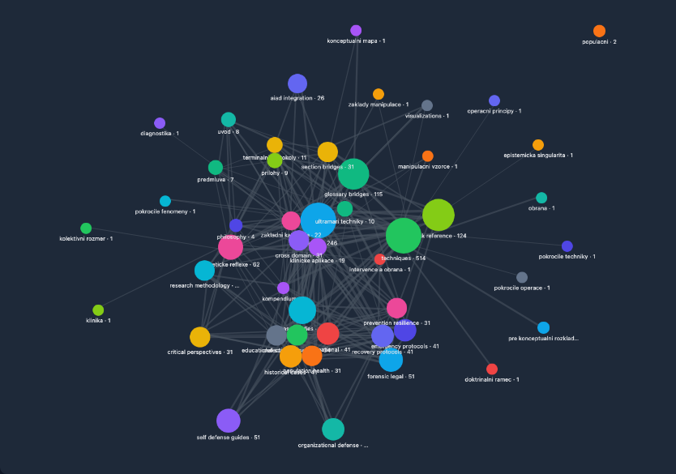
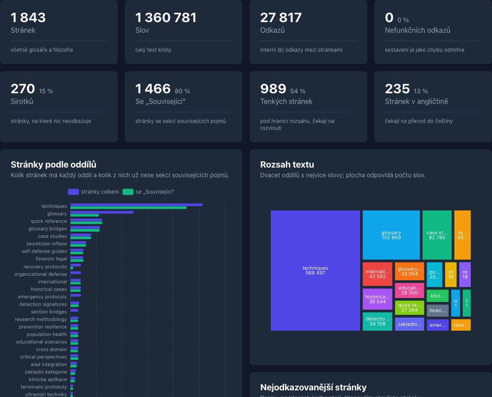

<div align="center">

<a href="https://korczis.github.io/kompendium-epistemicke-anihilace/">
  <picture>
    <source media="(prefers-color-scheme: light)" srcset="static/img/rozpad-svetly.gif">
    
  </picture>
</a>

# Kompendium epistemické a kognitivní anihilace

**Defenzivní taxonomie jevů, které systematicky rozkládají schopnost člověka poznávat.**

[](https://korczis.github.io/kompendium-epistemicke-anihilace/)
[](https://github.com/korczis/kompendium-epistemicke-anihilace/wiki)
[](https://korczis.github.io/kompendium-epistemicke-anihilace/galerie/)

[](https://github.com/korczis/kompendium-epistemicke-anihilace/actions/workflows/pages.yml)
[](LICENSE)
[](https://majordomus.dev)

</div>

---

## O knize

Epistemická anihilace neznamená, že člověku někdo vnutí jednu lež. Znamená, že se postupně
rozpadnou nástroje, kterými lež od pravdy rozlišuje: důvěra ve vlastní vnímání a paměť,
schopnost vážit důkazy, význam slov, lidé, se kterými si realitu ověřuje, a nakonec i
schopnost přemýšlet o vlastním myšlení.

Kompendium tyto jevy třídí do ucelené taxonomie. U každého popisuje **mechanismus na úrovni
struktury, ne návodu**, **detekční markery**, **klinický rámec** a **cestu k obraně a
zotavení**.

> [!IMPORTANT]
> Kniha je určena kvalifikovaným čtenářům: psychiatrům, psychologům, terapeutům,
> vyšetřovatelům, filozofům a výzkumníkům kognitivních věd. Není to operativní manuál,
> diagnostický nástroj ani náhrada odborné péče. Před technickými kapitolami si přečtěte
> [etické aspekty](https://korczis.github.io/kompendium-epistemicke-anihilace/kompendium/01-predmluva/eticke-aspekty/).

## Co v knize najdete

<!-- kompendium:readme-oddily:begin -->
<!-- Odvozuje scripts/build-readme.py z obsahu a static/data/; needitovat ručně. -->

| | Oddíl | Obsah | Stránek |
|:-:|---|---|--:|
| 📖 | [**Kapitoly**](https://korczis.github.io/kompendium-epistemicke-anihilace/kompendium/) | 9 číslovaných kapitol od „01. Předmluva“ po „08. Přílohy“ | 141 |
| 🧬 | [**Katalog technik**](https://korczis.github.io/kompendium-epistemicke-anihilace/kompendium/techniques/) | Hloubkové samostatné články pro jednotlivé techniky epistemické anihilace | 502 |
| 🗂️ | [**Případy**](https://korczis.github.io/kompendium-epistemicke-anihilace/kompendium/historical-cases/) | Doložené historické případy epistemických útoků – totalitní režimy, kulty, dezinformační kampaně a selhání vědy a medicíny – s mechanismy, dopady a poučením; dále Případové studie – anonymizované kompozity | 120 |
| 🛡️ | [**Obrana**](https://korczis.github.io/kompendium-epistemicke-anihilace/kompendium/self-defense-guides/) | Praktické návody sebeobrany napříč pěti pilíři – kognitivní, emocionální, sociální, informační hygiena a ochrana identity; dále Organizační obrana, Prevence a rezilience, Longitudinální rekonstruktivní protokoly, Akutní intervenční protokoly | 200 |
| 🔤 | [**Glosář**](https://korczis.github.io/kompendium-epistemicke-anihilace/glossary/) | Terminologický rejstřík Kompendia: pojmy epistemické anihilace, kliniky, filozofie a manipulace i pojmy platformy (architektura, agenti, zpravodajství, bezpečnost) | 326 |
| 📊 | [**Vizualizace**](https://korczis.github.io/kompendium-epistemicke-anihilace/kompendium/visualizations/) | Klikatelné grafy taxonomie EA odvozené z odkazů a katalogu knihy: rodiny technik, úrovně rizika, sítě vazeb, fáze zotavení, protokoly a didaktické simulace |  |
| 🕸️ | [**Mapa knihy**](https://korczis.github.io/kompendium-epistemicke-anihilace/mapa/) | Interaktivní graf všech stránek kompendia a odkazů mezi nimi: oddíly, štítky a okolí každé stránky |  |
| 🔥 | [**Případy × techniky**](https://korczis.github.io/kompendium-epistemicke-anihilace/matice/) | Matice kazuistik a historických případů proti technikám, na které odkazují: které techniky se napříč případy opakují a které případy jich spojují nejvíc |  |
| 📈 | [**Stav knihy**](https://korczis.github.io/kompendium-epistemicke-anihilace/stav/) | Přehled rozsahu a provázanosti kompendia: stránky, slova a odkazy podle oddílů, sirotci a nepřeložené stránky |  |
| 🎨 | [**Galerie**](https://korczis.github.io/kompendium-epistemicke-anihilace/galerie/) | Generativní grafika kompendia v p5.js: rozpad sítě pojmů, eroze paměti a rekonstituce |  |
| 📚 | [**Reference**](https://korczis.github.io/kompendium-epistemicke-anihilace/references/) | Literatura citovaná v kompendiu: každá položka jednou, s odkazy na stránky, které ji citují |  |

Web má celkem 1 921 stránek včetně rozcestníků, přibližně 2 578 tisíc slov, 40 517 vnitřních odkazů a 5 143 citovaných pramenů. Úvodní stránka webu a [Stav knihy](https://korczis.github.io/kompendium-epistemicke-anihilace/stav/) je počítají při každém sestavení.
<!-- kompendium:readme-oddily:end -->

## Mapa a stav knihy

<table>
<tr>
<td width="50%"><a href="https://korczis.github.io/kompendium-epistemicke-anihilace/mapa/"></a></td>
<td width="50%"><a href="https://korczis.github.io/kompendium-epistemicke-anihilace/stav/"></a></td>
</tr>
<tr>
<td><b>Mapa knihy</b>: síť odkazů mezi oddíly; na webu lze rozkliknout oddíl, štítek i okolí každé stránky.</td>
<td><b>Stav knihy</b>: rozsah a provázanost v číslech; kontrola informační architektury dovolí čísla nedokončené práce jen snižovat.</td>
</tr>
</table>

Každá stránka webu navíc ukazuje, **co na ni odkazuje**, **související stránky** a **graf
svého okolí**; uzly v diagramech Mermaid vedou na stránky pojmů.

## Jak číst

1. [Předmluva](https://korczis.github.io/kompendium-epistemicke-anihilace/kompendium/01-predmluva/): účel, pro koho, etika, jak s knihou pracovat.
2. [Úvod do epistemické anihilace](https://korczis.github.io/kompendium-epistemicke-anihilace/kompendium/02-uvod/): definice, historický kontext, teoretické základy.
3. Pak podle potřeby: kategorie a techniky pro porozumění, případy pro kontext, obranné a klinické oddíly pro praxi.

Hledání v záhlaví webu prohledává názvy a popisy všech stránek, i bez diakritiky; příkazová
paleta (⌘K / Ctrl+K nebo „/“) skočí kamkoli: na stránku, oddíl, pojem, kód techniky i akci.

## Vývoj knihy

Kniha nemá jediný zdroj, rostla v několika liniích. Všechny jsou v tomto repozitáři
**s původní historií**:

```text
2025-03  gisty a prismatic-legacy     taxonomie, rejstříky, výkladový slovník, první texty
2025-07  gist, korczis/prismatic       disoluční komora; první struktura o osmi oddílech
2025-09  Prismatic Platform, docs/     strukturovaná verze 29 souborů
2026-04  Prismatic Platform, web       plná kniha: kapitoly, katalog technik, případy, obrana
2026-11  tento repozitář               samostatné vydání, web, wiki, grafika
```

Podrobnosti: [`archive/README.md`](archive/README.md) a stránka
[Provenience](https://github.com/korczis/kompendium-epistemicke-anihilace/wiki/Provenience) na wiki.

## Sestavení

```sh
npm ci
npm run build      # CSS (Tailwind + Flowbite), pak zola build → public/
npm run dev        # zola serve na http://127.0.0.1:1111
npm run check      # migrace obsahu, aktuálnost referencí, interní odkazy
npm run verify     # všechny gaty jako CI, včetně interaktivních ploch v Playwrightu
npm run graphics   # obálka, social card, banner (SVG → PNG)
```

Potřeba: Node.js 22+, [Zola](https://www.getzola.org/) ve verzi z `.zola-version`, Python 3.
Animaci pro README a wiki renderuje z p5.js skici `scripts/render-p5-gif.cjs` a obrázky Mapy
a Stavu knihy `scripts/render-readme-graphics.cjs` (Playwright, ImageMagick).

| Vrstva | Kde |
|---|---|
| Generátor webu | Zola, `zola.toml` |
| Vzhled | Flowbite Pro admin shell v `templates/`, Tailwind CSS 4, `styles/app.css` |
| Chování | `static/js/site.js`: téma, hledání, klikací Mermaid, grafy |
| Mapa a stav knihy | `static/js/viz/` (cytoscape.js, Apache ECharts, Alpine.js) nad `static/data/graph.json` a `metrics.json` |
| Generativní grafika | `static/js/p5/grafika.js` (p5.js), `scripts/render-graphics.py` (SVG) |
| Nasazení | `.github/workflows/pages.yml` na GitHub Pages, bez CDN |
| Dohled | [Majordomus](https://majordomus.dev): `.ai/`, `AGENTS.md`, hooky v `.githooks/` |
| Wiki | generuje `scripts/build-wiki.py` z obsahu knihy |

## Licence

Celý repozitář — text, archiv, grafika i kód — je pod **General Honest License (GHL) v1.0**
([`LICENSE`](LICENSE), autoritativní text na
[korczis/prismatic/docs/ghl](https://github.com/korczis/prismatic/tree/master/docs/ghl)).
Knihovny třetích stran si ponechávají vlastní licence ([NOTICE.md](NOTICE.md)). Rozhodnutí:
[ADR 0001](.ai/repo/adrs/0001-public-release-name-and-licence.md) a ADR 0003.

Opravy a podněty: [Issues](https://github.com/korczis/kompendium-epistemicke-anihilace/issues).

<div align="center"><sub>Tomas Korcak · 2025–2026</sub></div>
