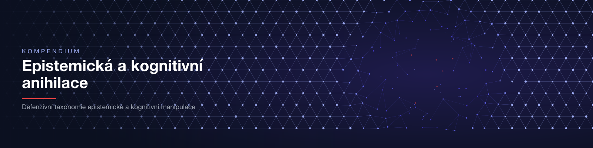

# Kompendium epistemické a kognitivní anihilace



[](https://github.com/korczis/kompendium-epistemicke-anihilace/actions/workflows/pages.yml)
[](LICENSE-CONTENT.md)
[](LICENSE)

**Read:** https://korczis.github.io/kompendium-epistemicke-anihilace/ ·
**Wiki:** https://github.com/korczis/kompendium-epistemicke-anihilace/wiki ·
**References:** https://korczis.github.io/kompendium-epistemicke-anihilace/references/

A Czech-language book by Tomas Korcak: a taxonomy of the phenomena that systematically erode a
person's ability to know, weigh information and keep a coherent picture of reality. For every
phenomenon it gives the mechanism at the level of structure (not implementation), detection
markers, the clinical frame, and the way to defence and recovery.

## Intent

The Kompendium is a **defensive taxonomy** for qualified readers: psychiatrists, psychologists,
therapists, investigators, philosophers and researchers in the cognitive sciences. It exists so
that manipulation can be recognised, prevented and treated. It is not an operational manual, a
diagnostic instrument or a substitute for professional care. The preface sets out the ethical
frame, the safety classification and how to read it
([`content/kompendium/01-predmluva/`](content/kompendium/01-predmluva/)).

## What is inside

| Area | Content | Source |
|---|---|---|
| Chapters | preface, introduction, basic categories, terminal protocols, ultramarine techniques, clinical applications, theoretical reflections, appendices, plus the expanded chapter series | `content/kompendium/0*/` |
| Technique catalogue | the EA-X.Y.Z entries, each with mechanism, detection markers and cross-links | `content/kompendium/techniques/` |
| Cases | anonymised case studies and historical cases (show trials, Zersetzung, normalisation, cults, disinformation campaigns, research fraud) | `content/kompendium/case-studies/`, `content/kompendium/historical-cases/` |
| Defence | self-defence guides, organisational defence, prevention and resilience, recovery and emergency protocols | `content/kompendium/*-defense*/`, `recovery-protocols/`, `emergency-protocols/` |
| Glossary and philosophy | the terms and essays the book links to | `content/glossary/`, `content/philosophy/` |
| Visualisations | interactive Chart.js, p5.js and three.js models; Mermaid concept maps on most pages | `static/js/kompendium/`, `content/kompendium/visualizations/` |
| References | every literature entry the book cites, deduplicated, linked to the citing pages | `content/references.md` (generated) |
| Archive | the 2025 versions and gists the book grew from | [`archive/`](archive/README.md) |

Counts change as the book grows; the landing page computes them at every build.

## Provenance

The book lived inside the private Prismatic Platform monorepo
(`apps/prismatic_web/priv/content/kompendium/`). It was recovered into this repository on
2026-11-09 with `git filter-repo`, so the commits from 2025-09-30 onwards keep their original
authorship and dates. One migration commit then made it stand alone:

- Zola 0.23 removed shortcodes; [`scripts/migrate-content.py`](scripts/migrate-content.py)
  turns them into Tera components (idempotent, `--check` in CI).
- Links to platform pages that are not part of the book point at the platform's original public
  site, so no reference is lost; links into the private application stay as marked text.
- Links to the private monorepo point here, and the owner's e-mail addresses are replaced by
  [Issues](https://github.com/korczis/kompendium-epistemicke-anihilace/issues).

## Build

```sh
npm ci
npm run graphics   # optional: re-render static/img from scripts/render-graphics.py
npm run build      # Tailwind + Flowbite CSS, then zola build -> public/
npm run dev        # zola serve on http://127.0.0.1:1111
npm run check      # migration idempotent, references current, internal links resolve
```

Requires Node.js 22+, [Zola](https://www.getzola.org/) (version in `.zola-version`) and Python 3.

## Architecture

| Concern | Lives in |
|---|---|
| Site generator | Zola, `zola.toml` |
| Layout | Flowbite Pro admin shell adapted in `templates/` (navbar, sidebar, page header, cards) |
| Styles | Tailwind CSS 4 + Flowbite + flowbite-typography, `styles/app.css` |
| Behaviour | `static/js/site.js`: theme, sidebar, search over the Zola index, Mermaid, charts |
| Graphics | `scripts/render-graphics.py`, deterministic SVG, PNG via `rsvg-convert` |
| Deploy | `.github/workflows/pages.yml` to GitHub Pages, no CDN at runtime |
| Supervision | [Majordomus](https://majordomus.dev): `.ai/`, `AGENTS.md`, hooks in `.githooks/` |

## Licence

Text, archive and graphics: [CC BY-NC-SA 4.0](LICENSE-CONTENT.md). Code: [MIT](LICENSE).
Third-party libraries: [NOTICE.md](NOTICE.md). Decision record:
[ADR 0001](.ai/repo/adrs/0001-public-release-name-and-licence.md).
