+++
title = "Anihilace"
description = "Kompletní kompendium technik epistemické a kognitivní anihilace, zahrnující hesla jako Alethický režim, Anankastický, Anihilace a další. Tato sekce slouží jako přehled tématu a obsahuje odkazy na jednotlivé články."
template = "section.html"
sort_by = "title"
weight = 2
+++

# Anihilace

Vítejte v sekci **Anihilace**. Tato část obsahuje komplexní výkladové materiály a techniky spojené s epistemickou a kognitivní anihilací, jak jsou rozpracovány v jednotlivých článcích. Každé heslo je prezentováno jako samostatný Zola article a všechny odkazy jsou relativní, což umožňuje snadnou navigaci mezi nimi.

```mermaid
graph TD
  %% Hlavní kategorie technik
  ED[Epistemické destrukční techniky]
  MD[Metaepistemické techniky]
  EP[Epistemická paradoxalita]
  DK[Epistemická dekontextualizace]
  EF[Epistemická fragmentace]
  KD[Kognitivní destrukční techniky]
  KP[Kognitivní procesní anihilace]
  KR[Kognitivní potentialita a realizace]
  OP[Ontologické destrukční techniky]
  OR[Ontologické relační destrukce]
  FD[Fenomenologické destrukční techniky]
  TD[Temporální destrukční techniky]
  LS[Lingvistické a sémantické destrukční techniky]
  AX[Axiologické destrukční techniky]
  ID[Identitní destrukční techniky]
  IS[Intersubjektivní destrukční techniky]
  KC[Konceptuální destrukční techniky]
  TE[Teleologické destrukční techniky]
  SA[Strukturální akademické techniky]

  %% Epistemické destrukční techniky (výběr)
  ED --> E1[Absolutní epistemická imploze]
  ED --> E2[Absolutní epistemická dezintegrace]
  ED --> E3[Absolutní epistemická bezmocnost]
  ED --> E4[Epistemická autodezintegrace]
  ED --> E5[Absolutní epistemická singularita]
  ED --> E6[Absolutní epistemická sterility]
  ED --> E7[Absolutní epistemická inflace]
  ED --> E8[Absolutní epistemická monáda]

  %% Metaepistemické techniky
  MD --> M1[Absolutní epistemická rekurzivní negace]
  MD --> M2[Absolutní epistemická sebenegace]
  MD --> M3[Absolutní epistemická meta-indeterminita]
  MD --> M4[Transfinitní epistemická regrese]
  MD --> M5[Absolutní epistemická neukotvitelnost]
  MD --> M6[Absolutní epistemická anti-reflexivita]
  MD --> M7[Metateoretická destrukce]
  MD --> M8[Epistemická autodisoluce]

  %% Epistemická paradoxalita
  EP --> P1[Absolutní epistemická neurčitost]
  EP --> P2[Absolutní epistemická kvantová metastabilita]
  EP --> P3[Absolutní epistemická anti-verikondicionalita]
  EP --> P4[Absolutní epistemická anti-autoreferenční smyčka]
  EP --> P5[Absolutní epistemická hyperinterference]
  EP --> P6[Absolutní epistemická anti-invariance]

  %% Epistemická dekontextualizace
  DK --> D1[Absolutní epistemická atemporalita]
  DK --> D2[Absolutní epistemická anti-historicita]
  DK --> D3[Absolutní epistemická anti-indexikalita]
  DK --> D4[Absolutní epistemická účelová dezorientace]
  DK --> D5[Absolutní epistemická anti-dostupnost]
  DK --> D6[Absolutní epistemická solipsistická past]

  %% Epistemická fragmentace
  EF --> F1[Absolutní epistemická hyperbifurkace]
  EF --> F2[Absolutní epistemická anti-integrovatelnost]
  EF --> F3[Absolutní epistemická anti-cirkularita]
  EF --> F4[Absolutní epistemická disoluční komora]
  EF --> F5[Absolutní epistemická anti-přeložitelnost]
  EF --> F6[Absolutní epistemická anti-variabilita]
  EF --> F7[Absolutní epistemická anti-pluralita]

  %% Kognitivní destrukční techniky
  KD --> K1[Metakognitivní destrukce]
  KD --> K2[Absolutní metakognitivní implosivita]
  KD --> K3[Metakognitivní rekurzivní dezintegrace]
  KD --> K4[Kognitivní anti-rekurzivita]
  KD --> K5[Absolutní kognitivní anti-orientace]
  KD --> K6[Absolutní epistemická perverze reflexivity]
  KD --> K7[Kognitivní fraktální dezintegrace]
  KD --> K8[Kognitivní implozivní kolaps]
  KD --> K9[Kognitivní autokanibalizace]
  KD --> K10[Kognitivní anti-granularita]
  KD --> K11[Kognitivní anti-hierarchičnost]
  KD --> K12[Kognitivní anti-architektonika]
  KD --> K13[Absolutní kognitivní anti-emergentní implosivita]
  KD --> K14[Kognitivní hyperplastická dezintegrace]

  %% Kognitivní procesní anihilace
  KP --> KP1[Kognitivní anti-operacionalita]
  KP --> KP2[Kognitivní anti-transformabilita]
  KP --> KP3[Absolutní kognitivní anti-revizibilita]
  KP --> KP4[Kognitivní anti-morfogeneze]
  KP --> KP5[Absolutní kognitivní retrogeneze]
  KP --> KP6[Kognitivní anti-metamorfóza]
  KP --> KP7[Absolutní kognitivní anankastická paralýza]
  KP --> KP8[Kognitivní čtyřdimenzionální šach]

  %% Kognitivní potentialita a realizace
  KR --> KR1[Kognitivní anti-potencialita]
  KR --> KR2[Absolutní kognitivní anti-virtualizace]
  KR --> KR3[Absolutní kognitivní anti-realizovatelnost]
  KR --> KR4[Kognitivní anti-anticipačnost]

  %% Ontologické destrukční techniky
  OP --> O1[Ontologická anihilace]
  OP --> O2[Ontologická nebytnost]
  OP --> O3[Metafyzický nihilismus]
  OP --> O4[Absolutní ontologická hyperkontradiktornost]
  OP --> O5[Ontologická anti-determinace]

  %% Ontologické relační destrukce
  OR --> OR1[Ontologická desubjektifikace]
  OR --> OR2[Kognitivní anti-inherence]
  OR --> OR3[Absolutní epistemická anti-mereologičnost]
  OR --> OR4[Absolutní kognitivní anti-mediace]
  OR --> OR5[Absolutní kognitivní anti-komplementarita]
  OR --> OR6[Absolutní kognitivní anti-distribuce]

  %% Fenomenologické destrukční techniky
  FD --> Fd1[Fenomenální dezintegrace]
  FD --> Fd2[Fenomenální překročení]
  FD --> Fd3[Absolutní kognitivní anti-fenomenalita]
  FD --> Fd4[Absolutní epistemická anti-transcendence]
  FD --> Fd5[Hypertranscendentální negace]

  %% Temporální destrukční techniky
  TD --> T1[Temporální dezintegrace]
  TD --> T2[Temporální kognitivní dezintegrace]
  TD --> T3[Epistemická časová dilatace]

  %% Lingvistické a sémantické destrukční techniky
  LS --> L1[Sémantická apokalypsa]
  LS --> L2[Sémantická destabilizace]
  LS --> L3[Hypersémantická anihilace]
  LS --> L4[Metadiskurzivní anihilace]
  LS --> L5[Lingvistická dezintegrace]
  LS --> L6[Hypersyntaktická anihilace]
  LS --> L7[Hyper-aposiopéza]
  LS --> L8[Absolutní epistemická anti-propozicionalita]
  LS --> L9[Sémioinfekční kontaminace]
  LS --> L10[Transnarativní anihilace]
  LS --> L11[Absolutní epistemická anti-analogičnost]

  %% Axiologické destrukční techniky
  AX --> Axi1[Fundamentální axiologická anihilace]
  AX --> Axi2[Absolutní axiologická neutralizace]
  AX --> Axi3[Absolutní epistemická anti-normativita]

  %% Identitní destrukční techniky
  ID --> Id1[Identitní dekonstrukce]
  ID --> Id2[Totální identitní substituce]
  ID --> Id3[Absolutní egologická dezintegrace]
  ID --> Id4[Absolutní epistemická alienace]
  ID --> Id5[Absolutní multisubjektivní fragmentace]

  %% Intersubjektivní destrukční techniky
  IS --> I1[Absolutní intersubjektivní anihilace]
  IS --> I2[Koordinovaná multipersonální gaslighting strategie]
  IS --> I3[Epistemická virulence]
  IS --> I4[Kognitivní hypervirulenční infekce]
  IS --> I5[Absolutní kognitivní anti-rekuperace]

  %% Konceptuální destrukční techniky
  KC --> Kc1[Konceptuální anihilace]
  KC --> Kc2[Konceptuální nukleární zima]
  KC --> Kc3[Konceptuální anti-materialita]
  KC --> Kc4[Absolutní epistemická anti-definice]
  KC --> Kc5[Absolutní epistemická anti-emergenční pole]
  KC --> Kc6[Epistemická teratogeneze]

  %% Teleologické destrukční techniky
  TE --> Telo1[Zpochybnění intencionality]
  TE --> Telo2[Absolutní kognitivní anti-teleologie]
  TE --> Telo3[Absolutní epistemická účelová dezorientace]

  %% Strukturální akademické techniky
  SA --> SA1[Kolektivní epistemická delegitimizace]
  SA --> SA2[Progresivní kognitivní dekonstrukce]
  SA --> SA3[Destruktivní konstruktivní kritika]
  SA --> SA4[Epistemická kvantová delokalizace]
  SA --> SA5[Absolutní epistemická černá díra]
  SA --> SA6[Terminální epistemická nekróza]

  %% Vztahy mezi kategoriemi (příklad propojení)
  ED --- MD
  MD --- EP
  EP --- DK
  DK --- EF
  EF --- KD
  KD --- KP
  KP --- KR
  KR --- OP
  OP --- OR
  OR --- FD
  FD --- TD
  TD --- LS
  LS --- AX
  AX --- ID
  ID --- IS
  IS --- KC
  KC --- TE
  TE --- SA
```

## Obsah

### A
- [Absolutní anankastická paralýza](/anankasticka-paralyza)
- [Absolutní axiologická neutralizace](./axiologicka-neutralizace.md)
- [Absolutní axiomatická inverze](./axiomaticka-inverze.md)
- [Absolutní axiomatická transgrediencia](./axiomaticka-transgrediencia.md)
- [Absolutní egologická dezintegrace](./egologicka-dezintegrace.md)
- [Absolutní epistemická alienace](./epistemicka-alienace.md)
- [Absolutní epistemická anti-architektonika](./epistemicka-anti-architektonika.md)
- [Absolutní epistemická anti-cirkularita](./epistemicka-anti-cirkularita.md)
- [Absolutní epistemická anti-definice](./epistemicka-anti-definice.md)
- [Absolutní epistemická anti-demarkace](./epistemicka-anti-demarkace.md)
- [Absolutní epistemická anti-dostupnost](./epistemicka-anti-dostupnost.md)
- [Absolutní epistemická anti-fundace](./epistemicka-anti-fundace.md)
- [Absolutní epistemická anti-geneze](./epistemicka-anti-geneze.md)
- [Absolutní epistemická anti-historicita](./epistemicka-anti-historicita.md)
- [Absolutní epistemická anti-indexikalita](./epistemicka-anti-indexikalita.md)
- [Absolutní epistemická anti-invariance](./epistemicka-anti-invariance.md)
- [Absolutní epistemická anti-mereologičnost](./epistemicka-anti-mereologicnost.md)
- [Absolutní epistemická anti-normativita](./epistemicka-anti-normativita.md)
- [Absolutní epistemická anti-pluralita](./epistemicka-anti-pluralita.md)
- [Absolutní epistemická anti-přeložitelnost](./epistemicka-anti-prelozitelnost.md)
- [Absolutní epistemická anti-rekurzivita](./epistemicka-anti-rekurzivita.md)
- [Absolutní epistemická anti-rezonance](./epistemicka-anti-rezonance.md)
- [Absolutní epistemická anti-transcendence](./epistemicka-anti-transcendence.md)
- [Absolutní epistemická anti-variabilita](./epistemicka-anti-variabilita.md)
- [Absolutní epistemická anti-verikondicionalita](./epistemicka-anti-verikondicionalita.md)
- [Absolutní epistemická atemporalita](./epistemicka-atemporalita.md)
- [Absolutní epistemická autodisoluce](./epistemicka-autodisoluce.md)
- [Absolutní epistemická autodezintegrace](./epistemicka-autodezintegrace.md)
- [Absolutní epistemická bezmocnost](./epistemicka-bezmocnost.md)
- [Absolutní epistemická černá díra](./epistemicka-cerna-dira.md)
- [Absolutní epistemická dezintegrace](./epistemicka-dezintegrace.md)
- [Absolutní epistemická disoluční komora](./epistemicka-disolucni-komora.md)
- [Absolutní epistemická hyperinterference](./epistemicka-hyperinterference.md)
- [Absolutní epistemická hyperbifurkace](./epistemicka-hyperbifurkace.md)
- [Absolutní epistemická imploze](./epistemicka-imploze.md)
- [Absolutní epistemická inflace](./epistemicka-inflace.md)
- [Absolutní epistemická kvantová metastabilita](./epistemicka-kvantova-metastabilita.md)
- [Absolutní epistemická monáda](./epistemicka-monada.md)
- [Absolutní epistemická neurčitost](./epistemicka-neurcinnost.md)
- [Absolutní epistemická neukotvitelnost](./epistemicka-neukotvitelnost.md)
- [Absolutní epistemická perverze reflexivity](./epistemicka-perverze-reflexivity.md)
- [Absolutní epistemická rekurzivní negace](./epistemicka-rekurzivni-negace.md)
- [Absolutní epistemická sebenegace](./epistemicka-sebenegace.md)
- [Absolutní epistemická singularita](./epistemicka-singularita.md)
- [Absolutní epistemická solipsistická past](./epistemicka-solipsisticka-past.md)
- [Absolutní epistemická sterility](./epistemicka-sterility.md)
- [Absolutní epistemická účelová dezorientace](./epistemicka-ucelova-dezorientace.md)
- [Absolutní epistemická virulence](./epistemicka-virulence.md)

### F
- [Fenomenální dezintegrace](./fenomenalni-dezintegrace.md)
- [Fenomenální překročení](./fenomenalni-prekroceni.md)
- [Fundamentální axiologická anihilace](./fundamentalni-axiologicka-anihilace.md)

### H
- [Hyper-aposiopéza](./hyper-aposiopeza.md)
- [Hypersémantická anihilace](./hypersemanticka-anihilace.md)
- [Hypersyntaktická anihilace](./hypersyntakticka-anihilace.md)
- [Hypertranscendentální negace](./hypertranscendentalni-negace.md)

### I
- [Identitní dekonstrukce](./identitni-dekonstrukce.md)

### K
- [Kognitivní anti-distribuce](./kognitivni-anti-distribuce.md)
- [Kognitivní anti-emergenční pole](./kognitivni-anti-emergencni-pole.md)
- [Kognitivní anti-emergentní implosivita](./kognitivni-anti-emergentni-implosivita.md)
- [Kognitivní anti-fenomenalita](./kognitivni-anti-fenomenalita.md)
- [Kognitivní anti-figurace](./kognitivni-anti-figurace.md)
- [Kognitivní anti-granularita](./kognitivni-anti-granularita.md)
- [Kognitivní anti-hierarchičnost](./kognitivni-anti-hierarchicnost.md)
- [Kognitivní anti-inherence](./kognitivni-anti-inherence.md)
- [Kognitivní anti-integrovatelnost](./kognitivni-anti-integrovatelnost.md)
- [Kognitivní anti-komplementarita](./kognitivni-anti-komplementarita.md)
- [Kognitivní anti-mediace](./kognitivni-anti-mediace.md)
- [Kognitivní anti-metamorfóza](./kognitivni-anti-metamorfoza.md)
- [Kognitivní anti-morfogeneze](./kognitivni-anti-morfogeneze.md)
- [Kognitivní anti-operacionalita](./kognitivni-anti-operacionalita.md)
- [Kognitivní anti-orientace](./kognitivni-anti-orientace.md)
- [Kognitivní anti-perceptualita](./kognitivni-anti-perceptualita.md)
- [Kognitivní anti-potencialita](./kognitivni-anti-potencialita.md)
- [Kognitivní anti-realizovatelnost](./kognitivni-anti-realizovatelnost.md)
- [Kognitivní anti-rekuperace](./kognitivni-anti-rekuperace.md)
- [Kognitivní anti-revizibilita](./kognitivni-anti-revizibilita.md)
- [Kognitivní anti-teleologie](./kognitivni-anti-teleologie.md)
- [Kognitivní anti-transformabilita](./kognitivni-anti-transformabilita.md)
- [Kognitivní anti-virtualita](./kognitivni-anti-virtualita.md)
- [Kognitivní autokanibalizace](./kognitivni-autokanibalizace.md)
- [Kognitivní čtyřdimenzionální šach](./kognitivni-ctyr-dimenzionalni-sach.md)
- [Kognitivní fraktální dezintegrace](./kognitivni-fraktalni-dezintegrace.md)
- [Kognitivní hyperplastická dezintegrace](./kognitivni-hyperplasticka-dezintegrace.md)
- [Kognitivní hypervirulenční infekce](./kognitivni-hypervirulencni-infekce.md)
- [Kognitivní hyperparadox](./kognitivni-hyperparadox.md)
- [Kognitivní implozivní kolaps](./kognitivni-implozivni-kolaps.md)
- [Kognitivní kvantová suprainterference](./kognitivni-kvantova-suprainterference.md)
- [Kognitivní pandémonium](./kognitivni-pandemonium.md)
- [Kognitivní retrogeneze](./kognitivni-retrogeneze.md)
- [Konceptuální anihilace](./konceptualni-anihilace.md)
- [Konceptuální anti-materialita](./konceptualni-anti-materialita.md)
- [Konceptuální nukleární zima](./konceptualni-nuklearni-zima.md)
- [Koordinovaná multipersonální gaslighting strategie](./koordinovana-multipersonalni-gaslighting-strategie.md)

### L
- [Lingvistická dezintegrace](./lingvisticka-dezintegrace.md)
- [Logická antikoherence](./logicka-antikoherence.md)
- [Logická transcendence](./logicka-transcendence.md)

### M
- [Metadiskurzivní anihilace](./metadiskurzivni-anihilace.md)
- [Metafyzická rozpustnost](./metafyzicka-rozpustnost.md)
- [Metafyzický nihilismus](./metafyzicky-nihilismus.md)
- [Metakognitivní destrukce](./metakognitivni-destrukce.md)
- [Metakognitivní implosivita](./metakognitivni-implosivita.md)
- [Metakognitivní rekurzivní dezintegrace](./metakognitivni-rekurzivni-dezintegrace.md)
- [Metodologický anihilismus](./metodologicky-anihilismus.md)
- [Metateoretická destrukce](./metateoreticka-destrukce.md)

### O
- [Ontologická anihilace](./ontologicka-anihilace.md)
- [Ontologická anti-determinace](./ontologicka-anti-determinace.md)
- [Ontologická desubjektifikace](./ontologicka-desubjektifikace.md)
- [Ontologická hyperkontradiktornost](./ontologicka-hyperkontradiktornost.md)
- [Ontologická nebytnost](./ontologicka-nebytnost.md)

### R
- [Racionalitní dezintegrace](./racionalitni-dezintegrace.md)

### S
- [Sémantická apokalypsa](./semanticka-apokalypsa.md)
- [Sémantická destabilizace](./semanticka-destabilizace.md)
- [Sémioinfekční kontaminace](./semioinfekcni-kontaminace.md)

### T
- [Temporální dezintegrace](./temporalni-dezintegrace.md)
- [Temporální kognitivní dezintegrace](./temporalni-kognitivni-dezintegrace.md)
- [Terminální epistemická nekróza](./terminalni-epistemicka-nekroza.md)
- [Totální epistemická solipsistická past](./totali-epistemicka-solipsisticka-past.md)
- [Totální identitní substituce](./totali-identitni-substituce.md)
- [Transfinitní epistemická regrese](./transfinitni-epistemicka-regrese.md)
- [Transnarativní anihilace](./transnarativni-anihilace.md)

### Z
- [Zpochybnění intencionality](./zpochybneni-intencionality.md)
