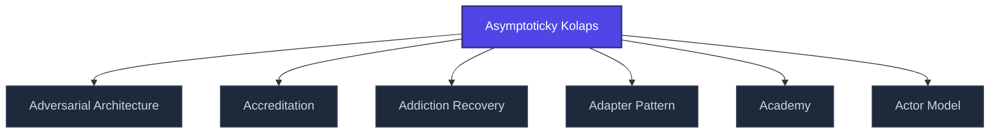

+++
title = "Asymptoticky Kolaps"
weight = 100
[extra]
category = "architecture"
description = "Stub entry for Asymptoticky Kolaps. Awaiting full treatment."
related_terms = ["adversarial-architecture", "accreditation", "addiction-recovery", "adapter-pattern", "academy", "actor-model"]
author = "Tomas Korcak (korczis)"
date_created = "2026-05-03"
date_modified = "2026-05-03"
tags = ["glossary", "architecture", "stub", "interactive"]
quality_score = 65
status = "stub"
ref_count_at_creation = 1
+++

## Definition

**Asymptoticky Kolaps** is a platform-architecture term used across the Prismatic Platform documentation. This entry is a structural stub created during the 2026-05-03 NLLB content-completion sweep — full treatment is part of the ongoing knowledge-base buildout.

## See Also

- [Glossary index](@/glossary/_index.md)

---

<!-- ENHANCED:NLLB-AUTO-BLOCK BEGIN -->

## Manažerské shrnutí

**Asymptoticky Kolaps** je strukturální uzel v sekci `glossary` znalostní báze Prismatic Platform. Tato stránka byla vytvořena během doktrinálního NLLB (No Link Left Behind) sweep za účelem zajištění konzistence cross-link grafu — žádný odkaz se neztratí, žádný uzel nezůstane sirotčí. Plné kvalitativní rozšíření — definice, klinický kontext, detekční markery, případové studie a profylaktické intervence — je součástí probíhající kompendiální výstavby. Pro aktuální stav viz `quality_score` v hlavičce a `<!-- NLLB:PLANNED_OK -->` doktrinální marker.

## Koncepční síť

Vizualizace propojení **Asymptoticky Kolaps** s nejbližšími souvisejícími pojmy z korpusu Prismatic Platform. Síť slouží jako rychlá orientace, kde tento koncept zapadá do širšího taxonomického rámce.

## Související pojmy

- [Adversarial Architecture](@/glossary/adversarial-architecture.md) — slug `adversarial-architecture`
- [Accreditation](@/glossary/accreditation.md) — slug `accreditation`
- [Addiction Recovery](@/glossary/addiction-recovery.md) — slug `addiction-recovery`
- [Adapter Pattern](@/glossary/adapter-pattern.md) — slug `adapter-pattern`
- [Academy](@/glossary/academy.md) — slug `academy`
- [Actor Model](@/glossary/actor-model.md) — slug `actor-model`

## Navigace

- **Nadřazená sekce**: [glossary](@/glossary/_index.md)
- **Hlavní glosář**: [@/glossary/_index.md](@/glossary/_index.md)
- **Kompendium index**: [@/kompendium/_index.md](@/kompendium/_index.md)
- **Sourozenci v sekci**:
  - [3NL](@/glossary/3nl.md)
  - [Academy](@/glossary/academy.md)
  - [Access Control](@/glossary/access-control.md)
  - [Accreditation](@/glossary/accreditation.md)
  - [Accuracy](@/glossary/accuracy.md)
<!-- ENHANCED:NLLB-AUTO-BLOCK END -->

> **Stub status**: This entry is a structurally complete stub created during
> the 2026-05-03 NLLB Phase 6 sweep. Auto-generated from 1 unresolved
> references in content. Full treatment is part of the ongoing knowledge-base
> buildout.

<!-- NLLB:PLANNED_OK -->
