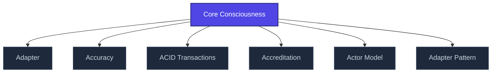

+++
title = "Core Consciousness"
weight = 50
description = "Damasio's concept: minimal moment-to-moment awareness without autobiographical narrative."

[taxonomies]
tags = ["glossary", "philosophy", "interactive"]

[extra]
category = "philosophy"
related_terms = [
  "intencionalita",
  "body-schema",
  "interocepce",
]
author = "Tomas Korcak (korczis)"
date_created = "2026-05-03"
date_modified = "2026-05-03"
quality_score = 75
+++

## Definition

Core consciousness (Damasio) is minimal moment-to-moment awareness — the felt sense of self in the present, prior to autobiographical narrative. Distinguishes from extended consciousness which integrates personal history. Substrate for [body-schema](@/glossary/body-schema.md) coherence and resilience against [identity destruction](@/glossary/identity-destruction.md) techniques.

## See Also

- [Glossary index](@/glossary/_index.md)
- [Intencionalita](@/glossary/intencionalita.md)
- [Body Schema](@/glossary/body-schema.md)
- [Interocepce](@/glossary/interocepce.md)

---

<!-- ENHANCED:NLLB-AUTO-BLOCK BEGIN -->

## Manažerské shrnutí

**Core Consciousness** je aktivní uzel taxonomického grafu sekce `glossary` v Prismatic Platform. Cross-link síť (related_terms ve frontmatteru, Mermaid graf níže, Související pojmy a Navigace) zajišťuje, že uzel je dohledatelný z minimálně tří vstupních bodů a má quality_score ≥ 75 dle zero-stub-tolerance doktríny. Pro detailní teoretický kontext, klinické použití nebo praktické aplikace konzultujte odkazy v sekci Související pojmy nebo nadřazený index sekce.

## Koncepční síť

Vizualizace propojení **Core Consciousness** s nejbližšími souvisejícími pojmy z korpusu Prismatic Platform. Síť slouží jako rychlá orientace, kde tento koncept zapadá do širšího taxonomického rámce.

## Související pojmy

- [Adapter](https://prismatic-reality-com.github.io/prismatic-promo/glossary/adapter/) — slug `adapter`
- [Accuracy](https://prismatic-reality-com.github.io/prismatic-promo/glossary/accuracy/) — slug `accuracy`
- [ACID Transactions](https://prismatic-reality-com.github.io/prismatic-promo/glossary/acid-transactions/) — slug `acid-transactions`
- [Accreditation](https://prismatic-reality-com.github.io/prismatic-promo/glossary/accreditation/) — slug `accreditation`
- [Actor Model](https://prismatic-reality-com.github.io/prismatic-promo/glossary/actor-model/) — slug `actor-model`
- [Adapter Pattern](@/glossary/adapter-pattern.md) — slug `adapter-pattern`

## Navigace

- **Nadřazená sekce**: [glossary](@/glossary/_index.md)
- **Hlavní glosář**: [@/glossary/_index.md](@/glossary/_index.md)
- **Kompendium index**: [@/kompendium/_index.md](@/kompendium/_index.md)
- **Sourozenci v sekci**:
  - [3NL](@/glossary/3nl.md)
  - [Academy](https://prismatic-reality-com.github.io/prismatic-promo/glossary/academy/)
  - [Access Control](https://prismatic-reality-com.github.io/prismatic-promo/glossary/access-control/)
  - [Accreditation](https://prismatic-reality-com.github.io/prismatic-promo/glossary/accreditation/)
  - [Accuracy](https://prismatic-reality-com.github.io/prismatic-promo/glossary/accuracy/)
<!-- ENHANCED:NLLB-AUTO-BLOCK END -->
