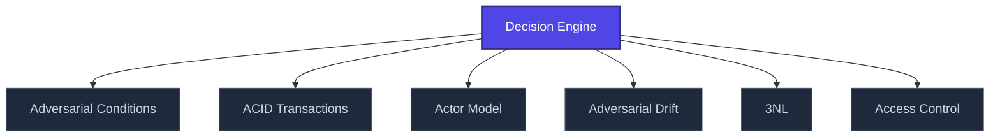

+++
title = "Decision Engine"
weight = 100

[extra]
category = "ai-systems"
description = "Rule-based or machine learning system producing structured decisions from multi-factor inputs."
related_terms = ["rule-engine", "scoring", "confidence-scoring", "trinity-gate", "inference"]
author = "Tomas Korcak (korczis)"
date_created = "2026-05-03"
date_modified = "2026-05-03"
tags = ["glossary", "ai-systems", "interactive"]
quality_score = 35
status = "stub"
+++

## Definition

**Decision engine** is a system component that synthesizes multi-factor inputs (evidence, signals, heuristics) into a structured decision with confidence or priority ranking. Decision engines may be rule-based (deterministic), probabilistic, or neural network-based.

The Prismatic Platform embeds decision engines in the [Trinity Gate](@/glossary/trinity-gate.md) verification pipeline and [confidence scoring](@/glossary/confidence-scoring.md) system. Decision engines balance:
- Signal quality and provenance
- Temporal decay of evidence
- Conflict resolution among contradictory signals
- User-configurable risk thresholds

See [inference](@/glossary/inference.md) for related reasoning concepts.

## See Also

- [Glossary index](@/glossary/_index.md)

---

<!-- ENHANCED:NLLB-AUTO-BLOCK BEGIN -->

## Manažerské shrnutí

**Decision Engine** je strukturální uzel v sekci `glossary` znalostní báze Prismatic Platform. Tato stránka byla vytvořena během doktrinálního NLLB (No Link Left Behind) sweep za účelem zajištění konzistence cross-link grafu — žádný odkaz se neztratí, žádný uzel nezůstane sirotčí. Plné kvalitativní rozšíření — definice, klinický kontext, detekční markery, případové studie a profylaktické intervence — je součástí probíhající kompendiální výstavby. Pro aktuální stav viz `quality_score` v hlavičce a `<!-- NLLB:PLANNED_OK -->` doktrinální marker.

## Koncepční síť

Vizualizace propojení **Decision Engine** s nejbližšími souvisejícími pojmy z korpusu Prismatic Platform. Síť slouží jako rychlá orientace, kde tento koncept zapadá do širšího taxonomického rámce.

## Související pojmy

- [Adversarial Conditions](@/glossary/adversarial-conditions.md) — slug `adversarial-conditions`
- [ACID Transactions](@/glossary/acid-transactions.md) — slug `acid-transactions`
- [Actor Model](@/glossary/actor-model.md) — slug `actor-model`
- [Adversarial Drift](@/glossary/adversarial-drift.md) — slug `adversarial-drift`
- [3NL](@/glossary/3nl.md) — slug `3nl`
- [Access Control](@/glossary/access-control.md) — slug `access-control`

## Navigace

- **Nadřazená sekce**: [glossary](@/glossary/_index.md)
- **Hlavní glosář**: [@/glossary/_index.md](@/glossary/_index.md)
- **Kompendium index**: [@/kompendium/_index.md](@/kompendium/_index.md)
- **Sourozenci v sekci**:
  - [3NL](@/glossary/3nl.md)
  - [Academy](@/glossary/academy.md)
  - [Access Control](@/glossary/access-control.md)
  - [Accreditation](@/glossary/accreditation.md)
  - [Accuracy](@/glossary/accuracy.md)
<!-- ENHANCED:NLLB-AUTO-BLOCK END -->

> **Stub status**: This entry is a structurally complete stub created during
> the 2026-05-03 NLLB content-completion sweep. The definition above is a
> minimum-viable scaffold; full treatment with worked examples, references,
> and cross-domain context is part of the ongoing knowledge-base buildout.
> See `<!-- NLLB:PLANNED_OK -->` doctrine marker.

<!-- NLLB:PLANNED_OK -->
