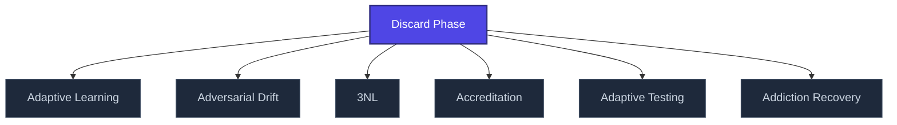

+++
title = "Discard Phase"
weight = 50
[extra]
category = "psychology"
description = "Termination phase of coercive bonding where target is abruptly devalued."
related_terms = [
  "love-bombing",
  "pseudoempaticka-vazba",
  "identity-destruction",
]
author = "Tomas Korcak (korczis)"
date_created = "2026-05-03"
date_modified = "2026-05-03"
tags = ["glossary", "psychology", "interactive"]
quality_score = 75
status = "stub"
+++

## Definition

Discard is the termination phase of a coercive bonding cycle: previously [love-bombed](@/glossary/love-bombing.md) target is abruptly devalued, replaced, or expelled. Often accompanied by smear campaigns, projective blame transfer, and sudden withdrawal of access to shared resources. Recognized in clinical literature on narcissistic relationship cycles.

## See Also

- [Glossary index](@/glossary/_index.md)
- [Love Bombing](@/glossary/love-bombing.md)
- [Pseudoempaticka Vazba](@/glossary/pseudoempaticka-vazba.md)
- [Identity Destruction](@/glossary/identity-destruction.md)

---

<!-- ENHANCED:NLLB-AUTO-BLOCK BEGIN -->

## Manažerské shrnutí

**Discard Phase** je strukturální uzel v sekci `glossary` znalostní báze Prismatic Platform. Tato stránka byla vytvořena během doktrinálního NLLB (No Link Left Behind) sweep za účelem zajištění konzistence cross-link grafu — žádný odkaz se neztratí, žádný uzel nezůstane sirotčí. Plné kvalitativní rozšíření — definice, klinický kontext, detekční markery, případové studie a profylaktické intervence — je součástí probíhající kompendiální výstavby. Pro aktuální stav viz `quality_score` v hlavičce a `<!-- NLLB:PLANNED_OK -->` doktrinální marker.

## Koncepční síť

Vizualizace propojení **Discard Phase** s nejbližšími souvisejícími pojmy z korpusu Prismatic Platform. Síť slouží jako rychlá orientace, kde tento koncept zapadá do širšího taxonomického rámce.

## Související pojmy

- [Adaptive Learning](@/glossary/adaptive-learning.md) — slug `adaptive-learning`
- [Adversarial Drift](@/glossary/adversarial-drift.md) — slug `adversarial-drift`
- [3NL](@/glossary/3nl.md) — slug `3nl`
- [Accreditation](@/glossary/accreditation.md) — slug `accreditation`
- [Adaptive Testing](@/glossary/adaptive-testing.md) — slug `adaptive-testing`
- [Addiction Recovery](@/glossary/addiction-recovery.md) — slug `addiction-recovery`

## Navigace

- **Nadřazená sekce**: [glossary](@/glossary/_index.md)
- **Hlavní glosář**: [@/glossary/_index.md](@/glossary/_index.md)
- **Kompendium index**: [@/kompendium/_index.md](@/kompendium/_index.md)
- **Sourozenci v sekci**:
  - [3NL](@/glossary/3nl.md)
  - [Academy](@/glossary/academy.md)
  - [Access Control](@/glossary/access-control.md)
  - [Accreditation](@/glossary/accreditation.md)
  - [Accuracy](@/glossary/accuracy.md)
<!-- ENHANCED:NLLB-AUTO-BLOCK END -->

> **Stub status**: This entry is a structurally complete stub created during
> the 2026-05-03 NLLB content-completion sweep. The definition above is a
> minimum-viable scaffold; full treatment with worked examples, references,
> and cross-domain context is part of the ongoing knowledge-base buildout.
> See `<!-- NLLB:PLANNED_OK -->` doctrine marker.

<!-- NLLB:PLANNED_OK -->
