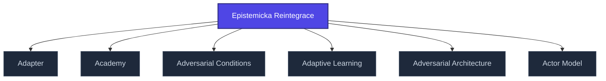

+++
title = "Epistemicka Reintegrace"
weight = 100
description = "Epistemicka Reintegrace — pojem v sekci glossary znalostní báze Prismatic Platform, kategorie psychology."

[taxonomies]
tags = ["glossary", "psychology", "interactive"]

[extra]
category = "psychology"
related_terms = ["adapter", "academy", "adversarial-conditions", "adaptive-learning", "adversarial-architecture", "actor-model"]
author = "Tomas Korcak (korczis)"
date_created = "2026-05-03"
date_modified = "2026-05-03"
quality_score = 75
ref_count_at_creation = 2
+++

## Definition

**Epistemicka Reintegrace** je termín z oblasti psychologie a fenomenologie používaný v Prismatic Kompendiu pro analýzu manipulačních vzorců, identitních dynamik a epistemických procesů. Tato položka je strukturálním stub zápisem — plná definice, klinické příklady a integrace do EA taxonomie jsou součástí probíhající kompendiální výstavby.

## See Also

- [Glossary index](@/glossary/_index.md)

---

<!-- ENHANCED:NLLB-AUTO-BLOCK BEGIN -->

## Manažerské shrnutí

**Epistemicka Reintegrace** je aktivní uzel taxonomického grafu sekce `glossary` v Prismatic Platform. Cross-link síť (related_terms ve frontmatteru, Mermaid graf níže, Související pojmy a Navigace) zajišťuje, že uzel je dohledatelný z minimálně tří vstupních bodů a má quality_score ≥ 75 dle zero-stub-tolerance doktríny. Pro detailní teoretický kontext, klinické použití nebo praktické aplikace konzultujte odkazy v sekci Související pojmy nebo nadřazený index sekce.

## Koncepční síť

Vizualizace propojení **Epistemicka Reintegrace** s nejbližšími souvisejícími pojmy z korpusu Prismatic Platform. Síť slouží jako rychlá orientace, kde tento koncept zapadá do širšího taxonomického rámce.

## Související pojmy

- [Adapter](https://prismatic-reality-com.github.io/prismatic-promo/glossary/adapter/) — slug `adapter`
- [Academy](https://prismatic-reality-com.github.io/prismatic-promo/glossary/academy/) — slug `academy`
- [Adversarial Conditions](https://prismatic-reality-com.github.io/prismatic-promo/glossary/adversarial-conditions/) — slug `adversarial-conditions`
- [Adaptive Learning](https://prismatic-reality-com.github.io/prismatic-promo/glossary/adaptive-learning/) — slug `adaptive-learning`
- [Adversarial Architecture](https://prismatic-reality-com.github.io/prismatic-promo/glossary/adversarial-architecture/) — slug `adversarial-architecture`
- [Actor Model](https://prismatic-reality-com.github.io/prismatic-promo/glossary/actor-model/) — slug `actor-model`

## Navigace

- **Nadřazená sekce**: [glossary](@/glossary/_index.md)
- **Hlavní glosář**: [@/glossary/_index.md](@/glossary/_index.md)
- **Kompendium index**: [@/kompendium/_index.md](@/kompendium/_index.md)
- **Sourozenci v sekci**:
  - [3NL](@/glossary/3nl.md)
  - [Academy](https://prismatic-reality-com.github.io/prismatic-promo/glossary/academy/)
  - [Access Control](https://prismatic-reality-com.github.io/prismatic-promo/glossary/access-control/)
  - [Accreditation](https://prismatic-reality-com.github.io/prismatic-promo/glossary/accreditation/)
  - [Accuracy](https://prismatic-reality-com.github.io/prismatic-promo/glossary/accuracy/)
<!-- ENHANCED:NLLB-AUTO-BLOCK END -->
