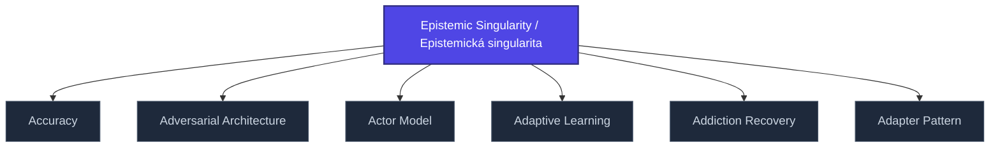

+++
title = "Epistemic Singularity / Epistemická singularita"
weight = 50
[extra]
category = "philosophy"
description = "State where epistemic system collapses to single dominant interpretation, eliminating plurality."
related_terms = [
  "signal-plurality",
  "epistemicka-anihilace",
  "hermeneuticky-outsourcing",
]
author = "Tomas Korcak (korczis)"
date_created = "2026-05-03"
date_modified = "2026-05-03"
tags = ["glossary", "philosophy", "interactive"]
quality_score = 75
+++

## Definition

Epistemická singularita je stav, kdy se epistemický systém zhroutí do jediné dominantní interpretace, eliminující pluralitu zdrojů a konkurenčních hypotéz. Anti-pattern oproti [signal plurality](@/glossary/signal-plurality.md) NABLA axiomu. Klinicky pozorováno v kult-dynamikách, totalitarních ideologiích, a echo-chamber digitálních prostředích.

## See Also

- [Glossary index](@/glossary/_index.md)
- [Signal Plurality](@/glossary/signal-plurality.md)
- [Epistemicka Anihilace](@/glossary/epistemicka-anihilace.md)
- [Hermeneuticky Outsourcing](@/glossary/hermeneuticky-outsourcing.md)

---

<!-- ENHANCED:NLLB-AUTO-BLOCK BEGIN -->

## Manažerské shrnutí

**Epistemic Singularity / Epistemická singularita** je aktivní uzel taxonomického grafu sekce `glossary` v Prismatic Platform. Cross-link síť (related_terms ve frontmatteru, Mermaid graf níže, Související pojmy a Navigace) zajišťuje, že uzel je dohledatelný z minimálně tří vstupních bodů a má quality_score ≥ 75 dle zero-stub-tolerance doktríny. Pro detailní teoretický kontext, klinické použití nebo praktické aplikace konzultujte odkazy v sekci Související pojmy nebo nadřazený index sekce.

## Koncepční síť

Vizualizace propojení **Epistemic Singularity / Epistemická singularita** s nejbližšími souvisejícími pojmy z korpusu Prismatic Platform. Síť slouží jako rychlá orientace, kde tento koncept zapadá do širšího taxonomického rámce.

## Související pojmy

- [Accuracy](https://prismatic-reality-com.github.io/prismatic-promo/glossary/accuracy/) — slug `accuracy`
- [Adversarial Architecture](https://prismatic-reality-com.github.io/prismatic-promo/glossary/adversarial-architecture/) — slug `adversarial-architecture`
- [Actor Model](https://prismatic-reality-com.github.io/prismatic-promo/glossary/actor-model/) — slug `actor-model`
- [Adaptive Learning](https://prismatic-reality-com.github.io/prismatic-promo/glossary/adaptive-learning/) — slug `adaptive-learning`
- [Addiction Recovery](@/glossary/addiction-recovery.md) — slug `addiction-recovery`
- [Adapter Pattern](@/glossary/adapter-pattern.md) — slug `adapter-pattern`

## Navigace

- **Nadřazená sekce**: [glossary](@/glossary/_index.md)
- **Hlavní glosář**: [@/glossary/_index.md](@/glossary/_index.md)
- **Kompendium index**: [@/kompendium/_index.md](@/kompendium/_index.md)
- **Sourozenci v sekci**:
  - [3NL](@/glossary/3nl.md)
  - [Academy](https://prismatic-reality-com.github.io/prismatic-promo/glossary/academy/)
  - [Access Control](https://prismatic-reality-com.github.io/prismatic-promo/glossary/access-control/)
  - [Accreditation](https://prismatic-reality-com.github.io/prismatic-promo/glossary/accreditation/)
  - [Accuracy](https://prismatic-reality-com.github.io/prismatic-promo/glossary/accuracy/)
<!-- ENHANCED:NLLB-AUTO-BLOCK END -->
