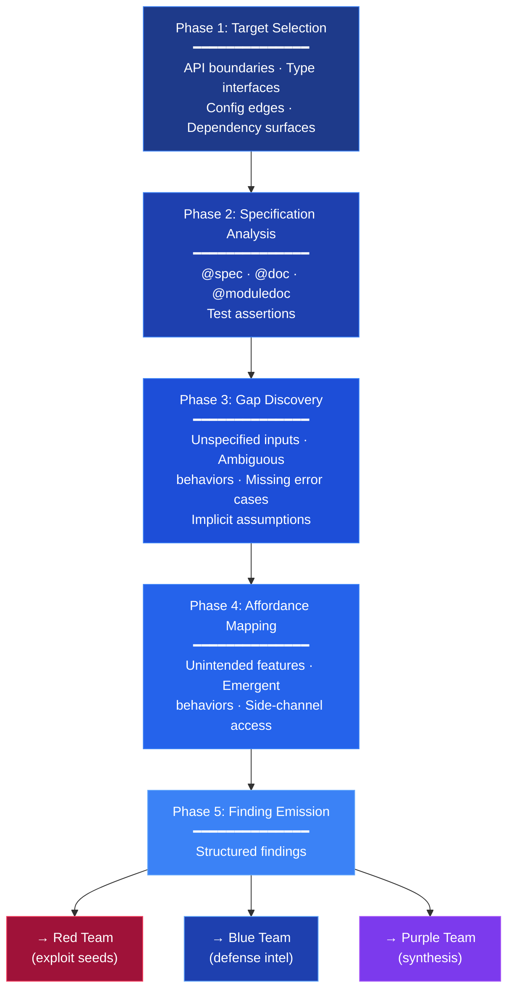
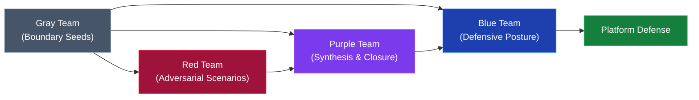

+++
title = "Gray Team (šedý tým)"
weight = 22
description = "Tým platformy Prismatic, který jen čtením zkoumá mezery ve specifikacích, okrajové případy a drift možností; v knize vzor pro hledání nejednoznačností, jež manipulace zneužívá."

[taxonomies]
tags = ["glossary", "security", "gray-team", "prismatic", "color-teams"]

[extra]
category = "security"
related_terms = ["color-teams", "red-team", "nabla-infinity", "black-team", "blue-team", "purple-team"]
author = "Tomas Korcak (korczis)"
reading_time = "9 min"
word_count = 1709
date_created = "2026-02-23"
date_modified = "2026-11-10"
keywords = ["Gray", "Team", "Boundary", "glossary", "security", "Prismatic Platform", "Gray Team", "Color Team", "Red Team"]
quality_score = 87
see_also = ["capabilities", "architecture", "agents"]
image = "/images/sections/glossary.png"
image_alt = "Gray Team – platforma Prismatic"
+++

## Definice a přehled

**Gray Team** (šedý tým) je specializovaný tým v rámci [Color Teams](@/glossary/color-teams.md) platformy Prismatic, z níž kniha vzešla. Tvoří jej tři agenti a provádí **výhradně čtecí** průzkum mezer ve specifikacích, okrajových případů a *driftu možností* (*affordance drift*) v bezpečnostním ekosystému platformy, který spojuje útočný a obranný přístup. Gray Team působí v nejranější fázi toku signálů mezi barevnými týmy: nejednoznačnost odhaluje, ale neřeší; předává „zárodky hranic“ do pipeline [Red Team](@/glossary/red-team.md), která z nich vytváří nepřátelské scénáře, a podkládá hodnocení obranného postoje [Blue Team](@/glossary/blue-team.md). Všechny operace šedého týmu přísně vyžadují **nulovou změnu stavu** zkoumaných systémů, takže průzkum nikdy nevnáší riziko ani vedlejší účinky.

Gray Team ztělesňuje základní poznatek bezpečnostního inženýrství: nejnebezpečnější zranitelnosti často neleží v kódu, který je zjevně chybný, ale ve specifikacích, které jsou nejednoznačné. Funkce, která „má validovat vstup“, nemusí mít specifikováno, co se stane, je-li vstup prázdný, `null`, částečně platný nebo nejednoznačný v kódování. Takové mezery ve specifikaci vytvářejí *možnosti* (*affordances*) – nezamýšlené schopnosti, které vznikají ze souhry nejednoznačné specifikace a implementačních rozhodnutí. Gray Team je soustavně odhaluje dřív, než je zneužije protivník.

Omezení na čtení je zároveň bezpečnostním opatřením i filozofickým postojem. Gray Team neopravuje problémy, nezneužívá zranitelnosti a nálezy ani netřídí na „dobré“ a „špatné“. Katalogizuje nejednoznačnost v surové podobě a zachovává tak axiom [NABLA Infinity](@/glossary/nabla-infinity.md) o **zachování rozporu**. Mezera ve specifikaci může být zranitelností, funkcí, nebo obojím zároveň. Tím, že ji Gray Team nechá nejednoznačnou, zajišťuje, že navazující týmy (Red, Blue, [Purple](@/glossary/purple-team.md)) dostávají nezkreslené informace o hranicích.

Nejpropracovanější schopností šedého týmu je detekce **driftu možností**. Ten nastává, když se praktické schopnosti systému postupně odchylují od zamýšlených – nahromaděním drobných změn, aktualizací závislostí, úprav konfigurace nebo změn prostředí. Každá jednotlivá změna je příliš malá na to, aby spustila bezpečnostní revizi, ale kumulativní účinek vytvoří útočnou plochu, kterou nikdo nenavrhl ani neschválil. Gray Team drift odhaluje porovnáním současného chování systému s historickými specifikacemi a hledáním schopností, které existují v implementaci, ale ne v návrhových dokumentech.

## Technický rozbor

### Architektura agentů

Gray Team tvoří tři agenti s odlišnými rolemi a úrovněmi pravomoci:

| agent | úroveň pravomoci | role | klíčová schopnost |
|-------|----------------|------|----------------|
| `gray-explorer-commander` | L3 strategický velitel | orchestrace kampaní | směruje nálezy do Red/Blue/Purple, určuje priority průzkumu |
| `gray-edge-finder` | L4 specialista | analýza hranic | hledání mezer ve specifikaci, okrajových případů, analýza hraničních hodnot |
| `gray-escalation-guard` | L4 bezpečnostně kritický | vynucování rozsahu | pravomoc zastavit jakoukoli operaci šedého týmu, která se blíží území Black Team |

Úrovně pravomoci L3/L4 jsou podstatné. Velitel (L3) má strategickou rozhodovací pravomoc pro plánování kampaní a směrování nálezů, specialisté (L4) mají soustředěnou výkonnou pravomoc ve svých oblastech. Označení strážce eskalace jako bezpečnostně kritického L4 mu dává pravomoc přebít velitele i hledače hran, takže bezpečnostní omezení nelze obejít velitelskou pravomocí. Úrovně popisuje [Agent Tier](@/glossary/agent-tier.md).

### Metodika průzkumu

Průzkum šedého týmu probíhá podle strukturované pětifázové metodiky:



### Struktura nálezu

Nálezy šedého týmu mají strukturovaný formát, který zachovává nejednoznačnost a přitom dává použitelnou informaci:

```elixir
defmodule PrismaticGray.Finding do
  @moduledoc """
  Structured boundary finding emitted by Gray Team exploration.
  Preserves ambiguity per NABLA contradiction preservation axiom.
  """

  @type severity :: :informational | :notable | :significant | :critical
  @type category :: :specification_gap | :edge_case | :affordance_drift | :boundary_condition

  @type t :: %__MODULE__{
    id: String.t(),
    category: category(),
    severity: severity(),
    target: String.t(),
    description: String.t(),
    specification: String.t() | nil,
    actual_behavior: String.t(),
    ambiguity_note: String.t(),
    discovered_at: DateTime.t(),
    discovered_by: atom(),
    escalation_risk: float()
  }

  defstruct [
    :id, :category, :severity, :target,
    :description, :specification, :actual_behavior,
    :ambiguity_note, :discovered_at, :discovered_by,
    escalation_risk: 0.0
  ]

  @spec emit(t()) :: :ok | {:error, :escalation_blocked}
  def emit(%__MODULE__{escalation_risk: risk} = finding) when risk > 0.8 do
    # High escalation risk triggers the escalation guard
    PrismaticGray.EscalationGuard.review(finding)
  end

  def emit(%__MODULE__{} = finding) do
    :telemetry.execute(
      [:prismatic, :gray_team, :finding],
      %{severity: finding.severity, category: finding.category},
      %{target: finding.target}
    )

    PrismaticGray.Commander.route_finding(finding)
  end
end
```

### Analýza hraničních hodnot

Agent hledající hrany provádí soustavnou analýzu hraničních hodnot na rozhraních platformy:

```elixir
defmodule PrismaticGray.EdgeFinder do
  @moduledoc """
  L4 Specialist agent performing boundary value analysis
  and specification gap identification.
  """

  @spec analyze_function_boundary(module(), atom(), non_neg_integer()) :: list(PrismaticGray.Finding.t())
  def analyze_function_boundary(module, function, arity) do
    spec = fetch_typespec(module, function, arity)
    docs = fetch_documentation(module, function, arity)
    tests = find_test_assertions(module, function)

    boundary_gaps =
      identify_type_boundaries(spec) ++
      identify_doc_ambiguities(docs) ++
      identify_untested_boundaries(spec, tests) ++
      identify_implicit_assumptions(module, function, arity)

    Enum.map(boundary_gaps, fn gap ->
      %PrismaticGray.Finding{
        id: generate_finding_id(module, function, gap),
        category: gap.category,
        severity: assess_gap_severity(gap),
        target: "#{inspect(module)}.#{function}/#{arity}",
        description: gap.description,
        specification: format_spec(spec),
        actual_behavior: gap.observed_behavior,
        ambiguity_note: gap.ambiguity,
        discovered_at: DateTime.utc_now(),
        discovered_by: :gray_edge_finder,
        escalation_risk: calculate_escalation_risk(gap)
      }
    end)
  end

  defp identify_type_boundaries(nil), do: []
  defp identify_type_boundaries(spec) do
    # Analyze typespec for edge cases
    # e.g., String.t() - what about empty string? Unicode? Very long strings?
    # e.g., integer() - what about negative? Zero? Very large?
    # e.g., map() - what about empty map? Nested? Circular reference?
    extract_boundary_conditions(spec)
  end

  defp identify_untested_boundaries(spec, tests) do
    specified_types = extract_types_from_spec(spec)
    tested_values = extract_values_from_tests(tests)

    specified_types
    |> Enum.flat_map(&boundary_values_for_type/1)
    |> Enum.reject(fn boundary -> covered_by_test?(boundary, tested_values) end)
    |> Enum.map(fn boundary ->
      %{
        category: :specification_gap,
        description: "Boundary value #{inspect(boundary.value)} not covered by tests",
        observed_behavior: "Unknown - untested boundary",
        ambiguity: "Behavior at boundary #{boundary.description} is unverified"
      }
    end)
  end
end
```

### Strážce eskalace

Strážce eskalace je bezpečnostně kritická složka, která brání tomu, aby průzkum šedého týmu přešel na území [Black Team](@/glossary/black-team.md):

```elixir
defmodule PrismaticGray.EscalationGuard do
  @moduledoc """
  L4 Safety-Critical agent preventing Gray-to-Black escalation.
  Has override authority to halt any Gray operation.
  """
  use GenServer

  @escalation_threshold 0.7
  @block_threshold 0.9

  @type escalation_level :: :safe | :caution | :warning | :blocked
  @type review_result :: {:ok, :approved} | {:ok, :modified} | {:error, :blocked}

  defstruct [:blocked_count, :approved_count, :modified_count, audit_log: []]

  @spec review(PrismaticGray.Finding.t()) :: review_result()
  def review(finding) do
    GenServer.call(__MODULE__, {:review, finding})
  end

  @spec halt_operation(String.t()) :: :ok
  def halt_operation(reason) do
    GenServer.cast(__MODULE__, {:halt, reason})
  end

  @impl GenServer
  def handle_call({:review, finding}, _from, state) do
    level = classify_escalation_level(finding)

    {result, new_state} =
      case level do
        :safe ->
          {{:ok, :approved}, %{state | approved_count: state.approved_count + 1}}

        :caution ->
          modified = sanitize_finding(finding)
          {{:ok, :modified}, %{state | modified_count: state.modified_count + 1}}

        :warning ->
          modified = heavily_sanitize_finding(finding)
          log_warning(finding, state)
          {{:ok, :modified}, %{state | modified_count: state.modified_count + 1}}

        :blocked ->
          log_blocked(finding, state)
          {{:error, :blocked}, %{state | blocked_count: state.blocked_count + 1}}
      end

    audit_entry = %{
      finding_id: finding.id,
      level: level,
      result: result,
      timestamp: DateTime.utc_now()
    }

    {:reply, result, %{new_state | audit_log: [audit_entry | state.audit_log]}}
  end

  defp classify_escalation_level(%{escalation_risk: risk}) when risk >= @block_threshold, do: :blocked
  defp classify_escalation_level(%{escalation_risk: risk}) when risk >= @escalation_threshold, do: :warning
  defp classify_escalation_level(%{escalation_risk: risk}) when risk >= 0.4, do: :caution
  defp classify_escalation_level(_), do: :safe
end
```

## Architektura a implementace

### Začlenění do toku signálů

Gray Team působí na vstupním bodě toku signálů barevných týmů:



Každý nález šedého týmu vstupuje do ekosystému barevných týmů. Velitel rozhoduje o směrování podle povahy nálezu: mezery ve specifikaci obvykle míří do Red Team k analýze zneužitelnosti, okrajové případy do Blue Team k obrannému zpevnění a drift možností do Purple Team k syntéze a analýze trendů.

### Řízení kampaní

Gray Team organizuje průzkum do kampaní – strukturovaných šetření určitých oblastí platformy:

| typ kampaně | trvání | rozsah | výstup |
|--------------|----------|-------|--------|
| **audit modulu** | 1–4 hodiny | jeden modul nebo aplikace | nálezy hranic na úrovni funkcí |
| **průzkum rozhraní** | 4–8 hodin | hranice mezi aplikacemi | soupis mezer v protokolech a API |
| **hodnocení driftu** | periodicky (týdně) | celá platforma | zpráva o trendu driftu možností |
| **sken závislostí** | při aktualizaci závislosti | změněná plocha závislosti | zpráva o nově zavedených hranicích |

## Použití na platformě Prismatic

V ekosystému agentů platformy (v době zápisu 434 agentů) poskytuje Gray Team základní informace o hranicích, z nichž vycházejí všechny bezpečnostní operace. Jeho nálezy jsou zvlášť cenné v následujících oblastech.

### Posílení bran kvality

Nálezy šedého týmu odhalují mezery v pokrytí bran kvality. Objevená mezera ve specifikaci často ukazuje na chybějící testovací případ nebo neúplnou typovou specifikaci. Tyto nálezy se vracejí do systému vynucování kvality:

```elixir
defmodule PrismaticGray.QualityFeedback do
  @moduledoc """
  Converts Gray Team findings into quality gate improvement suggestions.
  """

  @spec findings_to_quality_suggestions(list(PrismaticGray.Finding.t())) :: list(map())
  def findings_to_quality_suggestions(findings) do
    findings
    |> Enum.filter(&quality_relevant?/1)
    |> Enum.map(fn finding ->
      %{
        target: finding.target,
        suggestion_type: map_to_quality_domain(finding.category),
        description: "Add #{finding.category} coverage for #{finding.target}",
        priority: severity_to_priority(finding.severity),
        source: "gray-team-#{finding.id}"
      }
    end)
  end

  defp quality_relevant?(%{category: :specification_gap}), do: true
  defp quality_relevant?(%{category: :boundary_condition}), do: true
  defp quality_relevant?(_), do: false

  defp map_to_quality_domain(:specification_gap), do: :typespec_coverage
  defp map_to_quality_domain(:boundary_condition), do: :test_coverage
end
```

### Soulad s NABLA

Operace šedého týmu se řídí epistemickým rámcem NABLA Infinity. Zvlášť relevantní je axiom zachování rozporu: Gray Team zachovává nejednoznačné nálezy v surové podobě a neřeší je předčasně. Nález, který může být zranitelností i funkcí, je vydán jako nejednoznačný, aby jej navazující týmy mohly posoudit každý ze své perspektivy.

### Telemetrie a monitoring

Všechny operace šedého týmu vysílají telemetrické události pro pozorovatelnost:

| událost | měření | metadata |
|-------|-------------|----------|
| `[:prismatic, :gray_team, :exploration, :start]` | `%{target_count: n}` | `%{campaign: name}` |
| `[:prismatic, :gray_team, :finding]` | `%{severity: s, category: c}` | `%{target: t}` |
| `[:prismatic, :gray_team, :escalation, :review]` | `%{risk: r}` | `%{level: l, result: r}` |
| `[:prismatic, :gray_team, :exploration, :complete]` | `%{duration: d, findings: n}` | `%{campaign: name}` |

## Osvědčené postupy

**Dodržovat přísnou kázeň čtení.** Gray Team nikdy nesmí měnit systémy, které zkoumá. I zdánlivě neškodné změny stavu (vytvoření testovacích záznamů, zápis do logů) mohou změnit chování systému a kontaminovat nálezy. Vynucení pouhého čtení se má ověřovat izolací procesů a řízením přístupu.

**Zachovávat nejednoznačnost nálezů.** Odolat nutkání třídit nálezy na úrovni šedého týmu jako „zranitelnosti“ nebo „neproblémy“. Pole poznámky o nejednoznačnosti existuje z dobrého důvodu: předčasná klasifikace vnáší zkreslení, kvůli kterému mohou navazující týmy přehlédnout důležité signály.

**Soustavně obměňovat cíle průzkumu.** Vyhýbat se sklonu opakovaně zkoumat známé oblasti. Systém řízení kampaní má zajistit úplné pokrytí všech aplikací, rozhraní a ploch závislostí platformy.

**Dokumentovat zdroj specifikace.** Při zjištění mezery zaznamenat, vůči jaké specifikaci mezera existuje. Mezera mezi chováním kódu a dokumentací je jiná než mezera mezi chováním kódu a typovou specifikací; zdroj specifikace ovlivňuje, jak nález posoudí navazující týmy.

**Nastavovat prahy eskalace opatrně.** Strážce eskalace má blokovat spíše štědře než zdrženlivě. Zablokovaný nález, který byl ve skutečnosti bezpečný, nestojí nic; propuštěný nález, který přejde na území Black Team, ohrozí bezpečnostní model.

## Časté chyby

**Záměna průzkumu se zneužitím.** Gray Team hranice objevuje, nepřekračuje je. Způsobí-li okrajový případ pád, Gray Team ohlásí hranici pádu; nepokouší se sestavit vstupy, které by pád spolehlivě vyvolaly – to je doménou Red Team.

**Zahlcení navazujících týmů nálezy nízké závažnosti.** Úplná analýza hranic může vytvořit stovky informativních nálezů. Bez filtrování podle závažnosti a stanovení priorit je navazující týmy nezpracují. Šum má filtrovat směrovací logika velitele.

**Opomíjení detekce driftu možností.** Analýza mezer ve specifikaci přináší rychlejší uspokojení než detekce driftu, drift je však často nebezpečnější, protože představuje tichou a postupnou degradaci bezpečnostního postoje. Kampaně hodnocení driftu musí probíhat pravidelně.

**Podcenění pravomoci strážce eskalace.** Strážce eskalace má pravomoc přebít velitele. Pokusy jej obejít (rozdělením nálezu, aby se snížilo dílčí [rizikové skóre](@/glossary/risk-score.md), nebo přerámováním nálezu, aby se vyhnul spouštěcím vzorcům) podkopávají bezpečnostní model a mají se považovat za porušení.

**Statický průzkum bez časového kontextu.** Hranice se mění s vývojem kódu. Nálezy mají obsahovat časový kontext: kdy hranice vznikla, zda se nedávno změnila, zda směřuje ke specifikaci, nebo od ní.

## Začlenění do systémů platformy

Nálezy šedého týmu se začleňují i do dalších systémů mimo ekosystém barevných týmů. Objev mezery ve specifikaci spouští aktualizace systému Quality DNA, který sleduje trendy kvality napříč sezeními. Hraniční podmínky zjištěné šedým týmem se stávají vstupy pro testování založené na vlastnostech, takže okrajové případy se v dalších vývojových cyklech soustavně testují.

Systém [AutoHeal](@/glossary/autoheal.md) využívá nálezy šedého týmu k nalezení příležitostí k samoopravě. Zjistí-li Gray Team, že funkce korektně zvládá hraniční podmínku, která není formálně specifikována, AutoHeal může navrhnout formalizaci tohoto chování aktualizací specifikace a rozšířením testů.

Gray Team přispívá také do složky synchronizace znalostí rámce SEADF (*Scanner, Pipeline, Quality Guardian, Knowledge Sync, Cross-Domain Innovator, Autonomous Reporter, Enhanced Healing*). Objevené hranice vstupují do rozpoznávání vzorců napříč doménami a pomáhají určit, kdy podobné mezery ve specifikaci existují v různých aplikacích nebo modulech.

## Výkon a škálovatelnost

Průzkum šedého týmu je navržen tak, aby rostl s platformou. Konfigurace se třemi agenty v době zápisu zvládala analýzu 115 aplikací umbrella projektu, architektura však podporuje horizontální škálování: další hledači hran mohou paralelně pracovat na různých modulech nebo doménách aplikací a velitel koordinuje přidělování a odstraňování duplicit.

Výkon průzkumu se liší podle typu kampaně. Audity modulů obvykle trvají 1–4 hodiny u aplikací s 10–50 moduly. Průzkumy rozhraní vyžadují 4–8 hodin k úplnému zmapování hranic mezi aplikacemi. Týdenní hodnocení driftu možností proběhne přes noc a analyzuje celou platformu na nahromaděné změny chování.

Strážce eskalace přidává minimální režii – méně než 50 ms na posouzení nálezu. Jeho auditní stopa přitom poskytuje cennou telemetrii pro pochopení účinnosti šedého týmu a pro kalibraci prahů eskalace v čase.

## Význam pro Kompendium

Gray Team je technický pojem platformy, ale jeho logika má v knize přímou obdobu. Manipulace často nepracuje se zjevnou lží, nýbrž s **nejednoznačností**: s nedefinovanými pojmy, s pravidly, která „platí, jak se to hodí“, s mezerami mezi tím, co skupina tvrdí, a tím, co dělá. Kompendium tyto mezery popisuje například jako [terminologickou mystifikaci](@/kompendium/techniques/ea-1-1-3-terminologicka-mystifikace.md) nebo [rozšiřování rozsahu](@/kompendium/detection-signatures/7-linguistic-scope-creep.md). Drift možností má obdobu v postupném posouvání norem v kontrolujících vztazích a organizacích: každý krok je malý, výsledek nikdo neschválil. Použití šedého týmu při hledání okrajových případů EA popisuje [Gray Team a okrajové případy EA](@/kompendium/aiad-integration/gray-team-ea-edge-cases.md).

## Související

**Barevné týmy**

- [Color Teams](@/glossary/color-teams.md) – úplný přehled šesti útočně-obranných bezpečnostních týmů.
- [Red Team](@/glossary/red-team.md) – zpracovává zárodky hranic od šedého týmu do nepřátelských scénářů.
- [Blue Team](@/glossary/blue-team.md) – obranný tým, kterému objevy hranic slouží.
- [Purple Team](@/glossary/purple-team.md) – syntetický tým, který nálezy začleňuje do analýzy uzavření.
- [Black Team](@/glossary/black-team.md) – izolovaný tým, jehož přístup chrání strážce eskalace.

**Platforma a kniha**

- [NABLA Infinity](@/glossary/nabla-infinity.md) – epistemický rámec, který řídí metodiku průzkumu hranic.
- [Gray Team a okrajové případy EA](@/kompendium/aiad-integration/gray-team-ea-edge-cases.md) – použití v kontextu Kompendia.
- [EA-1.1.3 Terminologická mystifikace](@/kompendium/techniques/ea-1-1-3-terminologicka-mystifikace.md) – nejednoznačnost jako manipulační technika.

**Mimo knihu (web platformy)**

- [Quality Gates](https://prismatic-reality-com.github.io/prismatic-promo/glossary/quality-gates/) – vynucování kvality posílené nálezy šedého týmu.
- [Architecture](https://prismatic-reality-com.github.io/prismatic-promo/architecture/) – přehled architektury platformy.
- [Technologies](https://prismatic-reality-com.github.io/prismatic-promo/technologies/) – technologický zásobník.
- [Agents](https://prismatic-reality-com.github.io/prismatic-promo/agents/) – agenti AIAD včetně členů šedého týmu.
