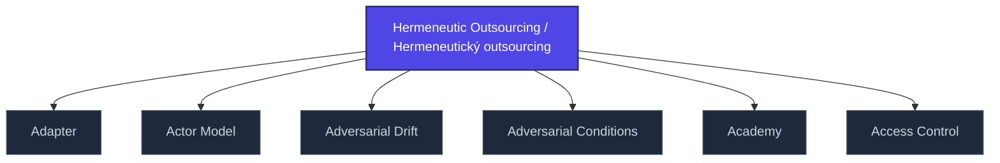

+++
title = "Hermeneutic Outsourcing / Hermeneutický outsourcing"
weight = 50
description = "Delegation of meaning-making to an external authority, eroding interpretive autonomy."

[taxonomies]
tags = ["glossary", "psychology", "interactive"]

[extra]
category = "psychology"
related_terms = [
  "epistemic-pipeline",
  "delegitimizace",
  "gaslighting",
]
author = "Tomas Korcak (korczis)"
date_created = "2026-05-03"
date_modified = "2026-05-03"
quality_score = 75
+++

## Definition

Hermeneutický outsourcing je proces, ve kterém jedinec deleguje interpretační autoritu nad svými zážitky externímu zdroji (autorita, ideologie, kult, AI systém). Vede k erozi epistemické autonomie a zranitelnosti vůči manipulaci. V Prismatic frameworku se modeluje jako selhání [signal plurality](@/glossary/signal-plurality.md) — jediný interpretační zdroj dominuje hermeneutickému prostoru.

## See Also

- [Glossary index](@/glossary/_index.md)
- [Epistemic Pipeline](@/glossary/epistemic-pipeline.md)
- [Delegitimizace](@/glossary/delegitimizace.md)
- [Gaslighting](@/glossary/gaslighting.md)

---

<!-- ENHANCED:NLLB-AUTO-BLOCK BEGIN -->

## Manažerské shrnutí

**Hermeneutic Outsourcing / Hermeneutický outsourcing** je aktivní uzel taxonomického grafu sekce `glossary` v Prismatic Platform. Cross-link síť (related_terms ve frontmatteru, Mermaid graf níže, Související pojmy a Navigace) zajišťuje, že uzel je dohledatelný z minimálně tří vstupních bodů a má quality_score ≥ 75 dle zero-stub-tolerance doktríny. Pro detailní teoretický kontext, klinické použití nebo praktické aplikace konzultujte odkazy v sekci Související pojmy nebo nadřazený index sekce.

## Koncepční síť

Vizualizace propojení **Hermeneutic Outsourcing / Hermeneutický outsourcing** s nejbližšími souvisejícími pojmy z korpusu Prismatic Platform. Síť slouží jako rychlá orientace, kde tento koncept zapadá do širšího taxonomického rámce.

## Související pojmy

- [Adapter](https://prismatic-reality-com.github.io/prismatic-promo/glossary/adapter/) — slug `adapter`
- [Actor Model](https://prismatic-reality-com.github.io/prismatic-promo/glossary/actor-model/) — slug `actor-model`
- [Adversarial Drift](https://prismatic-reality-com.github.io/prismatic-promo/glossary/adversarial-drift/) — slug `adversarial-drift`
- [Adversarial Conditions](https://prismatic-reality-com.github.io/prismatic-promo/glossary/adversarial-conditions/) — slug `adversarial-conditions`
- [Academy](https://prismatic-reality-com.github.io/prismatic-promo/glossary/academy/) — slug `academy`
- [Access Control](https://prismatic-reality-com.github.io/prismatic-promo/glossary/access-control/) — slug `access-control`

## Navigace

- **Nadřazená sekce**: [glossary](@/glossary/_index.md)
- **Hlavní glosář**: [@/glossary/_index.md](@/glossary/_index.md)
- **Kompendium index**: [@/kompendium/_index.md](@/kompendium/_index.md)
- **Sourozenci v sekci**:
  - [3NL](@/glossary/3nl.md)
  - [Academy](https://prismatic-reality-com.github.io/prismatic-promo/glossary/academy/)
  - [Access Control](https://prismatic-reality-com.github.io/prismatic-promo/glossary/access-control/)
  - [Accreditation](https://prismatic-reality-com.github.io/prismatic-promo/glossary/accreditation/)
  - [Accuracy](https://prismatic-reality-com.github.io/prismatic-promo/glossary/accuracy/)
<!-- ENHANCED:NLLB-AUTO-BLOCK END -->
