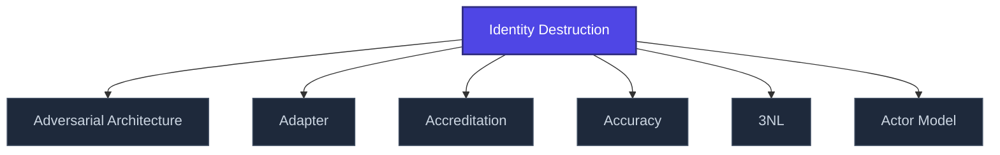

+++
title = "Identity Destruction"
weight = 50
[extra]
category = "psychology"
description = "Systematic dismantling of selfhood via coercive influence techniques."
related_terms = [
  "love-bombing",
  "discard",
  "trauma-bonding",
  "secure-attachment",
]
author = "Tomas Korcak (korczis)"
date_created = "2026-05-03"
date_modified = "2026-05-03"
tags = ["glossary", "psychology", "interactive"]
quality_score = 75
+++

## Definition

Identity destruction is the systematic dismantling of an individual's sense of self via coercive techniques: [love-bombing](@/glossary/love-bombing.md) → identity overwriting → [discard](@/glossary/discard.md) cycle. Documented in cult dynamics, coercive control, abusive relationships. The Prismatic Kompendium catalogs these patterns under the EA (Epistemická Anihilace) taxonomy with detection signatures and recovery protocols.

## See Also

- [Glossary index](@/glossary/_index.md)
- [Love Bombing](@/glossary/love-bombing.md)
- [Discard](@/glossary/discard.md)
- [Trauma Bonding](@/glossary/trauma-bonding.md)
- [Secure Attachment](@/glossary/secure-attachment.md)

---

<!-- ENHANCED:NLLB-AUTO-BLOCK BEGIN -->

## Manažerské shrnutí

**Identity Destruction** je aktivní uzel taxonomického grafu sekce `glossary` v Prismatic Platform. Cross-link síť (related_terms ve frontmatteru, Mermaid graf níže, Související pojmy a Navigace) zajišťuje, že uzel je dohledatelný z minimálně tří vstupních bodů a má quality_score ≥ 75 dle zero-stub-tolerance doktríny. Pro detailní teoretický kontext, klinické použití nebo praktické aplikace konzultujte odkazy v sekci Související pojmy nebo nadřazený index sekce.

## Koncepční síť

Vizualizace propojení **Identity Destruction** s nejbližšími souvisejícími pojmy z korpusu Prismatic Platform. Síť slouží jako rychlá orientace, kde tento koncept zapadá do širšího taxonomického rámce.

## Související pojmy

- [Adversarial Architecture](https://prismatic-reality-com.github.io/prismatic-promo/glossary/adversarial-architecture/) — slug `adversarial-architecture`
- [Adapter](https://prismatic-reality-com.github.io/prismatic-promo/glossary/adapter/) — slug `adapter`
- [Accreditation](https://prismatic-reality-com.github.io/prismatic-promo/glossary/accreditation/) — slug `accreditation`
- [Accuracy](https://prismatic-reality-com.github.io/prismatic-promo/glossary/accuracy/) — slug `accuracy`
- [3NL](@/glossary/3nl.md) — slug `3nl`
- [Actor Model](https://prismatic-reality-com.github.io/prismatic-promo/glossary/actor-model/) — slug `actor-model`

## Navigace

- **Nadřazená sekce**: [glossary](@/glossary/_index.md)
- **Hlavní glosář**: [@/glossary/_index.md](@/glossary/_index.md)
- **Kompendium index**: [@/kompendium/_index.md](@/kompendium/_index.md)
- **Sourozenci v sekci**:
  - [3NL](@/glossary/3nl.md)
  - [Academy](https://prismatic-reality-com.github.io/prismatic-promo/glossary/academy/)
  - [Access Control](https://prismatic-reality-com.github.io/prismatic-promo/glossary/access-control/)
  - [Accreditation](https://prismatic-reality-com.github.io/prismatic-promo/glossary/accreditation/)
  - [Accuracy](https://prismatic-reality-com.github.io/prismatic-promo/glossary/accuracy/)
<!-- ENHANCED:NLLB-AUTO-BLOCK END -->
