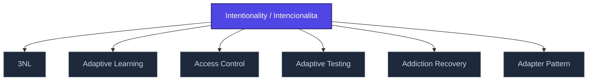

+++
title = "Intentionality / Intencionalita"
weight = 50
[extra]
category = "philosophy"
description = "Husserlian property of consciousness as 'aboutness' — directedness toward an object."
related_terms = [
  "pasivni-synteza",
  "core-consciousness",
  "epistemic-pipeline",
]
author = "Tomas Korcak (korczis)"
date_created = "2026-05-03"
date_modified = "2026-05-03"
tags = ["glossary", "philosophy", "interactive"]
quality_score = 75
+++

## Definition

Intencionalita (Husserl) je vlastnost vědomí být *o* něčem — directedness toward an object. Fundamentální pro fenomenologickou analýzu zkušenosti. V Prismatic frameworku slouží jako teoretický základ [epistemic pipeline](@/glossary/epistemic-pipeline.md) — každý epistemický akt má intencionální strukturu (noesis–noema).

## See Also

- [Glossary index](@/glossary/_index.md)
- [Pasivni Synteza](@/glossary/pasivni-synteza.md)
- [Core Consciousness](@/glossary/core-consciousness.md)
- [Epistemic Pipeline](@/glossary/epistemic-pipeline.md)

---

<!-- ENHANCED:NLLB-AUTO-BLOCK BEGIN -->

## Manažerské shrnutí

**Intentionality / Intencionalita** je aktivní uzel taxonomického grafu sekce `glossary` v Prismatic Platform. Cross-link síť (related_terms ve frontmatteru, Mermaid graf níže, Související pojmy a Navigace) zajišťuje, že uzel je dohledatelný z minimálně tří vstupních bodů a má quality_score ≥ 75 dle zero-stub-tolerance doktríny. Pro detailní teoretický kontext, klinické použití nebo praktické aplikace konzultujte odkazy v sekci Související pojmy nebo nadřazený index sekce.

## Koncepční síť

Vizualizace propojení **Intentionality / Intencionalita** s nejbližšími souvisejícími pojmy z korpusu Prismatic Platform. Síť slouží jako rychlá orientace, kde tento koncept zapadá do širšího taxonomického rámce.

## Související pojmy

- [3NL](@/glossary/3nl.md) — slug `3nl`
- [Adaptive Learning](@/glossary/adaptive-learning.md) — slug `adaptive-learning`
- [Access Control](@/glossary/access-control.md) — slug `access-control`
- [Adaptive Testing](@/glossary/adaptive-testing.md) — slug `adaptive-testing`
- [Addiction Recovery](@/glossary/addiction-recovery.md) — slug `addiction-recovery`
- [Adapter Pattern](@/glossary/adapter-pattern.md) — slug `adapter-pattern`

## Navigace

- **Nadřazená sekce**: [glossary](@/glossary/_index.md)
- **Hlavní glosář**: [@/glossary/_index.md](@/glossary/_index.md)
- **Kompendium index**: [@/kompendium/_index.md](@/kompendium/_index.md)
- **Sourozenci v sekci**:
  - [3NL](@/glossary/3nl.md)
  - [Academy](@/glossary/academy.md)
  - [Access Control](@/glossary/access-control.md)
  - [Accreditation](@/glossary/accreditation.md)
  - [Accuracy](@/glossary/accuracy.md)
<!-- ENHANCED:NLLB-AUTO-BLOCK END -->
