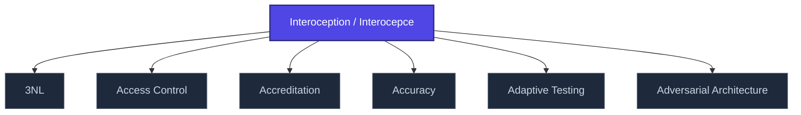

+++
title = "Interoception / Interocepce"
weight = 50
description = "Sense of internal bodily state — heart rate, breath, viscera, hunger, etc."

[taxonomies]
tags = ["glossary", "psychology", "interactive"]

[extra]
category = "psychology"
related_terms = [
  "body-schema",
  "polyvagalni-teorie",
  "core-consciousness",
]
author = "Tomas Korcak (korczis)"
date_created = "2026-05-03"
date_modified = "2026-05-03"
quality_score = 75
+++

## Definition

Interocepce je vnímání vnitřního stavu těla — tep, dech, viscerální signály, hlad. Společně s [body-schema](@/glossary/body-schema.md) tvoří substrát pro [core consciousness](@/glossary/core-consciousness.md). Interoceptive accuracy je markrem emoční regulace; její disrupce je dokumentovaným cílem některých manipulačních technik (Prismatic Kompendium, sekce 05.5).

## See Also

- [Glossary index](@/glossary/_index.md)
- [Body Schema](@/glossary/body-schema.md)
- [Polyvagalni Teorie](@/glossary/polyvagalni-teorie.md)
- [Core Consciousness](@/glossary/core-consciousness.md)

---

<!-- ENHANCED:NLLB-AUTO-BLOCK BEGIN -->

## Manažerské shrnutí

**Interoception / Interocepce** je aktivní uzel taxonomického grafu sekce `glossary` v Prismatic Platform. Cross-link síť (related_terms ve frontmatteru, Mermaid graf níže, Související pojmy a Navigace) zajišťuje, že uzel je dohledatelný z minimálně tří vstupních bodů a má quality_score ≥ 75 dle zero-stub-tolerance doktríny. Pro detailní teoretický kontext, klinické použití nebo praktické aplikace konzultujte odkazy v sekci Související pojmy nebo nadřazený index sekce.

## Koncepční síť

Vizualizace propojení **Interoception / Interocepce** s nejbližšími souvisejícími pojmy z korpusu Prismatic Platform. Síť slouží jako rychlá orientace, kde tento koncept zapadá do širšího taxonomického rámce.

## Související pojmy

- [3NL](@/glossary/3nl.md) — slug `3nl`
- [Access Control](https://prismatic-reality-com.github.io/prismatic-promo/glossary/access-control/) — slug `access-control`
- [Accreditation](https://prismatic-reality-com.github.io/prismatic-promo/glossary/accreditation/) — slug `accreditation`
- [Accuracy](https://prismatic-reality-com.github.io/prismatic-promo/glossary/accuracy/) — slug `accuracy`
- [Adaptive Testing](https://prismatic-reality-com.github.io/prismatic-promo/glossary/adaptive-testing/) — slug `adaptive-testing`
- [Adversarial Architecture](https://prismatic-reality-com.github.io/prismatic-promo/glossary/adversarial-architecture/) — slug `adversarial-architecture`

## Navigace

- **Nadřazená sekce**: [glossary](@/glossary/_index.md)
- **Hlavní glosář**: [@/glossary/_index.md](@/glossary/_index.md)
- **Kompendium index**: [@/kompendium/_index.md](@/kompendium/_index.md)
- **Sourozenci v sekci**:
  - [3NL](@/glossary/3nl.md)
  - [Academy](https://prismatic-reality-com.github.io/prismatic-promo/glossary/academy/)
  - [Access Control](https://prismatic-reality-com.github.io/prismatic-promo/glossary/access-control/)
  - [Accreditation](https://prismatic-reality-com.github.io/prismatic-promo/glossary/accreditation/)
  - [Accuracy](https://prismatic-reality-com.github.io/prismatic-promo/glossary/accuracy/)
<!-- ENHANCED:NLLB-AUTO-BLOCK END -->
