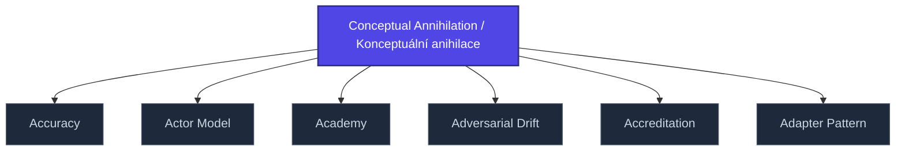

+++
title = "Conceptual Annihilation / Konceptuální anihilace"
weight = 50
description = "Systematic dismantling of conceptual schemas and meaning-making structures."

[taxonomies]
tags = ["glossary", "psychology", "interactive"]

[extra]
category = "psychology"
related_terms = [
  "epistemicka-anihilace",
  "epistemicka-singularita",
  "delegitimizace",
]
author = "Tomas Korcak (korczis)"
date_created = "2026-05-03"
date_modified = "2026-05-03"
quality_score = 75
+++

## Definition

Konceptuální anihilace je systematické rozkládání konceptuálních schémat a struktur tvorby významu — pokročilá fáze [epistemické anihilace](@/glossary/epistemicka-anihilace.md). Cílem manipulátora je odstranit kategorie, kterými oběť organizuje zkušenost, aby ji bylo možné rekonstruovat podle nových pravidel. Detailně dokumentováno v Prismatic Kompendiu [05-ultramari-techniky](@/kompendium/05-ultramari-techniky/_index.md).

## See Also

- [Glossary index](@/glossary/_index.md)
- [Epistemicka Anihilace](@/glossary/epistemicka-anihilace.md)
- [Epistemicka Singularita](@/glossary/epistemicka-singularita.md)
- [Delegitimizace](@/glossary/delegitimizace.md)

---

<!-- ENHANCED:NLLB-AUTO-BLOCK BEGIN -->

## Manažerské shrnutí

**Conceptual Annihilation / Konceptuální anihilace** je aktivní uzel taxonomického grafu sekce `glossary` v Prismatic Platform. Cross-link síť (related_terms ve frontmatteru, Mermaid graf níže, Související pojmy a Navigace) zajišťuje, že uzel je dohledatelný z minimálně tří vstupních bodů a má quality_score ≥ 75 dle zero-stub-tolerance doktríny. Pro detailní teoretický kontext, klinické použití nebo praktické aplikace konzultujte odkazy v sekci Související pojmy nebo nadřazený index sekce.

## Koncepční síť

Vizualizace propojení **Conceptual Annihilation / Konceptuální anihilace** s nejbližšími souvisejícími pojmy z korpusu Prismatic Platform. Síť slouží jako rychlá orientace, kde tento koncept zapadá do širšího taxonomického rámce.

## Související pojmy

- [Accuracy](https://prismatic-reality-com.github.io/prismatic-promo/glossary/accuracy/) — slug `accuracy`
- [Actor Model](https://prismatic-reality-com.github.io/prismatic-promo/glossary/actor-model/) — slug `actor-model`
- [Academy](https://prismatic-reality-com.github.io/prismatic-promo/glossary/academy/) — slug `academy`
- [Adversarial Drift](https://prismatic-reality-com.github.io/prismatic-promo/glossary/adversarial-drift/) — slug `adversarial-drift`
- [Accreditation](https://prismatic-reality-com.github.io/prismatic-promo/glossary/accreditation/) — slug `accreditation`
- [Adapter Pattern](@/glossary/adapter-pattern.md) — slug `adapter-pattern`

## Navigace

- **Nadřazená sekce**: [glossary](@/glossary/_index.md)
- **Hlavní glosář**: [@/glossary/_index.md](@/glossary/_index.md)
- **Kompendium index**: [@/kompendium/_index.md](@/kompendium/_index.md)
- **Sourozenci v sekci**:
  - [3NL](@/glossary/3nl.md)
  - [Academy](https://prismatic-reality-com.github.io/prismatic-promo/glossary/academy/)
  - [Access Control](https://prismatic-reality-com.github.io/prismatic-promo/glossary/access-control/)
  - [Accreditation](https://prismatic-reality-com.github.io/prismatic-promo/glossary/accreditation/)
  - [Accuracy](https://prismatic-reality-com.github.io/prismatic-promo/glossary/accuracy/)
<!-- ENHANCED:NLLB-AUTO-BLOCK END -->
