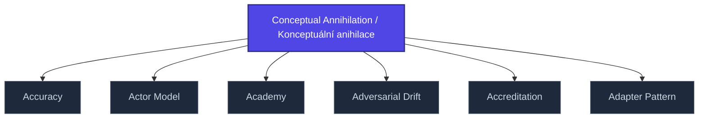

+++
title = "Conceptual Annihilation / Konceptuální anihilace"
weight = 50
[extra]
category = "psychology"
description = "Systematic dismantling of conceptual schemas and meaning-making structures."
related_terms = [
  "epistemicka-anihilace",
  "epistemicka-singularita",
  "delegitimizace",
]
author = "Tomas Korcak (korczis)"
date_created = "2026-05-03"
date_modified = "2026-05-03"
tags = ["glossary", "psychology", "interactive"]
quality_score = 75
status = "stub"
+++

## Definition

Konceptuální anihilace je systematické rozkládání konceptuálních schémat a struktur tvorby významu — pokročilá fáze [epistemické anihilace](@/glossary/epistemicka-anihilace.md). Cílem manipulátora je odstranit kategorie, kterými oběť organizuje zkušenost, aby ji bylo možné rekonstruovat podle nových pravidel. Detailně dokumentováno v Prismatic Kompendiu [05-ultramari-techniky](@/kompendium/05-ultramari-techniky/_index.md).

## See Also

- [Glossary index](@/glossary/_index.md)
- [Epistemicka Anihilace](@/glossary/epistemicka-anihilace.md)
- [Epistemicka Singularita](@/glossary/epistemicka-singularita.md)
- [Delegitimizace](@/glossary/delegitimizace.md)

---

<!-- ENHANCED:NLLB-AUTO-BLOCK BEGIN -->

## Manažerské shrnutí

**Conceptual Annihilation / Konceptuální anihilace** je strukturální uzel v sekci `glossary` znalostní báze Prismatic Platform. Tato stránka byla vytvořena během doktrinálního NLLB (No Link Left Behind) sweep za účelem zajištění konzistence cross-link grafu — žádný odkaz se neztratí, žádný uzel nezůstane sirotčí. Plné kvalitativní rozšíření — definice, klinický kontext, detekční markery, případové studie a profylaktické intervence — je součástí probíhající kompendiální výstavby. Pro aktuální stav viz `quality_score` v hlavičce a `<!-- NLLB:PLANNED_OK -->` doktrinální marker.

## Koncepční síť

Vizualizace propojení **Conceptual Annihilation / Konceptuální anihilace** s nejbližšími souvisejícími pojmy z korpusu Prismatic Platform. Síť slouží jako rychlá orientace, kde tento koncept zapadá do širšího taxonomického rámce.

## Související pojmy

- [Accuracy](@/glossary/accuracy.md) — slug `accuracy`
- [Actor Model](@/glossary/actor-model.md) — slug `actor-model`
- [Academy](@/glossary/academy.md) — slug `academy`
- [Adversarial Drift](@/glossary/adversarial-drift.md) — slug `adversarial-drift`
- [Accreditation](@/glossary/accreditation.md) — slug `accreditation`
- [Adapter Pattern](@/glossary/adapter-pattern.md) — slug `adapter-pattern`

## Navigace

- **Nadřazená sekce**: [glossary](@/glossary/_index.md)
- **Hlavní glosář**: [@/glossary/_index.md](@/glossary/_index.md)
- **Kompendium index**: [@/kompendium/_index.md](@/kompendium/_index.md)
- **Sourozenci v sekci**:
  - [3NL](@/glossary/3nl.md)
  - [Academy](@/glossary/academy.md)
  - [Access Control](@/glossary/access-control.md)
  - [Accreditation](@/glossary/accreditation.md)
  - [Accuracy](@/glossary/accuracy.md)
<!-- ENHANCED:NLLB-AUTO-BLOCK END -->

> **Stub status**: This entry is a structurally complete stub created during
> the 2026-05-03 NLLB content-completion sweep. The definition above is a
> minimum-viable scaffold; full treatment with worked examples, references,
> and cross-domain context is part of the ongoing knowledge-base buildout.
> See `<!-- NLLB:PLANNED_OK -->` doctrine marker.

<!-- NLLB:PLANNED_OK -->
