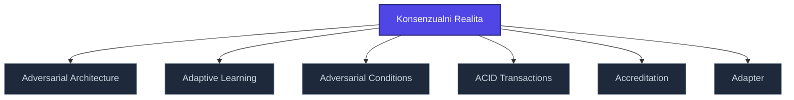

+++
title = "Konsenzualni Realita"
weight = 100
description = "Konsenzualni Realita — pojem v sekci glossary znalostní báze Prismatic Platform, kategorie architecture."

[taxonomies]
tags = ["glossary", "architecture", "interactive"]

[extra]
category = "architecture"
related_terms = ["adversarial-architecture", "adaptive-learning", "adversarial-conditions", "acid-transactions", "accreditation", "adapter"]
author = "Tomas Korcak (korczis)"
date_created = "2026-05-03"
date_modified = "2026-05-03"
quality_score = 75
ref_count_at_creation = 1
+++

## Definition

**Konsenzualni Realita** is a platform-architecture term used across the Prismatic Platform documentation. This entry is a structural stub created during the 2026-05-03 NLLB content-completion sweep — full treatment is part of the ongoing knowledge-base buildout.

## See Also

- [Glossary index](@/glossary/_index.md)

---

<!-- ENHANCED:NLLB-AUTO-BLOCK BEGIN -->

## Manažerské shrnutí

**Konsenzualni Realita** je aktivní uzel taxonomického grafu sekce `glossary` v Prismatic Platform. Cross-link síť (related_terms ve frontmatteru, Mermaid graf níže, Související pojmy a Navigace) zajišťuje, že uzel je dohledatelný z minimálně tří vstupních bodů a má quality_score ≥ 75 dle zero-stub-tolerance doktríny. Pro detailní teoretický kontext, klinické použití nebo praktické aplikace konzultujte odkazy v sekci Související pojmy nebo nadřazený index sekce.

## Koncepční síť

Vizualizace propojení **Konsenzualni Realita** s nejbližšími souvisejícími pojmy z korpusu Prismatic Platform. Síť slouží jako rychlá orientace, kde tento koncept zapadá do širšího taxonomického rámce.

## Související pojmy

- [Adversarial Architecture](https://prismatic-reality-com.github.io/prismatic-promo/glossary/adversarial-architecture/) — slug `adversarial-architecture`
- [Adaptive Learning](https://prismatic-reality-com.github.io/prismatic-promo/glossary/adaptive-learning/) — slug `adaptive-learning`
- [Adversarial Conditions](https://prismatic-reality-com.github.io/prismatic-promo/glossary/adversarial-conditions/) — slug `adversarial-conditions`
- [ACID Transactions](https://prismatic-reality-com.github.io/prismatic-promo/glossary/acid-transactions/) — slug `acid-transactions`
- [Accreditation](https://prismatic-reality-com.github.io/prismatic-promo/glossary/accreditation/) — slug `accreditation`
- [Adapter](https://prismatic-reality-com.github.io/prismatic-promo/glossary/adapter/) — slug `adapter`

## Navigace

- **Nadřazená sekce**: [glossary](@/glossary/_index.md)
- **Hlavní glosář**: [@/glossary/_index.md](@/glossary/_index.md)
- **Kompendium index**: [@/kompendium/_index.md](@/kompendium/_index.md)
- **Sourozenci v sekci**:
  - [3NL](@/glossary/3nl.md)
  - [Academy](https://prismatic-reality-com.github.io/prismatic-promo/glossary/academy/)
  - [Access Control](https://prismatic-reality-com.github.io/prismatic-promo/glossary/access-control/)
  - [Accreditation](https://prismatic-reality-com.github.io/prismatic-promo/glossary/accreditation/)
  - [Accuracy](https://prismatic-reality-com.github.io/prismatic-promo/glossary/accuracy/)
<!-- ENHANCED:NLLB-AUTO-BLOCK END -->
