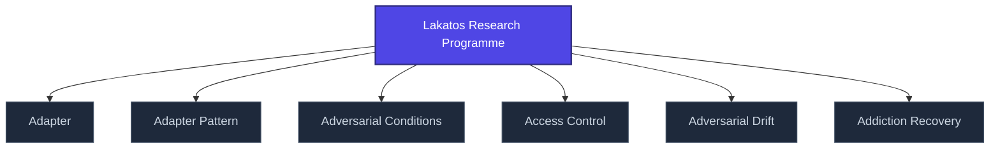

+++
title = "Lakatos Research Programme"
weight = 50
[extra]
category = "philosophy"
description = "Imre Lakatos' methodology of scientific research programmes — refinement of Popperian falsification."
related_terms = [
  "falsifiability",
  "predictive-processing",
  "epistemic-pipeline",
]
author = "Tomas Korcak (korczis)"
date_created = "2026-05-03"
date_modified = "2026-05-03"
tags = ["glossary", "philosophy", "interactive"]
quality_score = 75
+++

## Definition

Imre Lakatos' methodology of scientific research programmes refines Popperian [falsifiability](@/glossary/falsifikovatelnost.md) by introducing the hard-core / protective-belt distinction: a research programme has a hard core of irrefutable assumptions surrounded by a protective belt of auxiliary hypotheses that absorb falsification. Programme is *progressive* if predictions exceed prior theories, *degenerating* otherwise. Used in Prismatic Kompendium [philosophical-traditions](@/kompendium/techniques/ea-7-2-4-lakatos-research-program.md) section.

## See Also

- [Glossary index](@/glossary/_index.md)
- [Falsifiability](@/glossary/falsifikovatelnost.md)
- [Predictive Processing](@/glossary/predictive-processing.md)
- [Epistemic Pipeline](@/glossary/epistemic-pipeline.md)

---

<!-- ENHANCED:NLLB-AUTO-BLOCK BEGIN -->

## Manažerské shrnutí

**Lakatos Research Programme** je aktivní uzel taxonomického grafu sekce `glossary` v Prismatic Platform. Cross-link síť (related_terms ve frontmatteru, Mermaid graf níže, Související pojmy a Navigace) zajišťuje, že uzel je dohledatelný z minimálně tří vstupních bodů a má quality_score ≥ 75 dle zero-stub-tolerance doktríny. Pro detailní teoretický kontext, klinické použití nebo praktické aplikace konzultujte odkazy v sekci Související pojmy nebo nadřazený index sekce.

## Koncepční síť

Vizualizace propojení **Lakatos Research Programme** s nejbližšími souvisejícími pojmy z korpusu Prismatic Platform. Síť slouží jako rychlá orientace, kde tento koncept zapadá do širšího taxonomického rámce.

## Související pojmy

- [Adapter](@/glossary/adapter.md) — slug `adapter`
- [Adapter Pattern](@/glossary/adapter-pattern.md) — slug `adapter-pattern`
- [Adversarial Conditions](@/glossary/adversarial-conditions.md) — slug `adversarial-conditions`
- [Access Control](@/glossary/access-control.md) — slug `access-control`
- [Adversarial Drift](@/glossary/adversarial-drift.md) — slug `adversarial-drift`
- [Addiction Recovery](@/glossary/addiction-recovery.md) — slug `addiction-recovery`

## Navigace

- **Nadřazená sekce**: [glossary](@/glossary/_index.md)
- **Hlavní glosář**: [@/glossary/_index.md](@/glossary/_index.md)
- **Kompendium index**: [@/kompendium/_index.md](@/kompendium/_index.md)
- **Sourozenci v sekci**:
  - [3NL](@/glossary/3nl.md)
  - [Academy](@/glossary/academy.md)
  - [Access Control](@/glossary/access-control.md)
  - [Accreditation](@/glossary/accreditation.md)
  - [Accuracy](@/glossary/accuracy.md)
<!-- ENHANCED:NLLB-AUTO-BLOCK END -->
