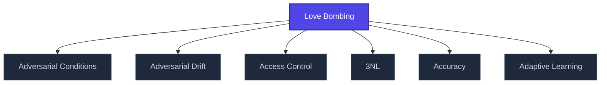

+++
title = "Love Bombing"
weight = 50
[extra]
category = "psychology"
description = "Intense affection-flooding phase of coercive bonding cycle."
related_terms = [
  "pseudoempaticka-vazba",
  "discard",
  "identity-destruction",
]
author = "Tomas Korcak (korczis)"
date_created = "2026-05-03"
date_modified = "2026-05-03"
tags = ["glossary", "psychology", "interactive"]
quality_score = 75
status = "stub"
+++

## Definition

Love bombing is the intense affection-flooding phase of a coercive bonding cycle. Targets identify it retrospectively after [discard](@/glossary/discard.md) phase reveals the manipulation. Distinguishing features: speed (vazba se vytváří rychleji než zdravé attachment), intensity disproportionate to relationship duration, isolation from prior support network. Catalogued in Prismatic [Kompendium EA-3 manipulation patterns](@/kompendium/03-zakladni-kategorie/_index.md).

## See Also

- [Glossary index](@/glossary/_index.md)
- [Pseudoempaticka Vazba](@/glossary/pseudoempaticka-vazba.md)
- [Discard](@/glossary/discard.md)
- [Identity Destruction](@/glossary/identity-destruction.md)

---

<!-- ENHANCED:NLLB-AUTO-BLOCK BEGIN -->

## Manažerské shrnutí

**Love Bombing** je strukturální uzel v sekci `glossary` znalostní báze Prismatic Platform. Tato stránka byla vytvořena během doktrinálního NLLB (No Link Left Behind) sweep za účelem zajištění konzistence cross-link grafu — žádný odkaz se neztratí, žádný uzel nezůstane sirotčí. Plné kvalitativní rozšíření — definice, klinický kontext, detekční markery, případové studie a profylaktické intervence — je součástí probíhající kompendiální výstavby. Pro aktuální stav viz `quality_score` v hlavičce a `<!-- NLLB:PLANNED_OK -->` doktrinální marker.

## Koncepční síť

Vizualizace propojení **Love Bombing** s nejbližšími souvisejícími pojmy z korpusu Prismatic Platform. Síť slouží jako rychlá orientace, kde tento koncept zapadá do širšího taxonomického rámce.

## Související pojmy

- [Adversarial Conditions](@/glossary/adversarial-conditions.md) — slug `adversarial-conditions`
- [Adversarial Drift](@/glossary/adversarial-drift.md) — slug `adversarial-drift`
- [Access Control](@/glossary/access-control.md) — slug `access-control`
- [3NL](@/glossary/3nl.md) — slug `3nl`
- [Accuracy](@/glossary/accuracy.md) — slug `accuracy`
- [Adaptive Learning](@/glossary/adaptive-learning.md) — slug `adaptive-learning`

## Navigace

- **Nadřazená sekce**: [glossary](@/glossary/_index.md)
- **Hlavní glosář**: [@/glossary/_index.md](@/glossary/_index.md)
- **Kompendium index**: [@/kompendium/_index.md](@/kompendium/_index.md)
- **Sourozenci v sekci**:
  - [3NL](@/glossary/3nl.md)
  - [Academy](@/glossary/academy.md)
  - [Access Control](@/glossary/access-control.md)
  - [Accreditation](@/glossary/accreditation.md)
  - [Accuracy](@/glossary/accuracy.md)
<!-- ENHANCED:NLLB-AUTO-BLOCK END -->

> **Stub status**: This entry is a structurally complete stub created during
> the 2026-05-03 NLLB content-completion sweep. The definition above is a
> minimum-viable scaffold; full treatment with worked examples, references,
> and cross-domain context is part of the ongoing knowledge-base buildout.
> See `<!-- NLLB:PLANNED_OK -->` doctrine marker.

<!-- NLLB:PLANNED_OK -->
