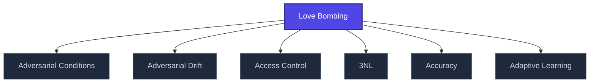

+++
title = "Love Bombing"
weight = 50
[extra]
category = "psychology"
description = "Intense affection-flooding phase of coercive bonding cycle."
related_terms = [
  "pseudoempaticka-vazba",
  "discard",
  "identity-destruction",
]
author = "Tomas Korcak (korczis)"
date_created = "2026-05-03"
date_modified = "2026-05-03"
tags = ["glossary", "psychology", "interactive"]
quality_score = 75
+++

## Definition

Love bombing is the intense affection-flooding phase of a coercive bonding cycle. Targets identify it retrospectively after [discard](@/glossary/discard.md) phase reveals the manipulation. Distinguishing features: speed (vazba se vytváří rychleji než zdravé attachment), intensity disproportionate to relationship duration, isolation from prior support network. Catalogued in Prismatic [Kompendium EA-3 manipulation patterns](@/kompendium/03-zakladni-kategorie/_index.md).

## See Also

- [Glossary index](@/glossary/_index.md)
- [Pseudoempaticka Vazba](@/glossary/pseudoempaticka-vazba.md)
- [Discard](@/glossary/discard.md)
- [Identity Destruction](@/glossary/identity-destruction.md)

---

<!-- ENHANCED:NLLB-AUTO-BLOCK BEGIN -->

## Manažerské shrnutí

**Love Bombing** je aktivní uzel taxonomického grafu sekce `glossary` v Prismatic Platform. Cross-link síť (related_terms ve frontmatteru, Mermaid graf níže, Související pojmy a Navigace) zajišťuje, že uzel je dohledatelný z minimálně tří vstupních bodů a má quality_score ≥ 75 dle zero-stub-tolerance doktríny. Pro detailní teoretický kontext, klinické použití nebo praktické aplikace konzultujte odkazy v sekci Související pojmy nebo nadřazený index sekce.

## Koncepční síť

Vizualizace propojení **Love Bombing** s nejbližšími souvisejícími pojmy z korpusu Prismatic Platform. Síť slouží jako rychlá orientace, kde tento koncept zapadá do širšího taxonomického rámce.

## Související pojmy

- [Adversarial Conditions](https://prismatic-reality-com.github.io/prismatic-promo/glossary/adversarial-conditions/) — slug `adversarial-conditions`
- [Adversarial Drift](https://prismatic-reality-com.github.io/prismatic-promo/glossary/adversarial-drift/) — slug `adversarial-drift`
- [Access Control](https://prismatic-reality-com.github.io/prismatic-promo/glossary/access-control/) — slug `access-control`
- [3NL](@/glossary/3nl.md) — slug `3nl`
- [Accuracy](https://prismatic-reality-com.github.io/prismatic-promo/glossary/accuracy/) — slug `accuracy`
- [Adaptive Learning](https://prismatic-reality-com.github.io/prismatic-promo/glossary/adaptive-learning/) — slug `adaptive-learning`

## Navigace

- **Nadřazená sekce**: [glossary](@/glossary/_index.md)
- **Hlavní glosář**: [@/glossary/_index.md](@/glossary/_index.md)
- **Kompendium index**: [@/kompendium/_index.md](@/kompendium/_index.md)
- **Sourozenci v sekci**:
  - [3NL](@/glossary/3nl.md)
  - [Academy](https://prismatic-reality-com.github.io/prismatic-promo/glossary/academy/)
  - [Access Control](https://prismatic-reality-com.github.io/prismatic-promo/glossary/access-control/)
  - [Accreditation](https://prismatic-reality-com.github.io/prismatic-promo/glossary/accreditation/)
  - [Accuracy](https://prismatic-reality-com.github.io/prismatic-promo/glossary/accuracy/)
<!-- ENHANCED:NLLB-AUTO-BLOCK END -->
