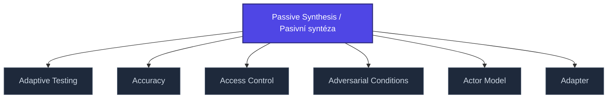

+++
title = "Passive Synthesis / Pasivní syntéza"
weight = 50
[extra]
category = "philosophy"
description = "Husserlian concept: pre-reflective constitution of meaning at the perceptual level."
related_terms = [
  "intencionalita",
  "husserl-retence",
  "core-consciousness",
]
author = "Tomas Korcak (korczis)"
date_created = "2026-05-03"
date_modified = "2026-05-03"
tags = ["glossary", "philosophy", "interactive"]
quality_score = 75
+++

## Definition

Pasivní syntéza (něm. *passive Synthesis*) je husserlovský koncept popisující pre-reflektivní konstituci významu na perceptivní úrovni — proces, který předchází vědomé syntéze. V Prismatic Kompendiu slouží jako teoretický fundament pro analýzu pre-konceptuálních manipulačních technik (sekce [05-ultramari-techniky](@/kompendium/05-ultramari-techniky/_index.md)).

## See Also

- [Glossary index](@/glossary/_index.md)
- [Intencionalita](@/glossary/intencionalita.md)
- [Husserl Retence](@/glossary/husserl-retence.md)
- [Core Consciousness](@/glossary/core-consciousness.md)

---

<!-- ENHANCED:NLLB-AUTO-BLOCK BEGIN -->

## Manažerské shrnutí

**Passive Synthesis / Pasivní syntéza** je aktivní uzel taxonomického grafu sekce `glossary` v Prismatic Platform. Cross-link síť (related_terms ve frontmatteru, Mermaid graf níže, Související pojmy a Navigace) zajišťuje, že uzel je dohledatelný z minimálně tří vstupních bodů a má quality_score ≥ 75 dle zero-stub-tolerance doktríny. Pro detailní teoretický kontext, klinické použití nebo praktické aplikace konzultujte odkazy v sekci Související pojmy nebo nadřazený index sekce.

## Koncepční síť

Vizualizace propojení **Passive Synthesis / Pasivní syntéza** s nejbližšími souvisejícími pojmy z korpusu Prismatic Platform. Síť slouží jako rychlá orientace, kde tento koncept zapadá do širšího taxonomického rámce.

## Související pojmy

- [Adaptive Testing](https://prismatic-reality-com.github.io/prismatic-promo/glossary/adaptive-testing/) — slug `adaptive-testing`
- [Accuracy](https://prismatic-reality-com.github.io/prismatic-promo/glossary/accuracy/) — slug `accuracy`
- [Access Control](https://prismatic-reality-com.github.io/prismatic-promo/glossary/access-control/) — slug `access-control`
- [Adversarial Conditions](https://prismatic-reality-com.github.io/prismatic-promo/glossary/adversarial-conditions/) — slug `adversarial-conditions`
- [Actor Model](https://prismatic-reality-com.github.io/prismatic-promo/glossary/actor-model/) — slug `actor-model`
- [Adapter](https://prismatic-reality-com.github.io/prismatic-promo/glossary/adapter/) — slug `adapter`

## Navigace

- **Nadřazená sekce**: [glossary](@/glossary/_index.md)
- **Hlavní glosář**: [@/glossary/_index.md](@/glossary/_index.md)
- **Kompendium index**: [@/kompendium/_index.md](@/kompendium/_index.md)
- **Sourozenci v sekci**:
  - [3NL](@/glossary/3nl.md)
  - [Academy](https://prismatic-reality-com.github.io/prismatic-promo/glossary/academy/)
  - [Access Control](https://prismatic-reality-com.github.io/prismatic-promo/glossary/access-control/)
  - [Accreditation](https://prismatic-reality-com.github.io/prismatic-promo/glossary/accreditation/)
  - [Accuracy](https://prismatic-reality-com.github.io/prismatic-promo/glossary/accuracy/)
<!-- ENHANCED:NLLB-AUTO-BLOCK END -->
