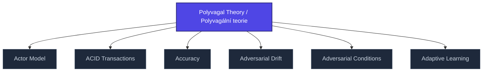

+++
title = "Polyvagal Theory / Polyvagální teorie"
weight = 50
[extra]
category = "psychology"
description = "Porges' model of autonomic nervous system as graded social-engagement system."
related_terms = [
  "interocepce",
  "co-regulation",
  "secure-attachment",
]
author = "Tomas Korcak (korczis)"
date_created = "2026-05-03"
date_modified = "2026-05-03"
tags = ["glossary", "psychology", "interactive"]
quality_score = 75
+++

## Definition

Polyvagální teorie (Porges) modeluje autonomní nervový systém jako odstupňovaný social-engagement systém s třemi vagálními okruhy: ventral vagal (social), sympathetic (mobilization), dorsal vagal (immobilization/freeze). V Prismatic frameworku slouží jako teoretická základna pro detekci dysregulace v coercive-control situacích a pro design [co-regulation](https://prismatic-reality-com.github.io/prismatic-promo/glossary/co-regulation/) intervencí.

## See Also

- [Glossary index](@/glossary/_index.md)
- [Interocepce](@/glossary/interocepce.md)
- [Co Regulation](https://prismatic-reality-com.github.io/prismatic-promo/glossary/co-regulation/)
- [Secure Attachment](@/glossary/secure-attachment.md)

---

<!-- ENHANCED:NLLB-AUTO-BLOCK BEGIN -->

## Manažerské shrnutí

**Polyvagal Theory / Polyvagální teorie** je aktivní uzel taxonomického grafu sekce `glossary` v Prismatic Platform. Cross-link síť (related_terms ve frontmatteru, Mermaid graf níže, Související pojmy a Navigace) zajišťuje, že uzel je dohledatelný z minimálně tří vstupních bodů a má quality_score ≥ 75 dle zero-stub-tolerance doktríny. Pro detailní teoretický kontext, klinické použití nebo praktické aplikace konzultujte odkazy v sekci Související pojmy nebo nadřazený index sekce.

## Koncepční síť

Vizualizace propojení **Polyvagal Theory / Polyvagální teorie** s nejbližšími souvisejícími pojmy z korpusu Prismatic Platform. Síť slouží jako rychlá orientace, kde tento koncept zapadá do širšího taxonomického rámce.

## Související pojmy

- [Actor Model](https://prismatic-reality-com.github.io/prismatic-promo/glossary/actor-model/) — slug `actor-model`
- [ACID Transactions](https://prismatic-reality-com.github.io/prismatic-promo/glossary/acid-transactions/) — slug `acid-transactions`
- [Accuracy](https://prismatic-reality-com.github.io/prismatic-promo/glossary/accuracy/) — slug `accuracy`
- [Adversarial Drift](https://prismatic-reality-com.github.io/prismatic-promo/glossary/adversarial-drift/) — slug `adversarial-drift`
- [Adversarial Conditions](https://prismatic-reality-com.github.io/prismatic-promo/glossary/adversarial-conditions/) — slug `adversarial-conditions`
- [Adaptive Learning](https://prismatic-reality-com.github.io/prismatic-promo/glossary/adaptive-learning/) — slug `adaptive-learning`

## Navigace

- **Nadřazená sekce**: [glossary](@/glossary/_index.md)
- **Hlavní glosář**: [@/glossary/_index.md](@/glossary/_index.md)
- **Kompendium index**: [@/kompendium/_index.md](@/kompendium/_index.md)
- **Sourozenci v sekci**:
  - [3NL](@/glossary/3nl.md)
  - [Academy](https://prismatic-reality-com.github.io/prismatic-promo/glossary/academy/)
  - [Access Control](https://prismatic-reality-com.github.io/prismatic-promo/glossary/access-control/)
  - [Accreditation](https://prismatic-reality-com.github.io/prismatic-promo/glossary/accreditation/)
  - [Accuracy](https://prismatic-reality-com.github.io/prismatic-promo/glossary/accuracy/)
<!-- ENHANCED:NLLB-AUTO-BLOCK END -->
