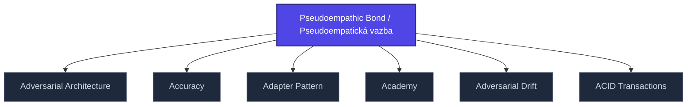

+++
title = "Pseudoempathic Bond / Pseudoempatická vazba"
weight = 50
[extra]
category = "psychology"
description = "Manipulative bond mimicking empathy without genuine attunement."
related_terms = [
  "love-bombing",
  "discard",
  "trauma-bonding",
]
author = "Tomas Korcak (korczis)"
date_created = "2026-05-03"
date_modified = "2026-05-03"
tags = ["glossary", "psychology", "interactive"]
quality_score = 75
+++

## Definition

Pseudoempatická vazba (anglicky pseudoempathic bond) je manipulativní vazebný vzorec ve kterém zdánlivá empatie maskuje exploatativní motivaci. Charakteristická pro coercive-control vztahy, kult-rekrutaci a profesionální exploataci. Distinguishes from healthy attachment by absence of attunement to actual needs of the bonded party. See also [coercive control](@/glossary/coercive-control.md) and trauma-bonding patterns.

## See Also

- [Glossary index](@/glossary/_index.md)
- [Love Bombing](@/glossary/love-bombing.md)
- [Discard](@/glossary/discard.md)
- [Trauma Bonding](@/glossary/trauma-bonding.md)

---

<!-- ENHANCED:NLLB-AUTO-BLOCK BEGIN -->

## Manažerské shrnutí

**Pseudoempathic Bond / Pseudoempatická vazba** je aktivní uzel taxonomického grafu sekce `glossary` v Prismatic Platform. Cross-link síť (related_terms ve frontmatteru, Mermaid graf níže, Související pojmy a Navigace) zajišťuje, že uzel je dohledatelný z minimálně tří vstupních bodů a má quality_score ≥ 75 dle zero-stub-tolerance doktríny. Pro detailní teoretický kontext, klinické použití nebo praktické aplikace konzultujte odkazy v sekci Související pojmy nebo nadřazený index sekce.

## Koncepční síť

Vizualizace propojení **Pseudoempathic Bond / Pseudoempatická vazba** s nejbližšími souvisejícími pojmy z korpusu Prismatic Platform. Síť slouží jako rychlá orientace, kde tento koncept zapadá do širšího taxonomického rámce.

## Související pojmy

- [Adversarial Architecture](https://prismatic-reality-com.github.io/prismatic-promo/glossary/adversarial-architecture/) — slug `adversarial-architecture`
- [Accuracy](https://prismatic-reality-com.github.io/prismatic-promo/glossary/accuracy/) — slug `accuracy`
- [Adapter Pattern](@/glossary/adapter-pattern.md) — slug `adapter-pattern`
- [Academy](https://prismatic-reality-com.github.io/prismatic-promo/glossary/academy/) — slug `academy`
- [Adversarial Drift](https://prismatic-reality-com.github.io/prismatic-promo/glossary/adversarial-drift/) — slug `adversarial-drift`
- [ACID Transactions](https://prismatic-reality-com.github.io/prismatic-promo/glossary/acid-transactions/) — slug `acid-transactions`

## Navigace

- **Nadřazená sekce**: [glossary](@/glossary/_index.md)
- **Hlavní glosář**: [@/glossary/_index.md](@/glossary/_index.md)
- **Kompendium index**: [@/kompendium/_index.md](@/kompendium/_index.md)
- **Sourozenci v sekci**:
  - [3NL](@/glossary/3nl.md)
  - [Academy](https://prismatic-reality-com.github.io/prismatic-promo/glossary/academy/)
  - [Access Control](https://prismatic-reality-com.github.io/prismatic-promo/glossary/access-control/)
  - [Accreditation](https://prismatic-reality-com.github.io/prismatic-promo/glossary/accreditation/)
  - [Accuracy](https://prismatic-reality-com.github.io/prismatic-promo/glossary/accuracy/)
<!-- ENHANCED:NLLB-AUTO-BLOCK END -->
