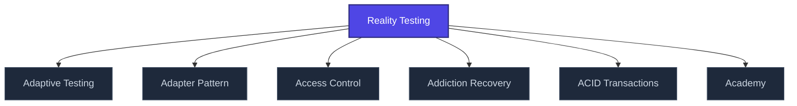

+++
title = "Reality Testing"
weight = 50
description = "Cognitive process of distinguishing internal representations from external reality."

[taxonomies]
tags = ["glossary", "psychology", "interactive"]

[extra]
category = "psychology"
related_terms = [
  "epistemic-pipeline",
  "trinity-gate",
  "nabla-infinity",
]
author = "Tomas Korcak (korczis)"
date_created = "2026-05-03"
date_modified = "2026-05-03"
quality_score = 75
+++

## Definition

Cognitive capacity to distinguish between subjective experience and external reality. In the Prismatic platform, reality testing is operationalized via the [Trinity Gate](@/glossary/trinity-gate.md) which enforces that every analytic claim survives structural, logical, and formal-verification checks before being accepted. Used in clinical contexts to assess perceptual integrity; used in OSINT contexts to gate evidence claims.

## See Also

- [Glossary index](@/glossary/_index.md)
- [Epistemic Pipeline](@/glossary/epistemic-pipeline.md)
- [Trinity Gate](@/glossary/trinity-gate.md)
- [Nabla Infinity](@/glossary/nabla-infinity.md)

---

<!-- ENHANCED:NLLB-AUTO-BLOCK BEGIN -->

## Manažerské shrnutí

**Reality Testing** je aktivní uzel taxonomického grafu sekce `glossary` v Prismatic Platform. Cross-link síť (related_terms ve frontmatteru, Mermaid graf níže, Související pojmy a Navigace) zajišťuje, že uzel je dohledatelný z minimálně tří vstupních bodů a má quality_score ≥ 75 dle zero-stub-tolerance doktríny. Pro detailní teoretický kontext, klinické použití nebo praktické aplikace konzultujte odkazy v sekci Související pojmy nebo nadřazený index sekce.

## Koncepční síť

Vizualizace propojení **Reality Testing** s nejbližšími souvisejícími pojmy z korpusu Prismatic Platform. Síť slouží jako rychlá orientace, kde tento koncept zapadá do širšího taxonomického rámce.

## Související pojmy

- [Adaptive Testing](https://prismatic-reality-com.github.io/prismatic-promo/glossary/adaptive-testing/) — slug `adaptive-testing`
- [Adapter Pattern](@/glossary/adapter-pattern.md) — slug `adapter-pattern`
- [Access Control](https://prismatic-reality-com.github.io/prismatic-promo/glossary/access-control/) — slug `access-control`
- [Addiction Recovery](@/glossary/addiction-recovery.md) — slug `addiction-recovery`
- [ACID Transactions](https://prismatic-reality-com.github.io/prismatic-promo/glossary/acid-transactions/) — slug `acid-transactions`
- [Academy](https://prismatic-reality-com.github.io/prismatic-promo/glossary/academy/) — slug `academy`

## Navigace

- **Nadřazená sekce**: [glossary](@/glossary/_index.md)
- **Hlavní glosář**: [@/glossary/_index.md](@/glossary/_index.md)
- **Kompendium index**: [@/kompendium/_index.md](@/kompendium/_index.md)
- **Sourozenci v sekci**:
  - [3NL](@/glossary/3nl.md)
  - [Academy](https://prismatic-reality-com.github.io/prismatic-promo/glossary/academy/)
  - [Access Control](https://prismatic-reality-com.github.io/prismatic-promo/glossary/access-control/)
  - [Accreditation](https://prismatic-reality-com.github.io/prismatic-promo/glossary/accreditation/)
  - [Accuracy](https://prismatic-reality-com.github.io/prismatic-promo/glossary/accuracy/)
<!-- ENHANCED:NLLB-AUTO-BLOCK END -->
