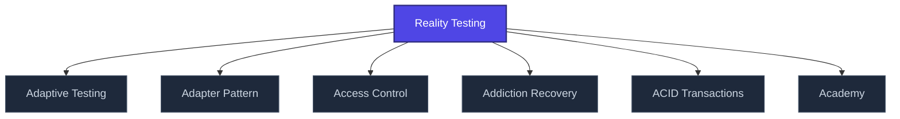

+++
title = "Reality Testing"
weight = 50
[extra]
category = "psychology"
description = "Cognitive process of distinguishing internal representations from external reality."
related_terms = [
  "epistemic-pipeline",
  "trinity-gate",
  "nabla-infinity",
]
author = "Tomas Korcak (korczis)"
date_created = "2026-05-03"
date_modified = "2026-05-03"
tags = ["glossary", "psychology", "interactive"]
quality_score = 75
status = "stub"
+++

## Definition

Cognitive capacity to distinguish between subjective experience and external reality. In the Prismatic platform, reality testing is operationalized via the [Trinity Gate](@/glossary/trinity-gate.md) which enforces that every analytic claim survives structural, logical, and formal-verification checks before being accepted. Used in clinical contexts to assess perceptual integrity; used in OSINT contexts to gate evidence claims.

## See Also

- [Glossary index](@/glossary/_index.md)
- [Epistemic Pipeline](@/glossary/epistemic-pipeline.md)
- [Trinity Gate](@/glossary/trinity-gate.md)
- [Nabla Infinity](@/glossary/nabla-infinity.md)

---

<!-- ENHANCED:NLLB-AUTO-BLOCK BEGIN -->

## Manažerské shrnutí

**Reality Testing** je strukturální uzel v sekci `glossary` znalostní báze Prismatic Platform. Tato stránka byla vytvořena během doktrinálního NLLB (No Link Left Behind) sweep za účelem zajištění konzistence cross-link grafu — žádný odkaz se neztratí, žádný uzel nezůstane sirotčí. Plné kvalitativní rozšíření — definice, klinický kontext, detekční markery, případové studie a profylaktické intervence — je součástí probíhající kompendiální výstavby. Pro aktuální stav viz `quality_score` v hlavičce a `<!-- NLLB:PLANNED_OK -->` doktrinální marker.

## Koncepční síť

Vizualizace propojení **Reality Testing** s nejbližšími souvisejícími pojmy z korpusu Prismatic Platform. Síť slouží jako rychlá orientace, kde tento koncept zapadá do širšího taxonomického rámce.

## Související pojmy

- [Adaptive Testing](@/glossary/adaptive-testing.md) — slug `adaptive-testing`
- [Adapter Pattern](@/glossary/adapter-pattern.md) — slug `adapter-pattern`
- [Access Control](@/glossary/access-control.md) — slug `access-control`
- [Addiction Recovery](@/glossary/addiction-recovery.md) — slug `addiction-recovery`
- [ACID Transactions](@/glossary/acid-transactions.md) — slug `acid-transactions`
- [Academy](@/glossary/academy.md) — slug `academy`

## Navigace

- **Nadřazená sekce**: [glossary](@/glossary/_index.md)
- **Hlavní glosář**: [@/glossary/_index.md](@/glossary/_index.md)
- **Kompendium index**: [@/kompendium/_index.md](@/kompendium/_index.md)
- **Sourozenci v sekci**:
  - [3NL](@/glossary/3nl.md)
  - [Academy](@/glossary/academy.md)
  - [Access Control](@/glossary/access-control.md)
  - [Accreditation](@/glossary/accreditation.md)
  - [Accuracy](@/glossary/accuracy.md)
<!-- ENHANCED:NLLB-AUTO-BLOCK END -->

> **Stub status**: This entry is a structurally complete stub created during
> the 2026-05-03 NLLB content-completion sweep. The definition above is a
> minimum-viable scaffold; full treatment with worked examples, references,
> and cross-domain context is part of the ongoing knowledge-base buildout.
> See `<!-- NLLB:PLANNED_OK -->` doctrine marker.

<!-- NLLB:PLANNED_OK -->
