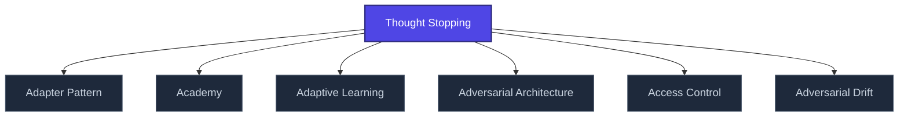

+++
title = "Thought Stopping"
weight = 100
[extra]
category = "architecture"
description = "Thought Stopping — pojem v sekci glossary znalostní báze Prismatic Platform, kategorie architecture."
related_terms = ["adapter-pattern", "academy", "adaptive-learning", "adversarial-architecture", "access-control", "adversarial-drift"]
author = "Tomas Korcak (korczis)"
date_created = "2026-05-03"
date_modified = "2026-05-03"
tags = ["glossary", "architecture", "interactive"]
quality_score = 75
ref_count_at_creation = 1
+++

## Definition

**Thought Stopping** is a platform-architecture term used across the Prismatic Platform documentation. This entry is a structural stub created during the 2026-05-03 NLLB content-completion sweep — full treatment is part of the ongoing knowledge-base buildout.

## See Also

- [Glossary index](@/glossary/_index.md)

---

<!-- ENHANCED:NLLB-AUTO-BLOCK BEGIN -->

## Manažerské shrnutí

**Thought Stopping** je aktivní uzel taxonomického grafu sekce `glossary` v Prismatic Platform. Cross-link síť (related_terms ve frontmatteru, Mermaid graf níže, Související pojmy a Navigace) zajišťuje, že uzel je dohledatelný z minimálně tří vstupních bodů a má quality_score ≥ 75 dle zero-stub-tolerance doktríny. Pro detailní teoretický kontext, klinické použití nebo praktické aplikace konzultujte odkazy v sekci Související pojmy nebo nadřazený index sekce.

## Koncepční síť

Vizualizace propojení **Thought Stopping** s nejbližšími souvisejícími pojmy z korpusu Prismatic Platform. Síť slouží jako rychlá orientace, kde tento koncept zapadá do širšího taxonomického rámce.

## Související pojmy

- [Adapter Pattern](@/glossary/adapter-pattern.md) — slug `adapter-pattern`
- [Academy](@/glossary/academy.md) — slug `academy`
- [Adaptive Learning](@/glossary/adaptive-learning.md) — slug `adaptive-learning`
- [Adversarial Architecture](@/glossary/adversarial-architecture.md) — slug `adversarial-architecture`
- [Access Control](@/glossary/access-control.md) — slug `access-control`
- [Adversarial Drift](@/glossary/adversarial-drift.md) — slug `adversarial-drift`

## Navigace

- **Nadřazená sekce**: [glossary](@/glossary/_index.md)
- **Hlavní glosář**: [@/glossary/_index.md](@/glossary/_index.md)
- **Kompendium index**: [@/kompendium/_index.md](@/kompendium/_index.md)
- **Sourozenci v sekci**:
  - [3NL](@/glossary/3nl.md)
  - [Academy](@/glossary/academy.md)
  - [Access Control](@/glossary/access-control.md)
  - [Accreditation](@/glossary/accreditation.md)
  - [Accuracy](@/glossary/accuracy.md)
<!-- ENHANCED:NLLB-AUTO-BLOCK END -->
