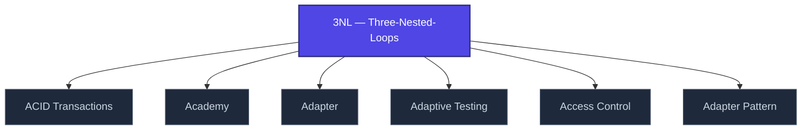

+++
title = "3NL — Three-Nested-Loops"
weight = 50
[extra]
category = "methodology"
description = "Architectural philosophy: outer loops (mission), middle (epoch), inner (cycle)."
related_terms = [
  "doctrine-overview",
  "nabla-infinity",
  "epistemic-pipeline",
]
author = "Tomas Korcak (korczis)"
date_created = "2026-05-03"
date_modified = "2026-05-03"
tags = ["glossary", "methodology", "interactive"]
quality_score = 75
status = "stub"
+++

## Definition

3NL (Three-Nested-Loops) is the foundational architectural philosophy of the Prismatic platform. Three concentric control loops: **outer** (mission-scope, days-weeks), **middle** (epoch-scope, hours), **inner** (cycle-scope, seconds-minutes). Each loop has its own state, telemetry, and termination criteria. See [doctrine overview](@/faq/_index.md#q-doctrine-overview) and [3NL pillar policy](@/capabilities/aiad-standard.md).

## See Also

- [Glossary index](@/glossary/_index.md)
- [Doctrine Overview](@/glossary/doctrine-overview.md)
- [Nabla Infinity](@/glossary/nabla-infinity.md)
- [Epistemic Pipeline](@/glossary/epistemic-pipeline.md)

---

<!-- ENHANCED:NLLB-AUTO-BLOCK BEGIN -->

## Manažerské shrnutí

**3NL — Three-Nested-Loops** je strukturální uzel v sekci `glossary` znalostní báze Prismatic Platform. Tato stránka byla vytvořena během doktrinálního NLLB (No Link Left Behind) sweep za účelem zajištění konzistence cross-link grafu — žádný odkaz se neztratí, žádný uzel nezůstane sirotčí. Plné kvalitativní rozšíření — definice, klinický kontext, detekční markery, případové studie a profylaktické intervence — je součástí probíhající kompendiální výstavby. Pro aktuální stav viz `quality_score` v hlavičce a `<!-- NLLB:PLANNED_OK -->` doktrinální marker.

## Koncepční síť

Vizualizace propojení **3NL — Three-Nested-Loops** s nejbližšími souvisejícími pojmy z korpusu Prismatic Platform. Síť slouží jako rychlá orientace, kde tento koncept zapadá do širšího taxonomického rámce.

## Související pojmy

- [ACID Transactions](@/glossary/acid-transactions.md) — slug `acid-transactions`
- [Academy](@/glossary/academy.md) — slug `academy`
- [Adapter](@/glossary/adapter.md) — slug `adapter`
- [Adaptive Testing](@/glossary/adaptive-testing.md) — slug `adaptive-testing`
- [Access Control](@/glossary/access-control.md) — slug `access-control`
- [Adapter Pattern](@/glossary/adapter-pattern.md) — slug `adapter-pattern`

## Navigace

- **Nadřazená sekce**: [glossary](@/glossary/_index.md)
- **Hlavní glosář**: [@/glossary/_index.md](@/glossary/_index.md)
- **Kompendium index**: [@/kompendium/_index.md](@/kompendium/_index.md)
- **Sourozenci v sekci**:
  - [3NL](@/glossary/3nl.md)
  - [Academy](@/glossary/academy.md)
  - [Access Control](@/glossary/access-control.md)
  - [Accreditation](@/glossary/accreditation.md)
  - [Accuracy](@/glossary/accuracy.md)
<!-- ENHANCED:NLLB-AUTO-BLOCK END -->

> **Stub status**: This entry is a structurally complete stub created during
> the 2026-05-03 NLLB content-completion sweep. The definition above is a
> minimum-viable scaffold; full treatment with worked examples, references,
> and cross-domain context is part of the ongoing knowledge-base buildout.
> See `<!-- NLLB:PLANNED_OK -->` doctrine marker.

<!-- NLLB:PLANNED_OK -->
