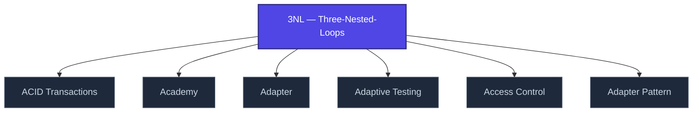

+++
title = "3NL — Three-Nested-Loops"
weight = 50
description = "Architectural philosophy: outer loops (mission), middle (epoch), inner (cycle)."

[taxonomies]
tags = ["glossary", "methodology", "interactive"]

[extra]
category = "methodology"
related_terms = [
  "doctrine-overview",
  "nabla-infinity",
  "epistemic-pipeline",
]
author = "Tomas Korcak (korczis)"
date_created = "2026-05-03"
date_modified = "2026-05-03"
quality_score = 75
+++

## Definition

3NL (Three-Nested-Loops) is the foundational architectural philosophy of the Prismatic platform. Three concentric control loops: **outer** (mission-scope, days-weeks), **middle** (epoch-scope, hours), **inner** (cycle-scope, seconds-minutes). Each loop has its own state, telemetry, and termination criteria. See [doctrine overview](https://prismatic-reality-com.github.io/prismatic-promo/faq/#q-doctrine-overview) and [3NL pillar policy](https://prismatic-reality-com.github.io/prismatic-promo/capabilities/aiad-standard/).

## See Also

- [Glossary index](@/glossary/_index.md)
- [Doctrine Overview](https://prismatic-reality-com.github.io/prismatic-promo/glossary/doctrine-overview/)
- [Nabla Infinity](@/glossary/nabla-infinity.md)
- [Epistemic Pipeline](@/glossary/epistemic-pipeline.md)

---

<!-- ENHANCED:NLLB-AUTO-BLOCK BEGIN -->

## Manažerské shrnutí

**3NL — Three-Nested-Loops** je aktivní uzel taxonomického grafu sekce `glossary` v Prismatic Platform. Cross-link síť (related_terms ve frontmatteru, Mermaid graf níže, Související pojmy a Navigace) zajišťuje, že uzel je dohledatelný z minimálně tří vstupních bodů a má quality_score ≥ 75 dle zero-stub-tolerance doktríny. Pro detailní teoretický kontext, klinické použití nebo praktické aplikace konzultujte odkazy v sekci Související pojmy nebo nadřazený index sekce.

## Koncepční síť

Vizualizace propojení **3NL — Three-Nested-Loops** s nejbližšími souvisejícími pojmy z korpusu Prismatic Platform. Síť slouží jako rychlá orientace, kde tento koncept zapadá do širšího taxonomického rámce.

## Související pojmy

- [ACID Transactions](https://prismatic-reality-com.github.io/prismatic-promo/glossary/acid-transactions/) — slug `acid-transactions`
- [Academy](https://prismatic-reality-com.github.io/prismatic-promo/glossary/academy/) — slug `academy`
- [Adapter](https://prismatic-reality-com.github.io/prismatic-promo/glossary/adapter/) — slug `adapter`
- [Adaptive Testing](https://prismatic-reality-com.github.io/prismatic-promo/glossary/adaptive-testing/) — slug `adaptive-testing`
- [Access Control](https://prismatic-reality-com.github.io/prismatic-promo/glossary/access-control/) — slug `access-control`
- [Adapter Pattern](@/glossary/adapter-pattern.md) — slug `adapter-pattern`

## Navigace

- **Nadřazená sekce**: [glossary](@/glossary/_index.md)
- **Hlavní glosář**: [@/glossary/_index.md](@/glossary/_index.md)
- **Kompendium index**: [@/kompendium/_index.md](@/kompendium/_index.md)
- **Sourozenci v sekci**:
  - [3NL](@/glossary/3nl.md)
  - [Academy](https://prismatic-reality-com.github.io/prismatic-promo/glossary/academy/)
  - [Access Control](https://prismatic-reality-com.github.io/prismatic-promo/glossary/access-control/)
  - [Accreditation](https://prismatic-reality-com.github.io/prismatic-promo/glossary/accreditation/)
  - [Accuracy](https://prismatic-reality-com.github.io/prismatic-promo/glossary/accuracy/)
<!-- ENHANCED:NLLB-AUTO-BLOCK END -->
