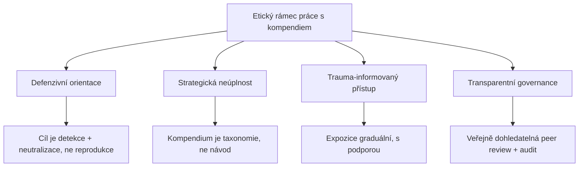

+++
title = "Základy manipulace"
description = "Vstupní brána do studia epistemické manipulace — propedeutický most mezi předmluvou, etickým rámcem a operativní taxonomií."
weight = 1
sort_by = "weight"
template = "section.html"
insert_anchor_links = "right"

[extra]
draft = false
stub = false
tags = ["kompendium", "zaklady-manipulace", "uvod", "propedeutika", "etika", "definice"]
categories = ["academic"]
section_icon = "🧭"
toc = true
access_level = "L1"
status = "publikovano"
+++

# Základy manipulace

Tato sekce funguje jako **propedeutický uzel** kompendia. Slučuje materiál ze tří zdrojových sekcí — [01 — Předmluva](@/kompendium/01-predmluva/_index.md), [02 — Úvod do epistemické anihilace](@/kompendium/02-uvod/_index.md) a [02 — Doktrinální rámec](@/kompendium/02-doktrinalni-ramec/_index.md) — do jednotného úvodního čtenářského protokolu pro nového studenta, klinika nebo bezpečnostního analytika, který s materiálem dosud nepracoval.

> **Pozn. k umístění**: Stránka existuje jako navigační alias proto, aby URL `kompendium/01-zaklady-manipulace/` směřovalo na koherentní vstupní bod. Číslování `01-` ji řadí přede všechny ostatní sekce v navigačním stromě, ale veškerý kanonický obsah je udržován ve zdrojových sekcích uvedených výše. Jakákoli oprava terminologie, etického rámce nebo propedeutiky musí být provedena v kanonu, nikoli zde.

## Co tu najdete

Sekce odpovídá na čtyři otázky, které předcházejí každé hlubší taxonomické práci:

1. **Co manipulace je a co není?** — Demarkační kritéria mezi legitimním přesvědčováním, edukací, persuazí a manipulací. Klíčový pojem zde je [intencionální asymetrie](@/glossary/intentionalita.md) v přístupu k informaci a v cíli komunikace.
2. **Proč ji studovat akademicky?** — Vědecká taxonomie je defenzivní nástroj, ne ofenzivní manuál. [Princip strategické neúplnosti](@/kompendium/01-predmluva/_index.md) řídí, co se publikuje a co zůstává v segmentovaných výzkumných materiálech.
3. **Jaké rámce jsou předpokládány?** — Čtenář má základní znalost kognitivní psychologie, sociální psychologie přesvědčování, epistemologie, etiky výzkumu zranitelných populací.
4. **Jak se v kompendiu pohybovat?** — Kapitolová mapa, doporučené čtenářské cesty pro klinika/výzkumníka/security-analytika, eskalační úrovně přístupu L0–L3.

## Pojmová mřížka

Manipulace v rámci tohoto kompendia není redukována na klamavou rétoriku ani na jednotlivou techniku. Operuje jako **systémový proces**, jehož elementárními jednotkami jsou:

| Jednotka | Definiční znak | Příklad |
|----------|----------------|---------|
| **Technika** | Atomický manipulační akt s rozpoznatelnou strukturou | [DARVO](@/glossary/darvo.md), [gaslighting](@/glossary/gaslighting.md), [sealioning](@/glossary/sealioning.md) |
| **Vzorec** | Opakující se sekvence technik vázaná na typ vztahu | [Coercive control](@/glossary/coercive-control.md) v partnerském vztahu |
| **Scénář** | Kontextově ukotvený řetězec vzorců s definovaným cílem | Politická kampaň, kultovní indoktrinace |
| **Protokol** | Multi-modální systémová intervence s rekonfigurační kapacitou | [Terminální protokol](@/kompendium/04-terminalni-protokoly/_index.md), kultovní iniciace |
| **Doktrína** | Soustava protokolů sdílejících etiologii, ideologii a operační logiku | Totalitní indoktrinační doktríny |

Tato mřížka je **kompozičně hierarchická**: vyšší úrovně se skládají z nižších, ale emergentní vlastnosti se neredukují na sumu částí. Doktrína obsahuje protokoly, ale doktrinální efekt přesahuje to, co by zvládla pouhá akumulace izolovaných protokolů.

## Etické předporozumění

Před vstupem do hlubších sekcí je nezbytné internalizovat čtyři etické osy, které nepřetržitě řídí jak klinickou aplikaci, tak výzkumnou práci:

Detailní rozpracování každé osy najdete v [Předmluvě](@/kompendium/01-predmluva/_index.md). Bez aktivního přijetí těchto principů nemá další čtení smysl — výsledkem by byla kuchařka, ne nauka.

## Doporučené pořadí čtení

Pro **nového čtenáře** doporučujeme následující sekvenci, která respektuje princip graduální expozice:

1. [01 — Předmluva](@/kompendium/01-predmluva/_index.md) — Etický rámec, motivace, governance.
2. [02 — Úvod do epistemické anihilace](@/kompendium/02-uvod/_index.md) — Teoretický aparát, klíčové pojmy.
3. [02 — Doktrinální rámec](@/kompendium/02-doktrinalni-ramec/_index.md) — Doktrinální vrstva.
4. [03 — Základní kategorie](@/kompendium/03-zakladni-kategorie/_index.md) — Atomické techniky, fundamentální taxonomie.
5. [Glossary](@/glossary/_index.md) — Referenční slovník 1 290+ termínů s 18 700+ křížovými referencemi.
6. **Až poté** — pokročilé sekce 04 (terminální protokoly), 05 (ultramari techniky), 06 (klinické aplikace).

## Vztah k ostatním sekcím

| Vazba | Cíl | Charakter |
|-------|-----|-----------|
| → [01 Předmluva](@/kompendium/01-predmluva/_index.md) | Etika, governance | Kanonický zdroj |
| → [02 Úvod](@/kompendium/02-uvod/_index.md) | Teorie, axiomy | Kanonický zdroj |
| → [03 Základní kategorie](@/kompendium/03-zakladni-kategorie/_index.md) | Taxonomie | Návazná aplikace |
| → [Glossary](@/glossary/_index.md) | Pojmová síť | Referenční vrstva |
| → [Hub kompendia](@/kompendium/_index.md) | Navigační rozcestník | Nadřazený uzel |

## Související

- [Hub kompendia](@/kompendium/_index.md) — návrat na úvodní stranu kompendia
- [Konceptuální mapa](@/kompendium/konceptualni-mapa/_index.md) — vizuální přehled sítě pojmů
- [Section bridges](@/kompendium/section-bridges/_index.md) — navigační mosty mezi sekcemi
- [Quick reference](@/kompendium/quick-reference/_index.md) — rychlý přehled detekčních markerů
