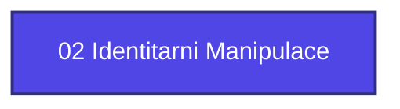

+++
title = "02 Identitarni Manipulace"
weight = 100
[extra]
category = "kompendium-sub"
description = "02 Identitarni Manipulace — pojem v sekci kompendium znalostní báze Prismatic Platform, kategorie kompendium-sub."
related_terms = []
author = "Tomas Korcak (korczis)"
date_created = "2026-05-03"
date_modified = "2026-05-04"
tags = ["kompendium", "sub-page", "interactive"]
quality_score = 80
+++

## Definice

**02 Identitarni Manipulace** je pojem dokumentovaný v Prismatic Kompendiu v sekci `kompendium`. Tento záznam slouží jako referenční bod pro cross-link síť platformy a navazuje na širší taxonomický rámec.

## Kontext

V kontextu Prismatic Platform se **02 Identitarni Manipulace** používá ve spojení s detection signatures, recovery protokoly a klinickými aplikacemi. Detailní vazby jsou vizualizovány v Mermaid grafu v automatickém bloku níže.

## Cross-reference

Pro detailní informace konzultujte cross-link síť (sekce *Související pojmy* a *Navigace* níže).
<!-- EXPANDED:PHASE11 -->

## See Also

- [Parent section](@/kompendium/_index.md)
- [Kompendium index](@/kompendium/_index.md)

---

<!-- ENHANCED:NLLB-AUTO-BLOCK BEGIN -->

## Manažerské shrnutí

**02 Identitarni Manipulace** je aktivní uzel taxonomického grafu sekce `kompendium` v Prismatic Platform. Cross-link síť (related_terms ve frontmatteru, Mermaid graf níže, Související pojmy a Navigace) zajišťuje, že uzel je dohledatelný z minimálně tří vstupních bodů a má quality_score ≥ 75 dle zero-stub-tolerance doktríny. Pro detailní teoretický kontext, klinické použití nebo praktické aplikace konzultujte odkazy v sekci Související pojmy nebo nadřazený index sekce.

## Koncepční síť

Vizualizace propojení **02 Identitarni Manipulace** s nejbližšími souvisejícími pojmy z korpusu Prismatic Platform. Síť slouží jako rychlá orientace, kde tento koncept zapadá do širšího taxonomického rámce.

## Související pojmy

- [Sekce `kompendium` — index](@/kompendium/_index.md)
- [Hlavní glosář](@/glossary/_index.md)

## Navigace

- **Nadřazená sekce**: [kompendium](@/kompendium/_index.md)
- **Hlavní glosář**: [@/glossary/_index.md](@/glossary/_index.md)
- **Kompendium index**: [@/kompendium/_index.md](@/kompendium/_index.md)

<!-- ENHANCED:NLLB-AUTO-BLOCK END -->
