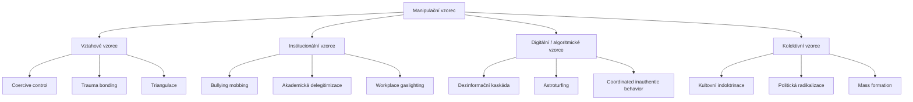
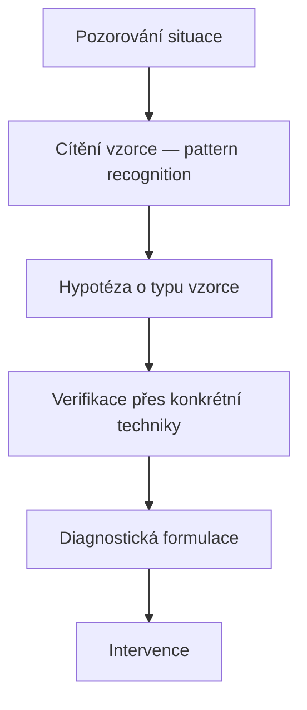

+++
title = "Manipulační vzorce"
description = "Systematický katalog opakujících se sekvencí manipulačních technik vázaných na typ vztahu, kontext a institucionální nastavení. Tato sekce přemosťuje atomickou taxonomii Sekce 03 (Základní kategorie) a pokročilé scenárování Sekcí 04–05."
weight = 3
sort_by = "weight"
template = "section.html"
insert_anchor_links = "right"

[extra]
draft = false
stub = false
tags = ["kompendium", "manipulacni-vzorce", "vzorce", "taxonomie", "coercive-control", "vztahove-vzorce"]
categories = ["academic"]
section_icon = "🔁"
toc = true
parent = "kompendium"
access_level = "L1"
status = "publikovano"
+++

# Manipulační vzorce

Tato sekce katalogizuje **opakující se sekvence manipulačních technik** — středovou taxonomickou jednotku mezi atomickou *technikou* (popsanou v [Základních kategoriích](@/kompendium/03-zakladni-kategorie/_index.md)) a komplexním *protokolem* (popsaným v [Terminálních protokolech](@/kompendium/04-terminalni-protokoly/_index.md)). Vzorec je definován tím, že jednotlivé techniky se v něm opakují s **rozpoznatelnou strukturou**, **typickým kontextem výskytu** a **predikovatelným efektem na cíl**.

> **Pozn. k umístění**: Tato stránka funguje jako navigační uzel — kanonický taxonomický katalog technik je v [Sekci 03 — Základní kategorie](@/kompendium/03-zakladni-kategorie/_index.md), per-technique hloubkové články v [Techniques](@/kompendium/techniques/_index.md). Zde se shromažďuje *vzorcová vrstva*, která propojuje izolované techniky do diagnosticky relevantních konstelací.

## Definice vzorce

Manipulační vzorec splňuje čtyři kritéria:

1. **Sekvenčnost** — Konkrétní pořadí technik vede k vyšší účinnosti než jejich náhodná aplikace. Vzorec má vstup, eskalační fázi a uzavírací fázi.
2. **Kontextová vázanost** — Vzorec se objevuje v určitém typu vztahu (partnerský, pracovní, terapeutický, kult, algoritmické platformy) a v jiném kontextu buď nefunguje, nebo nabývá jiného významu.
3. **Replikovatelnost napříč pachateli** — Vzorec není idiosynkratický; je popsán v klinické literatuře, právní dokumentaci nebo investigativní žurnalistice u různých nezávislých případů.
4. **Diagnostická hodnota** — Rozpoznání vzorce dovoluje predikci dalších kroků a včasnou intervenci. To je primární klinická a operativní hodnota této taxonomické vrstvy.

## Typologie vzorců

### Vztahové vzorce

Vzorce vázané na dyadický nebo trojúhelníkový vztah mezi konkrétními osobami:

- **[Coercive control](@/glossary/coercive-control.md)** — Sekvence izolace, ekonomické kontroly, monitoringu, gaslightingu a degradace (Stark 2007). Standardní rámec současné domácí násilné praxe v UK, Skotsku, Austrálii.
- **[Trauma bonding](@/glossary/trauma-bonding.md)** — Cyklus násilí–smíření–idealizace–devalvace, který vytváří paradoxní pouto mezi obětí a pachatelem (Dutton & Painter 1981).
- **Triangulace** — Vtažení třetí strany do dyadického konfliktu jako nástroje kontroly nebo flying monkey. Typické u narcistických systémů.

### Institucionální vzorce

Vzorce vázané na hierarchické organizační struktury:

- **Mobbing** — Systematická skupinová devalvace jednotlivce v pracovním kolektivu (Leymann 1990).
- **Akademická delegitimizace** — Vzorec kombinující [sealioning](@/glossary/sealioning.md), JAQing off, citation-stacking a peer-review sabotáž. Popsáno v [Sekci 03.2](@/kompendium/03-zakladni-kategorie/kapitola-2.md).
- **Workplace gaslighting** — Institucionální verze gaslightingu s asymetrií moci na straně managementu, často kombinovaná s dokumentační manipulací (HR records).

### Digitální a algoritmické vzorce

Vzorce specifické pro digitální prostředí, často s algoritmickou amplifikací:

- **Dezinformační kaskáda** — Vícekrokové šíření zkresleného nebo fabrikovaného obsahu přes různé platformy s plánovanou eskalací viditelnosti.
- **Astroturfing** — Fabrikace zdánlivě grassroots podpory přes falešné účty a koordinovaný obsah. Mapováno týmy jako Stanford Internet Observatory (SIO).
- **Coordinated inauthentic behavior (CIB)** — Termín Meta pro koordinované sítě falešných identit. Detekováno přes [graph-theoretickou](@/glossary/graph-theory.md) analýzu a behaviorální fingerprinting.

### Kolektivní vzorce

Vzorce na úrovni skupin, hnutí a populací:

- **Kultovní indoktrinace** — Standardní [BITE model](@/glossary/bite-model.md) (Hassan 1988): Behavioral, Information, Thought, Emotional control. Detail v [Recovery Protocols](@/kompendium/recovery-protocols/_index.md).
- **Politická radikalizace** — Funnel od mainstream názoru přes kontroverzní obsah k extremistickým komunitám (DARE-model framework).
- **Mass formation** — Sociálně-psychologický fenomén masové konvergence kognice (Desmet 2022, kontroverzní rámec).

## Vztah k atomickým technikám

Každý vzorec je rozložitelný na konkrétní techniky z [taxonomie základních kategorií](@/kompendium/03-zakladni-kategorie/_index.md). Příklad:

| Vzorec | Klíčové techniky |
|--------|-------------------|
| **Coercive control** | [DARVO](@/glossary/darvo.md), [gaslighting](@/glossary/gaslighting.md), izolace, ekonomická kontrola, smear campaign |
| **Akademická delegitimizace** | [sealioning](@/glossary/sealioning.md), JAQing off, motte-and-bailey, citation manipulation |
| **Kultovní indoktrinace** | Love bombing, milieu control, sacred science, demand for purity, mystical manipulation |
| **Dezinformační kaskáda** | False flag, gish gallop, Brandoliniho zákon, source laundering |

Per-technique hloubkové popisy najdete v [Techniques](@/kompendium/techniques/_index.md).

## Detekční pyramida

Klinik nebo analytik typicky postupuje **shora dolů** — nejprve si všímá vzorce, teprve poté identifikuje jednotlivé techniky:

Tento postup je popsán v [Sekci 06.1 — Diagnostické indikátory](@/kompendium/06-klinicke-aplikace/diagnosticke-indikatory.md) a [Sekci 06.2 — Diferenciální diagnostika](@/kompendium/06-klinicke-aplikace/diferencialni-diagnostika.md).

## Vztah k ostatním sekcím

| Vazba | Charakter |
|-------|-----------|
| ← [03 Základní kategorie](@/kompendium/03-zakladni-kategorie/_index.md) | Atomické techniky tvořící vzorce |
| ← [Techniques](@/kompendium/techniques/_index.md) | Per-technique detail |
| → [04 Terminální protokoly](@/kompendium/04-terminalni-protokoly/_index.md) | Vyšší taxonomická vrstva — komplexní protokoly |
| → [06 Klinické aplikace](@/kompendium/06-klinicke-aplikace/_index.md) | Diagnostická aplikace vzorců |
| → [Detection signatures](@/kompendium/detection-signatures/_index.md) | Operativní signatury pro automatickou detekci |

## Související

- [Hub kompendia](@/kompendium/_index.md)
- [Glossary](@/glossary/_index.md) — pojmový aparát
- [Quick reference](@/kompendium/quick-reference/_index.md) — rychlé detekční checklisty
- [Self-defense guides](@/kompendium/self-defense-guides/_index.md) — praktické obranné postupy
