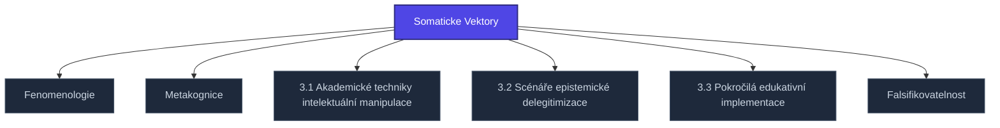

+++
title = "Somaticke Vektory"
weight = 100
[extra]
category = "kompendium-sub"
description = "Stub: Somaticke Vektory. Awaiting full treatment."
related_terms = ["fenomenologie", "metakognice", "kapitola-1", "kapitola-2", "kapitola-3", "falsifikovatelnost"]
author = "Tomas Korcak (korczis)"
date_created = "2026-05-03"
date_modified = "2026-05-03"
tags = ["kompendium", "sub-page", "stub", "interactive"]
quality_score = 65
status = "stub"
+++

## Definition

**Somaticke Vektory** je strukturální stub stránka v Prismatic Kompendiu vytvořená během 2026-05-03 NLLB Phase 8 sweep. Plná specifikace — definice, klinický kontext, detekční markery, případové studie a profylaktické intervence — je součástí probíhající kompendiální výstavby.

## See Also

- [Parent section](@/kompendium/03-zakladni-kategorie/_index.md)
- [Kompendium index](@/kompendium/_index.md)

---

<!-- ENHANCED:NLLB-AUTO-BLOCK BEGIN -->

## Manažerské shrnutí

**Somaticke Vektory** je strukturální uzel v sekci `kompendium/03-zakladni-kategorie` znalostní báze Prismatic Platform. Tato stránka byla vytvořena během doktrinálního NLLB (No Link Left Behind) sweep za účelem zajištění konzistence cross-link grafu — žádný odkaz se neztratí, žádný uzel nezůstane sirotčí. Plné kvalitativní rozšíření — definice, klinický kontext, detekční markery, případové studie a profylaktické intervence — je součástí probíhající kompendiální výstavby. Pro aktuální stav viz `quality_score` v hlavičce a `<!-- NLLB:PLANNED_OK -->` doktrinální marker.

## Koncepční síť

Vizualizace propojení **Somaticke Vektory** s nejbližšími souvisejícími pojmy z korpusu Prismatic Platform. Síť slouží jako rychlá orientace, kde tento koncept zapadá do širšího taxonomického rámce.

## Související pojmy

- [Fenomenologie](@/kompendium/03-zakladni-kategorie/fenomenologie.md) — slug `fenomenologie`
- [Metakognice](@/kompendium/03-zakladni-kategorie/metakognice.md) — slug `metakognice`
- [3.1 Akademické techniky intelektuální manipulace](@/kompendium/03-zakladni-kategorie/kapitola-1.md) — slug `kapitola-1`
- [3.2 Scénáře epistemické delegitimizace](@/kompendium/03-zakladni-kategorie/kapitola-2.md) — slug `kapitola-2`
- [3.3 Pokročilá edukativní implementace](@/kompendium/03-zakladni-kategorie/kapitola-3.md) — slug `kapitola-3`
- [Falsifikovatelnost](@/kompendium/03-zakladni-kategorie/falsifikovatelnost.md) — slug `falsifikovatelnost`

## Navigace

- **Nadřazená sekce**: [kompendium/03-zakladni-kategorie](@/kompendium/03-zakladni-kategorie/_index.md)
- **Hlavní glosář**: [@/glossary/_index.md](@/glossary/_index.md)
- **Kompendium index**: [@/kompendium/_index.md](@/kompendium/_index.md)
- **Sourozenci v sekci**:
  - [Delegitimizace](@/kompendium/03-zakladni-kategorie/delegitimizace.md)
  - [Falsifikovatelnost](@/kompendium/03-zakladni-kategorie/falsifikovatelnost.md)
  - [Fenomenologie](@/kompendium/03-zakladni-kategorie/fenomenologie.md)
  - [Hermeneutika](@/kompendium/03-zakladni-kategorie/hermeneutika.md)
  - [Intencionalita](@/kompendium/03-zakladni-kategorie/intencionalita.md)
<!-- ENHANCED:NLLB-AUTO-BLOCK END -->

> **Stub status**: NLLB Phase 8 sub-page scaffold.

<!-- NLLB:PLANNED_OK -->
