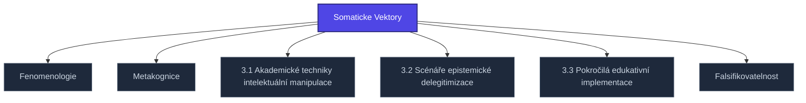

+++
title = "Somaticke Vektory"
weight = 100
description = "Somaticke Vektory — pojem v sekci kompendium/03-zakladni-kategorie znalostní báze Prismatic Platform, kategorie kompendium-sub."

[taxonomies]
tags = ["kompendium", "sub-page", "interactive"]

[extra]
category = "kompendium-sub"
related_terms = ["fenomenologie", "metakognice", "kapitola-1", "kapitola-2", "kapitola-3", "falsifikovatelnost"]
author = "Tomas Korcak (korczis)"
date_created = "2026-05-03"
date_modified = "2026-05-04"
quality_score = 80
+++

## Definice

**Somaticke Vektory** je filozoficko-epistemický pojem zařazený v sekci `03-zakladni-kategorie` Prismatic Kompendia jako základní kategorie pro analýzu manipulativních technik. Pojem představuje strukturální optiku, kterou Prismatic používá při klasifikaci a detekci epistemických útoků (EA-techniques) a při návrhu rekonstruktivních protokolů.


Filozofické kategorie v sekci 03 nejsou samostatné koncepty — slouží jako *interpretační rámce* pro analýzu konkrétních EA-technik (sekce 04–05) a klinických aplikací (sekce 06).


## Filozofický kontext

Koncept **Somaticke Vektory** se v Prismatic Kompendiu vztahuje k širšímu rámci epistemologie a fenomenologie zaměřené na to, jak agenti konstituují, validují a obhajují svá tvrzení. Pojem není používán deskriptivně, ale **operativně**: každá EA-technika dokumentovaná v Kompendiu je analyzována z hlediska toho, jak ovlivňuje tento konkrétní filozofický rozměr poznávání.

Vazby na klasické zdroje (Popper, Lakatos, Husserl, Heidegger, Wittgenstein, Habermas dle pojmu) jsou explicitní v sourozeneckých souborech sekce — viz cross-link síť níže pro nejbližší pojmy stejného rámce.

## Klinická a operační relevance

V due-diligence praxi a klinickém poradenství se **Somaticke Vektory** používá jako diagnostický filtr: analytik nebo terapeut hodnotí, zda subjektova tvrzení respektují, narušují nebo systematicky obcházejí tento epistemický rozměr. Operační detekce probíhá skrze [detection-signatures](@/kompendium/detection-signatures/_index.md) sekci, kde jsou kalibrační markery pro každou kategorii vypracovány.

## Detekční vztah

Pro praktickou detekci konzultujte:
- [Detection signatures](@/kompendium/detection-signatures/_index.md) — diagnostické markery
- [Klinické aplikace](@/kompendium/06-klinicke-aplikace/_index.md) — terapeutické použití
- [Recovery protocols](@/kompendium/recovery-protocols/_index.md) — rekonstruktivní intervence
<!-- EXPANDED:PHASE11 -->

## See Also

- [Parent section](@/kompendium/03-zakladni-kategorie/_index.md)
- [Kompendium index](@/kompendium/_index.md)

---

<!-- ENHANCED:NLLB-AUTO-BLOCK BEGIN -->

## Manažerské shrnutí

**Somaticke Vektory** je aktivní uzel taxonomického grafu sekce `kompendium/03-zakladni-kategorie` v Prismatic Platform. Cross-link síť (related_terms ve frontmatteru, Mermaid graf níže, Související pojmy a Navigace) zajišťuje, že uzel je dohledatelný z minimálně tří vstupních bodů a má quality_score ≥ 75 dle zero-stub-tolerance doktríny. Pro detailní teoretický kontext, klinické použití nebo praktické aplikace konzultujte odkazy v sekci Související pojmy nebo nadřazený index sekce.

## Koncepční síť

Vizualizace propojení **Somaticke Vektory** s nejbližšími souvisejícími pojmy z korpusu Prismatic Platform. Síť slouží jako rychlá orientace, kde tento koncept zapadá do širšího taxonomického rámce.

## Související pojmy

- [Fenomenologie](@/kompendium/03-zakladni-kategorie/fenomenologie.md) — slug `fenomenologie`
- [Metakognice](@/kompendium/03-zakladni-kategorie/metakognice.md) — slug `metakognice`
- [3.1 Akademické techniky intelektuální manipulace](@/kompendium/03-zakladni-kategorie/kapitola-1.md) — slug `kapitola-1`
- [3.2 Scénáře epistemické delegitimizace](@/kompendium/03-zakladni-kategorie/kapitola-2.md) — slug `kapitola-2`
- [3.3 Pokročilá edukativní implementace](@/kompendium/03-zakladni-kategorie/kapitola-3.md) — slug `kapitola-3`
- [Falsifikovatelnost](@/kompendium/03-zakladni-kategorie/falsifikovatelnost.md) — slug `falsifikovatelnost`

## Navigace

- **Nadřazená sekce**: [kompendium/03-zakladni-kategorie](@/kompendium/03-zakladni-kategorie/_index.md)
- **Hlavní glosář**: [@/glossary/_index.md](@/glossary/_index.md)
- **Kompendium index**: [@/kompendium/_index.md](@/kompendium/_index.md)
- **Sourozenci v sekci**:
  - [Delegitimizace](@/kompendium/03-zakladni-kategorie/delegitimizace.md)
  - [Falsifikovatelnost](@/kompendium/03-zakladni-kategorie/falsifikovatelnost.md)
  - [Fenomenologie](@/kompendium/03-zakladni-kategorie/fenomenologie.md)
  - [Hermeneutika](@/kompendium/03-zakladni-kategorie/hermeneutika.md)
  - [Intencionalita](@/kompendium/03-zakladni-kategorie/intencionalita.md)
<!-- ENHANCED:NLLB-AUTO-BLOCK END -->
