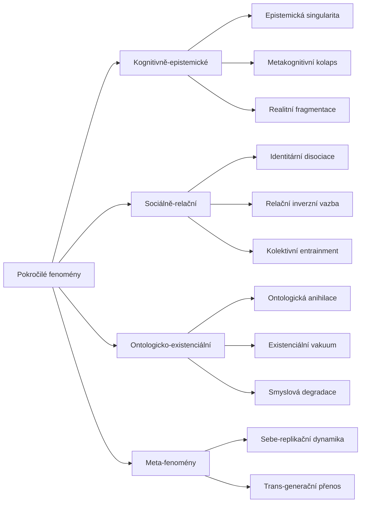

+++
title = "Pokročilé fenomény"
description = "Taxonomie pokročilých fenomenologických vzorců epistemické anihilace — emergentní stavy, které vznikají na rozhraní kognitivních."
weight = 4
sort_by = "weight"
template = "section.html"
insert_anchor_links = "right"

[extra]
draft = false
stub = false
tags = ["kompendium", "pokrocile-fenomeny", "fenomenologie", "emergence", "ultramari", "terminalni-protokoly"]
categories = ["academic", "research"]
section_icon = "🌌"
toc = true
access_level = "L2"
status = "publikovano"
+++

# Pokročilé fenomény

> ⚠️ **Přístupová úroveň L2 (rozšířený přístup)** — Tato sekce popisuje fenomény, které se objevují v krajních stavech epistemické anihilace. Materiál je určen výzkumníkům, klinickým specialistům a bezpečnostním analytikům s odpovídajícím vzděláním a etickou supervizí. Práce s touto sekcí předpokládá zvládnuté teoretické a etické rámce ze sekcí [01](@/kompendium/01-predmluva/_index.md) a [02](@/kompendium/02-uvod/_index.md).

Pokročilé fenomény tvoří taxonomickou vrstvu, kde **kognitivní, sociální a ontologické roviny** přestávají být analyticky oddělitelné. Zatímco izolovaná technika ovlivňuje jednu rovinu (typicky kognici nebo emoci) a [terminální protokol](@/kompendium/04-terminalni-protokoly/_index.md) působí synchronně na více rovinách, pokročilý fenomén je **emergentní stav**, který nelze přímo vyrobit — vyrůstá z dlouhodobé expozice protokolům, často v kombinaci s individuální zranitelností a sociálním nastavením.

> **Pozn. k umístění**: Tato stránka funguje jako navigační uzel slučující pohled tří kanonických sekcí — [04 Terminální protokoly](@/kompendium/04-terminalni-protokoly/_index.md), [05 Ultramari techniky](@/kompendium/05-ultramari-techniky/_index.md) a [06 Epistemická singularita](@/kompendium/06-epistemicka-singularita/_index.md). Kanonický obsah zůstává v původních sekcích; zde je řazen podle fenomenologického rámce, který klinika a výzkumníka zajímá víc než algoritmický katalog technik.

## Kategorizace fenoménů

### Kognitivně-epistemické fenomény

Stavy, kde primárním poškozením je samotný **poznávací aparát** subjektu:

- **[Epistemická singularita](@/kompendium/06-epistemicka-singularita/_index.md)** — Krajní stav, kdy subjekt ztrácí schopnost rozlišit pravdu od falše, autentický prožitek od indukovaného obsahu, vlastní úsudek od cizí narativy. Detail v [Sekci 06](@/kompendium/06-epistemicka-singularita/_index.md).
- **Metakognitivní kolaps** — Ztráta schopnosti monitorovat vlastní poznávací procesy. Subjekt přestává rozlišovat „myslím" od „je mi řečeno, ať myslím". Fenomén navazuje na klasický rámec [metakognice](@/glossary/metakognice.md) (Flavell 1979) a vede k popsaným klinickým profilům [metakognitivní destrukce](@/glossary/metakognitivni-destrukce.md) a [metakognitivního deficitu](@/glossary/metakognitivni-deficit.md).
- **Realitní fragmentace** — Strukturální narušení integrity reality, kdy paralelní inkonzistentní rámce koexistují bez subjektivního konfliktu. Příbuzné s disociativní symptomatikou, ale s primárně epistemickou (ne emoční) etiologií.

### Sociálně-relační fenomény

Stavy emerge na rozhraní subjektu a sociálního pole:

- **Identitární [disociace](@/glossary/disociace.md)** — Aktivní, manipulátorem podporovaná dezintegrace subjektivního self do více navzájem nekompatibilních identitárních fragmentů.
- **Relační inverzní vazba** — Stav, kdy subjekt rozpozná manipulátora jako ohrožení a současně jako jediný zdroj bezpečí. Mechanismus překračuje klasické [trauma bonding](@/glossary/trauma-bonding.md) tím, že neoperuje primárně přes intermitentní posilování, ale přes epistemickou závislost.
- **Kolektivní entrainment** — Synchronizace kognice, emocí a chování ve skupině do té míry, že individuální posouzení přestává být dostupné. Mechanismus mass formation, Le Bonovy „duše davu“ v moderní reformulaci.

### Ontologicko-existenciální fenomény

Stavy, které zasahují základní strukturu existenciálního prožívání:

- **[Ontologická anihilace](@/glossary/ontologicka-anihilace.md)** — Ztráta základního pocitu vlastní existenciální zakotvenosti. Subjekt rozumí pojmu „já jsem", ale neprožívá jej.
- **Existenciální vakuum** — Stav, kdy ztráta sdíleného významového rámce není kompenzována žádnou alternativou. Příbuzné s Franklovým konceptem noogenní deprese, ale s indukovanou (ne biograficky vyrostlou) etiologií.
- **Smyslová degradace** — Postupná ztráta schopnosti zakoušet sémantickou hloubku — slova, gesta a rituály se stávají prázdnými znaky bez referentu.

### Meta-fenomény

Fenomény, které popisují dynamiku samotných pokročilých fenoménů:

- **Sebe-replikační dynamika** — Tendence pokročilého fenoménu generovat podmínky pro vlastní reprodukci. Přeživší kultu se mohou nevědomky stát rekrutéry.
- **Trans-generační přenos** — Replikace epistemických poškození do dalších generací bez explicitní indoktrinace, přes výchovné vzorce, jazyk a emoční regulaci. Příbuzné s konceptem intergeneračního traumatu (viz [komplexní trauma](@/glossary/complex-trauma.md), [strukturální trauma](@/glossary/strukturalni-trauma.md)).

## Diferenciační kritéria

Pokročilý fenomén lze odlišit od běžné techniky nebo izolovaného protokolu podle čtyř indikátorů:

| Indikátor | Technika | Protokol | Pokročilý fenomén |
|-----------|----------|----------|-------------------|
| **Reverzibilita** | Vysoká | Střední | Nízká až žádná |
| **Doba expozice před stabilizací** | Hodiny | Týdny–měsíce | Měsíce–roky |
| **Závislost na pachateli** | Vysoká | Vysoká | Persistuje po jeho odstranění |
| **Generativní efekt** | Žádný | Omezený | Sebe-replikující |

Fenomén je tedy definován **systémovou autonomií** — jakmile vznikne, existuje nezávisle na původním zdroji a často mu jeho odstranění neukončí dynamiku.

## Implikace pro klinickou praxi

Pokročilé fenomény vyžadují **fundamentálně odlišný terapeutický přístup** než akutní traumatické stavy:

1. **Žádná extraktivní strategie sama o sobě neuspěje** — pouhé vyvedení subjektu z prostředí pachatele neukončí fenomén; potřebná je epistemická rekonstrukce.
2. **Nutnost dlouhodobé terapie** — Týdny stabilizace, měsíce rekonstrukce, roky integrace. Detail v [Recovery Protocols](@/kompendium/recovery-protocols/_index.md).
3. **Nebezpečí iatrogenní reinscenace** — Nesprávně vedená terapie může reprodukovat asymetrickou epistemickou autoritu, která fenomén původně vyvolala. Viz [Sekce 06.5](@/kompendium/06-klinicke-aplikace/vulnerabilni-populace.md).
4. **Indikace specializovaných terapeutů** — Standardní kognitivně-behaviorální terapie nemusí stačit; doporučují se specialisté na trauma-fokusovanou terapii s tréninkem v rekonstrukci epistemické autonomie.

## Vztah k jiným sekcím

| Vazba | Charakter |
|-------|-----------|
| ← [04 Terminální protokoly](@/kompendium/04-terminalni-protokoly/_index.md) | Vstupní brána fenoménů |
| ← [05 Ultramari techniky](@/kompendium/05-ultramari-techniky/_index.md) | Operacionalizovatelné techniky generující fenomény |
| ← [06 Epistemická singularita](@/kompendium/06-epistemicka-singularita/_index.md) | Specifický fenomén krajního stavu |
| → [06 Klinické aplikace](@/kompendium/06-klinicke-aplikace/_index.md) | Diagnostika a terapie |
| → [Recovery Protocols](@/kompendium/recovery-protocols/_index.md) | Dlouhodobá rehabilitace |
| → [07 Teoretické reflexe](@/kompendium/07-teoreticke-reflexe/_index.md) | Filozofické a epistemologické důsledky |

## Etická upozornění

Detailní popis pokročilých fenoménů je publikován v rámci [principu strategické neúplnosti](@/kompendium/01-predmluva/_index.md) — uvedeny jsou strukturní rámce a klinické markery, nikoli implementační detaily, které by usnadnily jejich záměrnou indukci. Výzkumníci, kteří potřebují plný materiál, kontaktují editory přes proces popsaný v [governance](@/kompendium/_index.md).

## Související

- [Hub kompendia](@/kompendium/_index.md)
- [Glossary](@/glossary/_index.md) — pojmový aparát
- [Konceptuální mapa](@/kompendium/konceptualni-mapa/_index.md) — síťový pohled
- [Critical perspectives](@/kompendium/critical-perspectives/_index.md) — kritické reflexe
