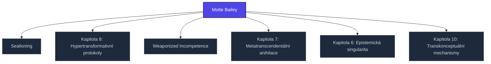

+++
title = "Motte Bailey"
weight = 100
[extra]
category = "kompendium-sub"
description = "Motte Bailey — pojem v sekci kompendium/05-ultramari-techniky znalostní báze Prismatic Platform, kategorie kompendium-sub."
related_terms = ["sealioning", "kapitola-8", "weaponized-incompetence", "kapitola-7", "kapitola-6", "kapitola-10"]
author = "Tomas Korcak (korczis)"
date_created = "2026-05-03"
date_modified = "2026-05-04"
tags = ["kompendium", "sub-page", "interactive"]
quality_score = 80
+++

## Definice

**Motte Bailey** patří mezi **ultramari techniky** (sekce 05 Prismatic Kompendia) — kategorii high-severity epistemických útoků, které kombinují více útočných vektorů současně a vyžadují koordinovanou víceúrovňovou obranu. Ultramari techniky překračují individuální epistemické útoky a pracují na úrovni celé interakce, narativu nebo identity oběti.


Ultramari techniky mají **severity = HIGH**. Klinická konzultace je doporučena při dlouhodobé expozici. Recovery protokoly v sekci `recovery-protocols/` jsou navrženy pro extrakci z těchto vzorců.


## Anatomie útoku

Mechanismus **Motte Bailey** typicky zahrnuje tři fáze:

1. **Setup phase** — útočník etabluje rámec, který činí standardní obranné mechanismy oběti irelevantními nebo invertuje jejich smysl
2. **Eskalační fáze** — útočník vystupňuje tlak nebo nejednoznačnost, dokud oběť nezačne pochybovat o vlastním úsudku
3. **Konsolidační fáze** — útočník upevní novou epistemickou pozici jako "normální" nebo "samozřejmou", takže návrat k původnímu stavu vyžaduje externí intervenci

Detailní analýza jednotlivých fází je dokumentována v technique-level článcích (`techniques/ea-X-X-X.md`) a v detection-signature záznamech.

## Detekční signatura

Operační detekce **Motte Bailey** se opírá o behaviorální a lingvistické markery dokumentované v [detection-signatures/](@/kompendium/detection-signatures/_index.md). Analytik hledá diskrepance mezi:
- explicitním obsahem výroku a implicitním rámcem (motte-bailey vzorec)
- rychlostí přechodu mezi pozicemi (sealioning timing)
- asymetrií v důkazních standardech mezi vlastními a oponentovými tvrzeními

## Counter-protokol

Ochrana proti **Motte Bailey** vyžaduje:
- **Externalizaci epistemických procesů** — peer review, dokumentační stopy, časové razítko
- **Strukturní přerušení interakce** — stop-pravidla, time-outs, externí mediace
- **Rekonstruktivní práci po expozici** — viz [recovery-protocols/](@/kompendium/recovery-protocols/_index.md), zejména protokoly orientované na narativ a paradigm-rebuilding
<!-- EXPANDED:PHASE11 -->

## See Also

- [Parent section](@/kompendium/05-ultramari-techniky/_index.md)
- [Kompendium index](@/kompendium/_index.md)

---

<!-- ENHANCED:NLLB-AUTO-BLOCK BEGIN -->

## Manažerské shrnutí

**Motte Bailey** je aktivní uzel taxonomického grafu sekce `kompendium/05-ultramari-techniky` v Prismatic Platform. Cross-link síť (related_terms ve frontmatteru, Mermaid graf níže, Související pojmy a Navigace) zajišťuje, že uzel je dohledatelný z minimálně tří vstupních bodů a má quality_score ≥ 75 dle zero-stub-tolerance doktríny. Pro detailní teoretický kontext, klinické použití nebo praktické aplikace konzultujte odkazy v sekci Související pojmy nebo nadřazený index sekce.

## Koncepční síť

Vizualizace propojení **Motte Bailey** s nejbližšími souvisejícími pojmy z korpusu Prismatic Platform. Síť slouží jako rychlá orientace, kde tento koncept zapadá do širšího taxonomického rámce.

## Související pojmy

- [Sealioning](@/kompendium/05-ultramari-techniky/sealioning.md) — slug `sealioning`
- [Kapitola 8: Hypertransformativní protokoly](@/kompendium/05-ultramari-techniky/kapitola-8.md) — slug `kapitola-8`
- [Weaponized Incompetence](@/kompendium/05-ultramari-techniky/weaponized-incompetence.md) — slug `weaponized-incompetence`
- [Kapitola 7: Metatranscendentální anihilace](@/kompendium/05-ultramari-techniky/kapitola-7.md) — slug `kapitola-7`
- [Kapitola 6: Epistemická singularita](@/kompendium/05-ultramari-techniky/kapitola-6.md) — slug `kapitola-6`
- [Kapitola 10: Transkonceptuální mechanismy](@/kompendium/05-ultramari-techniky/kapitola-10.md) — slug `kapitola-10`

## Navigace

- **Nadřazená sekce**: [kompendium/05-ultramari-techniky](@/kompendium/05-ultramari-techniky/_index.md)
- **Hlavní glosář**: [@/glossary/_index.md](@/glossary/_index.md)
- **Kompendium index**: [@/kompendium/_index.md](@/kompendium/_index.md)
- **Sourozenci v sekci**:
  - [Kapitola 10: Transkonceptuální mechanismy](@/kompendium/05-ultramari-techniky/kapitola-10.md)
  - [Kapitola 6: Epistemická singularita](@/kompendium/05-ultramari-techniky/kapitola-6.md)
  - [Kapitola 7: Metatranscendentální anihilace](@/kompendium/05-ultramari-techniky/kapitola-7.md)
  - [Kapitola 8: Hypertransformativní protokoly](@/kompendium/05-ultramari-techniky/kapitola-8.md)
  - [Kapitola 9: Paradoxální metaanihilační protokoly](@/kompendium/05-ultramari-techniky/kapitola-9.md)
<!-- ENHANCED:NLLB-AUTO-BLOCK END -->
