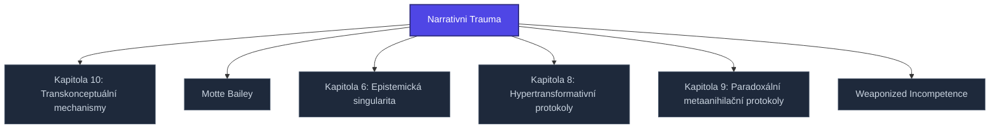

+++
title = "Narrativni Trauma"
weight = 100
[extra]
category = "kompendium-sub"
description = "Stub: Narrativni Trauma. Awaiting full treatment."
related_terms = ["kapitola-10", "motte-bailey", "kapitola-6", "kapitola-8", "kapitola-9", "weaponized-incompetence"]
author = "Tomas Korcak (korczis)"
date_created = "2026-05-03"
date_modified = "2026-05-03"
tags = ["kompendium", "sub-page", "stub", "interactive"]
quality_score = 65
status = "stub"
+++

## Definition

**Narrativni Trauma** je strukturální stub stránka v Prismatic Kompendiu vytvořená během 2026-05-03 NLLB Phase 8 sweep. Plná specifikace — definice, klinický kontext, detekční markery, případové studie a profylaktické intervence — je součástí probíhající kompendiální výstavby.

## See Also

- [Parent section](@/kompendium/05-ultramari-techniky/_index.md)
- [Kompendium index](@/kompendium/_index.md)

---

<!-- ENHANCED:NLLB-AUTO-BLOCK BEGIN -->

## Manažerské shrnutí

**Narrativni Trauma** je strukturální uzel v sekci `kompendium/05-ultramari-techniky` znalostní báze Prismatic Platform. Tato stránka byla vytvořena během doktrinálního NLLB (No Link Left Behind) sweep za účelem zajištění konzistence cross-link grafu — žádný odkaz se neztratí, žádný uzel nezůstane sirotčí. Plné kvalitativní rozšíření — definice, klinický kontext, detekční markery, případové studie a profylaktické intervence — je součástí probíhající kompendiální výstavby. Pro aktuální stav viz `quality_score` v hlavičce a `<!-- NLLB:PLANNED_OK -->` doktrinální marker.

## Koncepční síť

Vizualizace propojení **Narrativni Trauma** s nejbližšími souvisejícími pojmy z korpusu Prismatic Platform. Síť slouží jako rychlá orientace, kde tento koncept zapadá do širšího taxonomického rámce.

## Související pojmy

- [Kapitola 10: Transkonceptuální mechanismy](@/kompendium/05-ultramari-techniky/kapitola-10.md) — slug `kapitola-10`
- [Motte Bailey](@/kompendium/05-ultramari-techniky/motte-bailey.md) — slug `motte-bailey`
- [Kapitola 6: Epistemická singularita](@/kompendium/05-ultramari-techniky/kapitola-6.md) — slug `kapitola-6`
- [Kapitola 8: Hypertransformativní protokoly](@/kompendium/05-ultramari-techniky/kapitola-8.md) — slug `kapitola-8`
- [Kapitola 9: Paradoxální metaanihilační protokoly](@/kompendium/05-ultramari-techniky/kapitola-9.md) — slug `kapitola-9`
- [Weaponized Incompetence](@/kompendium/05-ultramari-techniky/weaponized-incompetence.md) — slug `weaponized-incompetence`

## Navigace

- **Nadřazená sekce**: [kompendium/05-ultramari-techniky](@/kompendium/05-ultramari-techniky/_index.md)
- **Hlavní glosář**: [@/glossary/_index.md](@/glossary/_index.md)
- **Kompendium index**: [@/kompendium/_index.md](@/kompendium/_index.md)
- **Sourozenci v sekci**:
  - [Kapitola 10: Transkonceptuální mechanismy](@/kompendium/05-ultramari-techniky/kapitola-10.md)
  - [Kapitola 6: Epistemická singularita](@/kompendium/05-ultramari-techniky/kapitola-6.md)
  - [Kapitola 7: Metatranscendentální anihilace](@/kompendium/05-ultramari-techniky/kapitola-7.md)
  - [Kapitola 8: Hypertransformativní protokoly](@/kompendium/05-ultramari-techniky/kapitola-8.md)
  - [Kapitola 9: Paradoxální metaanihilační protokoly](@/kompendium/05-ultramari-techniky/kapitola-9.md)
<!-- ENHANCED:NLLB-AUTO-BLOCK END -->

> **Stub status**: NLLB Phase 8 sub-page scaffold.

<!-- NLLB:PLANNED_OK -->
