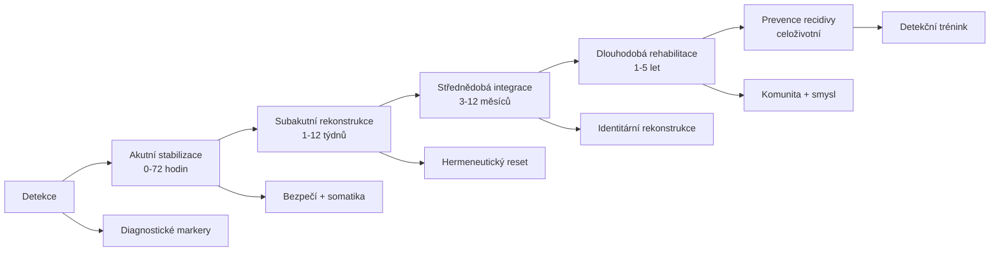
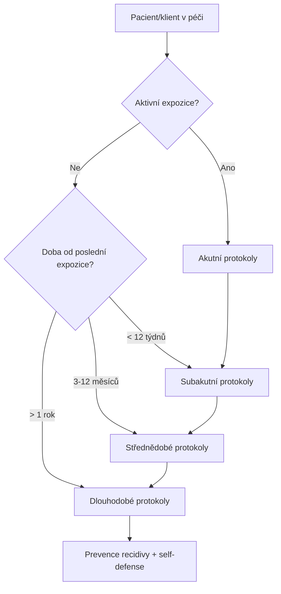

+++
title = "Intervence a obrana"
description = "Komplexní rámec intervenčních a obranných protokolů pro epistemickou anihilaci — od akutní stabilizace přes střednědobou rekonstrukci až po dlouhodobou rehabilitaci a prevenci recidivy."
weight = 6
sort_by = "weight"
template = "section.html"
insert_anchor_links = "right"

[extra]
draft = false
stub = false
tags = ["kompendium", "intervence", "obrana", "rekonstrukce", "rehabilitace", "klinicke-aplikace", "recovery-protocols"]
categories = ["academic", "clinical"]
section_icon = "🛡️"
toc = true
access_level = "L1"
status = "publikovano"
+++

# Intervence a obrana

Tato sekce funguje jako operativní rozcestník klinických a obranných protokolů kompendia. Její
strukturu určuje časová osa intervenční práce — akutní, subakutní, střednědobá, dlouhodobá a
preventivní fáze — a vychází z fázového modelu zotavení z chronického traumatu, který popsala Herman
(1992) jako posloupnost bezpečí, rekonstrukce a opětovného spojení. Materiál syntetizuje ze tří
kanonických zdrojů: [Sekce 06 — Klinické aplikace](@/kompendium/06-klinicke-aplikace/_index.md),
[Recovery Protocols](@/kompendium/recovery-protocols/_index.md) a
[Self-defense Guides](@/kompendium/self-defense-guides/_index.md). Kanonické protokoly zůstávají v
původních sekcích; zde se řadí podle časového horizontu a klinické funkce, tedy optikou, kterou při
akutním rozhodování potřebuje terapeut, sociální pracovník nebo bezpečnostní analytik.

## Časová architektura intervence

### Akutní stabilizace (0–72 hodin)

Cílem akutní fáze je odstranit pokračující expozici a obnovit základní bezpečí; Herman (1992) klade
nastolení bezpečí před jakoukoli hlubší práci, protože v dysregulačním stavu není racionální zpracování
možné. Do této fáze patří [Acute safety establishment](@/kompendium/recovery-protocols/acute-safety-establishment.md),
které zajišťuje fyzické a sociální bezpečí, [Acute somatic regulation](@/kompendium/recovery-protocols/acute-somatic-regulation.md)
pro stabilizaci autonomního nervového systému a
[Acute information curation](@/kompendium/recovery-protocols/acute-information-curation.md), jež omezuje
epistemickou zátěž. Doplňuje je [Acute cognitive anchoring](@/kompendium/recovery-protocols/acute-cognitive-anchoring.md),
které etabluje orientační kotvy datem, místem a identitou, a
[Acute social reconnection](@/kompendium/recovery-protocols/acute-social-reconnection.md), obnovující
kontakt s důvěryhodnými osobami mimo manipulátorův okruh.

### Subakutní rekonstrukce (1–12 týdnů)

Po stabilizaci přichází rekonstrukce poznávacího aparátu, kdy je pacient schopen verbálního zpracování,
ale jeho [metakognice](@/glossary/metakognice.md) zůstává kompromitovaná. Herman (1992) tuto fázi spojuje
s obnovou schopnosti vyprávět vlastní příběh, čemuž slouží
[Subacute narrative externalization](@/kompendium/recovery-protocols/subacute-narrative-externalization.md)
a [Subacute meaning reconstruction](@/kompendium/recovery-protocols/subacute-meaning-reconstruction.md).
Současně probíhá [Subacute trust rebuilding](@/kompendium/recovery-protocols/subacute-trust-rebuilding.md),
[Subacute relational restructuring](@/kompendium/recovery-protocols/subacute-relational-restructuring.md),
[Subacute axiological restoration](@/kompendium/recovery-protocols/subacute-axiological-restoration.md) a
první [Subacute detection training](@/kompendium/recovery-protocols/subacute-detection-training.md).

### Střednědobá integrace (3–12 měsíců)

Ve střednědobé fázi se zpracovává identitární a vztahová vrstva; Herman (1992) ji pojímá jako obnovu
spojení se světem a s vlastní budoucností. Patří sem
[Midterm identity reconstruction](@/kompendium/recovery-protocols/midterm-identity-reconstruction.md),
[Midterm hermeneutic reset](@/kompendium/recovery-protocols/midterm-hermeneutic-reset.md) a
[Midterm metacognitive rehab](@/kompendium/recovery-protocols/midterm-metacognitive-rehab.md), doplněné o
[Midterm skill rebuilding](@/kompendium/recovery-protocols/midterm-skill-rebuilding.md),
[Midterm vocational integration](@/kompendium/recovery-protocols/midterm-vocational-integration.md) a
[Midterm educational reintegration](@/kompendium/recovery-protocols/midterm-educational-reintegration.md).

### Dlouhodobá rehabilitace (1–5 let)

Dlouhodobá fáze klade důraz na komunitu, smysl a růst. Zahrnuje
[Longterm community rebuilding](@/kompendium/recovery-protocols/longterm-community-rebuilding.md),
[Longterm meaning deepening](@/kompendium/recovery-protocols/longterm-meaning-deepening.md) a
[Longterm post-traumatic growth](@/kompendium/recovery-protocols/longterm-post-traumatic-growth.md),
k nimž přistupuje [Longterm altruistic channeling](@/kompendium/recovery-protocols/longterm-altruistic-channeling.md),
[Longterm resilience cultivation](@/kompendium/recovery-protocols/longterm-resilience-cultivation.md) a
[Longterm relapse prevention](@/kompendium/recovery-protocols/longterm-relapse-prevention.md). Herman
(1992) upozorňuje, že zotavení není nikdy úplně „hotové“ a že obnovené spojení s komunitou je jeho
nejspolehlivější oporou.

### Specializované populační protokoly

Pro specifické cílové skupiny existují kalibrované varianty, které zohledňují jejich zvláštní
zranitelnost a kontext; Herman (1992) zdůrazňuje, že fázový rámec zotavení je nutné přizpůsobit vývojovému
stádiu, dějinám zajetí a sociální situaci přeživšího. Následující tabulka je rozcestníkem k těmto
variantám.

| Populace | Protokol | Specifika |
|----------|----------|-----------|
| Děti | [Recovery children protocol](@/kompendium/recovery-protocols/recovery-children-protocol.md) | Vývojová citlivost, opatrovník |
| Adolescenti | [Recovery adolescent protocol](@/kompendium/recovery-protocols/recovery-adolescent-protocol.md) | Identitární vývoj, peer skupina |
| Senioři | [Recovery elder protocol](@/kompendium/recovery-protocols/recovery-elder-protocol.md) | Kognitivní rezerva, izolace |
| Post-kult | [Recovery cult extraction protocol](@/kompendium/recovery-protocols/recovery-cult-extraction-protocol.md) | Komunitní extrakce, BITE rozpad |
| Oběti obchodu s lidmi | [Recovery trafficking survivor protocol](@/kompendium/recovery-protocols/recovery-trafficking-survivor-protocol.md) | [Komplexní trauma](@/glossary/complex-trauma.md), právní rovina |
| Političtí vězni | [Recovery political prisoner protocol](@/kompendium/recovery-protocols/recovery-political-prisoner-protocol.md) | Ideologická indoktrinace, exil |

Post-kultová varianta vychází z Hassanova (2015) modelu, podle něhož extrakce vyžaduje rozpad kontroly
chování, informací, myšlení a emocí; varianta pro oběti obchodu s lidmi a politické vězně navazuje na
Hermanové (1992) rozšíření pojmu traumatu o dlouhodobé zajetí a nadvládu.

## Defenzivní vrstva — self-defense

Paralelně s klinickými intervenčními protokoly existuje preventivní obranná vrstva určená pro běžnou
populaci, která dosud nebyla cílem systematické manipulace, ale chce se na ni připravit; Hassan (2015)
takovou prevenci pokládá za účinnější než pozdější extrakci. Patří sem
[Self-defense guides](@/kompendium/self-defense-guides/_index.md) jako praktické příručky pro občany,
novináře a akademiky, [Detection signatures](@/kompendium/detection-signatures/_index.md) jako operativní
signatury pro detekci a [Quick reference](@/kompendium/quick-reference/_index.md) jako pohotová referenční
karta markerů.

## Volba intervenční úrovně

## Indikace pro multidisciplinární tým

Závažné případy vyžadují koordinovanou práci více profesí, jejichž role shrnuje následující tabulka.

| Role | Funkce |
|------|--------|
| Klinický psycholog | Diagnostika, terapie, výzkum |
| Psychiatr | Psychofarmakologie, diferenciální diagnostika |
| Sociální pracovník | Sociální opora, právní zastoupení, ubytování |
| Právník | Ochrana práv, předběžná opatření, dokumentace |
| Bezpečnostní analytik | Hodnocení pokračující hrozby, OSINT |
| Komunitní podpora | Peer-skupiny, mentoring přeživších |

## Literatura

- Hassan, S. (2015). *Combating Cult Mind Control.* Newton, MA: Freedom of Mind Press.
- Herman, J. L. (1992). *Trauma and Recovery.* New York: Basic Books.

## Související

- [Hub kompendia](@/kompendium/_index.md)
- [06 Klinické aplikace](@/kompendium/06-klinicke-aplikace/_index.md) — diagnostický rámec
- [Vulnerabilní populace](@/kompendium/06-klinicke-aplikace/vulnerabilni-populace.md)
- [Recovery protocols](@/kompendium/recovery-protocols/_index.md) — detailní protokoly
- [Self-defense guides](@/kompendium/self-defense-guides/_index.md) — preventivní vrstva
- [Emergency protocols](@/kompendium/emergency-protocols/_index.md) — krizové postupy
- [Population health](@/kompendium/population-health/_index.md) — populační rovina
- [Glossary](@/glossary/_index.md)
