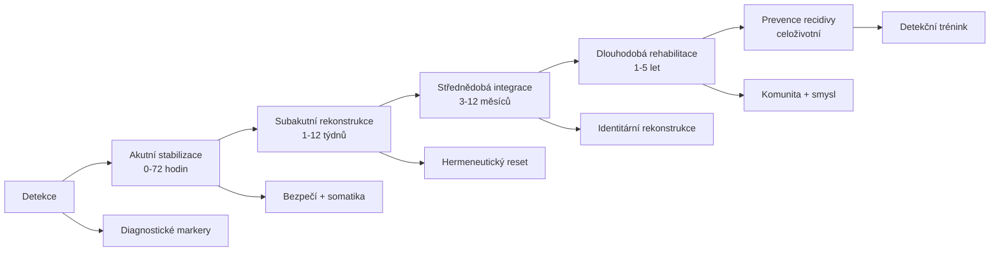
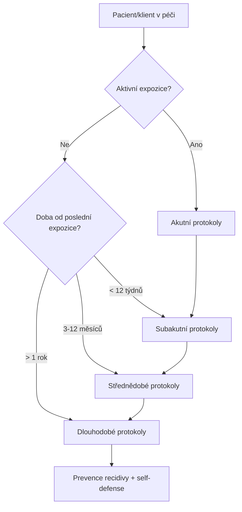

+++
title = "Intervence a obrana"
description = "Komplexní rámec intervenčních a obranných protokolů pro epistemickou anihilaci — od akutní stabilizace přes střednědobou rekonstrukci až po dlouhodobou rehabilitaci a prevenci recidivy. Most mezi klinickou taxonomií a operativní praxí."
weight = 6
sort_by = "weight"
template = "section.html"
insert_anchor_links = "right"

[extra]
draft = false
stub = false
tags = ["kompendium", "intervence", "obrana", "rekonstrukce", "rehabilitace", "klinicke-aplikace", "recovery-protocols"]
categories = ["academic", "clinical"]
section_icon = "🛡️"
toc = true
parent = "kompendium"
access_level = "L1"
status = "publikovano"
+++

# Intervence a obrana

Tato sekce funguje jako **operativní rozcestník** klinických a obranných protokolů kompendia. Strukturu definuje časová osa intervenční práce — **akutní → subakutní → střednědobá → dlouhodobá → preventivní** — a syntetizuje materiál ze tří kanonických zdrojů: [Sekce 06 — Klinické aplikace](@/kompendium/06-klinicke-aplikace/_index.md), [Recovery Protocols](@/kompendium/recovery-protocols/_index.md) a [Self-defense Guides](@/kompendium/self-defense-guides/_index.md).

> **Pozn. k umístění**: Tato stránka je navigační uzel; kanonické protokoly jsou v původních sekcích. Zde se materiál řadí podle časového horizontu a klinické funkce, což je optika, kterou potřebuje terapeut, sociální pracovník nebo bezpečnostní analytik při akutním rozhodování.

## Časová architektura intervence

### Akutní stabilizace (0–72 hodin)

Cílem akutní fáze je **odstranit pokračující expozici** a obnovit základní bezpečí. Žádná hluboká kognitivní práce v této fázi nepřichází v úvahu — subjekt je v dysregulačním stavu, který znemožňuje racionální zpracování.

Klíčové protokoly:

- [Acute safety establishment](@/kompendium/recovery-protocols/acute-safety-establishment.md) — Zajištění fyzického a sociálního bezpečí.
- [Acute somatic regulation](@/kompendium/recovery-protocols/acute-somatic-regulation.md) — Stabilizace autonomního nervového systému, polyvagální přístupy.
- [Acute information curation](@/kompendium/recovery-protocols/acute-information-curation.md) — Omezení epistemické zátěže, kontrola informačního prostředí.
- [Acute cognitive anchoring](@/kompendium/recovery-protocols/acute-cognitive-anchoring.md) — Etablování orientačních kotev (datum, místo, identita).
- [Acute social reconnection](@/kompendium/recovery-protocols/acute-social-reconnection.md) — Obnova kontaktu s důvěryhodnými osobami mimo manipulátorův okruh.

### Subakutní rekonstrukce (1–12 týdnů)

Po stabilizaci přichází fáze **rekonstrukce poznávacího aparátu**. Subjekt je schopen verbálního zpracování, ale jeho [metakognice](@/glossary/metakognice.md) zůstává kompromitovaná.

- [Subacute trust rebuilding](@/kompendium/recovery-protocols/subacute-trust-rebuilding.md) — Obnova schopnosti důvěřovat (sobě, druhým, instituci).
- [Subacute narrative externalization](@/kompendium/recovery-protocols/subacute-narrative-externalization.md) — Externalizace zážitku do narativní formy.
- [Subacute relational restructuring](@/kompendium/recovery-protocols/subacute-relational-restructuring.md) — Rekonfigurace vztahové sítě.
- [Subacute meaning reconstruction](@/kompendium/recovery-protocols/subacute-meaning-reconstruction.md) — Obnova schopnosti přiřazovat smysl.
- [Subacute axiological restoration](@/kompendium/recovery-protocols/subacute-axiological-restoration.md) — Rekonstrukce hodnotového systému.
- [Subacute detection training](@/kompendium/recovery-protocols/subacute-detection-training.md) — První trénink rozpoznávání manipulačních markerů.

### Střednědobá integrace (3–12 měsíců)

Fáze hlubší integrace, kdy se zpracovává identitární a vztahová vrstva:

- [Midterm identity reconstruction](@/kompendium/recovery-protocols/midterm-identity-reconstruction.md) — Rekonstrukce subjektivního self.
- [Midterm hermeneutic reset](@/kompendium/recovery-protocols/midterm-hermeneutic-reset.md) — Reset interpretačního aparátu.
- [Midterm metacognitive rehab](@/kompendium/recovery-protocols/midterm-metacognitive-rehab.md) — Rehabilitace metakognitivních funkcí.
- [Midterm skill rebuilding](@/kompendium/recovery-protocols/midterm-skill-rebuilding.md) — Obnova praktických dovedností.
- [Midterm vocational integration](@/kompendium/recovery-protocols/midterm-vocational-integration.md) — Profesní reintegrace.
- [Midterm educational reintegration](@/kompendium/recovery-protocols/midterm-educational-reintegration.md) — Vzdělávací reintegrace.

### Dlouhodobá rehabilitace (1–5 let)

Hluboká integrace s důrazem na komunitu, smysl a růst:

- [Longterm community rebuilding](@/kompendium/recovery-protocols/longterm-community-rebuilding.md) — Budování trvalé komunitní opory.
- [Longterm meaning deepening](@/kompendium/recovery-protocols/longterm-meaning-deepening.md) — Prohlubování smyslové struktury.
- [Longterm post-traumatic growth](@/kompendium/recovery-protocols/longterm-post-traumatic-growth.md) — Posttraumatický růst.
- [Longterm altruistic channeling](@/kompendium/recovery-protocols/longterm-altruistic-channeling.md) — Kanalizace zkušenosti do pomoci jiným.
- [Longterm resilience cultivation](@/kompendium/recovery-protocols/longterm-resilience-cultivation.md) — Kultivace odolnosti.
- [Longterm relapse prevention](@/kompendium/recovery-protocols/longterm-relapse-prevention.md) — Prevence recidivy.

### Specializované populační protokoly

Pro specifické cílové skupiny existují kalibrované varianty:

| Populace | Protokol | Specifika |
|----------|----------|-----------|
| Děti | [Recovery children protocol](@/kompendium/recovery-protocols/recovery-children-protocol.md) | Vývojová citlivost, opatrovník |
| Adolescenti | [Recovery adolescent protocol](@/kompendium/recovery-protocols/recovery-adolescent-protocol.md) | Identitární vývoj, peer skupina |
| Senioři | [Recovery elder protocol](@/kompendium/recovery-protocols/recovery-elder-protocol.md) | Kognitivní rezerva, izolace |
| Post-kult | [Recovery cult extraction protocol](@/kompendium/recovery-protocols/recovery-cult-extraction-protocol.md) | Komunitní extrakce, BITE rozpad |
| Oběti obchodu s lidmi | [Recovery trafficking survivor protocol](@/kompendium/recovery-protocols/recovery-trafficking-survivor-protocol.md) | Komplexní trauma, právní rovina |
| Političtí vězni | [Recovery political prisoner protocol](@/kompendium/recovery-protocols/recovery-political-prisoner-protocol.md) | Ideologická indoktrinace, exil |

## Defenzivní vrstva — Self-defense

Paralelně s klinickými intervenčními protokoly existuje **preventivní obranná vrstva** určená pro běžnou populaci, která dosud nebyla cílem systematické manipulace, ale chce se na ni připravit:

- [Self-defense guides](@/kompendium/self-defense-guides/_index.md) — Praktické příručky pro občany, novináře, akademiky.
- [Detection signatures](@/kompendium/detection-signatures/_index.md) — Operativní signatury pro automatickou detekci.
- [Quick reference](@/kompendium/quick-reference/_index.md) — Pokladní referenční karta detekčních markerů.

## Volba intervenční úrovně

## Indikace pro multidisciplinární tým

Závažné případy vyžadují koordinovanou práci:

| Rola | Funkce |
|------|--------|
| **Klinický psycholog** | Diagnostika, terapie, výzkum |
| **Psychiatr** | Psychofarmakologie, diferenciální diagnostika |
| **Sociální pracovník** | Sociální opora, právní zastoupení, ubytování |
| **Právník** | Ochrana práv, restraining orders, dokumentace |
| **Bezpečnostní analytik** | Hodnocení pokračující hrozby, OSINT |
| **Komunitní podpora** | Peer-skupiny, mentoring přeživších |

## Vztah k ostatním sekcím

| Vazba | Charakter |
|-------|-----------|
| ← [03 Základní kategorie](@/kompendium/03-zakladni-kategorie/_index.md) | Identifikace expozice |
| ← [04 Terminální protokoly](@/kompendium/04-terminalni-protokoly/_index.md) | Závažnost expozice |
| ← [06 Klinické aplikace](@/kompendium/06-klinicke-aplikace/_index.md) | Diagnostický rámec |
| → [Recovery protocols](@/kompendium/recovery-protocols/_index.md) | Detailní protokoly |
| → [Self-defense guides](@/kompendium/self-defense-guides/_index.md) | Preventivní vrstva |
| → [Emergency protocols](@/kompendium/emergency-protocols/_index.md) | Krizové postupy |

## Související

- [Hub kompendia](@/kompendium/_index.md)
- [Vulnerabilní populace](@/kompendium/06-klinicke-aplikace/vulnerabilni-populace.md)
- [Population health](@/kompendium/population-health/_index.md) — populační rovina
- [Glossary](@/glossary/_index.md)
