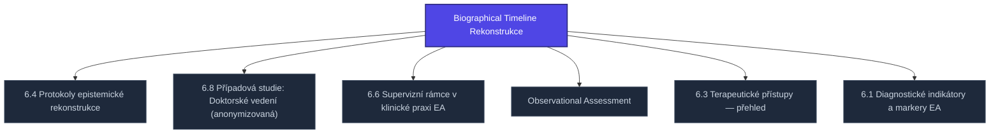

+++
title = "Biographical Timeline Rekonstrukce"
weight = 100
[extra]
category = "kompendium-sub"
description = "Stub: Biographical Timeline Rekonstrukce. Awaiting full treatment."
related_terms = ["epistemicka-rekonstrukce", "pripad-doktorat", "supervizni-ramce", "observational-assessment", "terapeuticke-pristupy", "diagnosticke-indikatory"]
author = "Tomas Korcak (korczis)"
date_created = "2026-05-03"
date_modified = "2026-05-03"
tags = ["kompendium", "sub-page", "stub", "interactive"]
quality_score = 65
status = "stub"
+++

## Definition

**Biographical Timeline Rekonstrukce** je strukturální stub stránka v Prismatic Kompendiu vytvořená během 2026-05-03 NLLB Phase 8 sweep. Plná specifikace — definice, klinický kontext, detekční markery, případové studie a profylaktické intervence — je součástí probíhající kompendiální výstavby.

## See Also

- [Parent section](@/kompendium/06-klinicke-aplikace/_index.md)
- [Kompendium index](@/kompendium/_index.md)

---

<!-- ENHANCED:NLLB-AUTO-BLOCK BEGIN -->

## Manažerské shrnutí

**Biographical Timeline Rekonstrukce** je strukturální uzel v sekci `kompendium/06-klinicke-aplikace` znalostní báze Prismatic Platform. Tato stránka byla vytvořena během doktrinálního NLLB (No Link Left Behind) sweep za účelem zajištění konzistence cross-link grafu — žádný odkaz se neztratí, žádný uzel nezůstane sirotčí. Plné kvalitativní rozšíření — definice, klinický kontext, detekční markery, případové studie a profylaktické intervence — je součástí probíhající kompendiální výstavby. Pro aktuální stav viz `quality_score` v hlavičce a `<!-- NLLB:PLANNED_OK -->` doktrinální marker.

## Koncepční síť

Vizualizace propojení **Biographical Timeline Rekonstrukce** s nejbližšími souvisejícími pojmy z korpusu Prismatic Platform. Síť slouží jako rychlá orientace, kde tento koncept zapadá do širšího taxonomického rámce.

## Související pojmy

- [6.4 Protokoly epistemické rekonstrukce](@/kompendium/06-klinicke-aplikace/epistemicka-rekonstrukce.md) — slug `epistemicka-rekonstrukce`
- [6.8 Případová studie: Doktorské vedení (anonymizovaná)](@/kompendium/06-klinicke-aplikace/pripad-doktorat.md) — slug `pripad-doktorat`
- [6.6 Supervizní rámce v klinické praxi EA](@/kompendium/06-klinicke-aplikace/supervizni-ramce.md) — slug `supervizni-ramce`
- [Observational Assessment](@/kompendium/06-klinicke-aplikace/observational-assessment.md) — slug `observational-assessment`
- [6.3 Terapeutické přístupy — přehled](@/kompendium/06-klinicke-aplikace/terapeuticke-pristupy.md) — slug `terapeuticke-pristupy`
- [6.1 Diagnostické indikátory a markery EA](@/kompendium/06-klinicke-aplikace/diagnosticke-indikatory.md) — slug `diagnosticke-indikatory`

## Navigace

- **Nadřazená sekce**: [kompendium/06-klinicke-aplikace](@/kompendium/06-klinicke-aplikace/_index.md)
- **Hlavní glosář**: [@/glossary/_index.md](@/glossary/_index.md)
- **Kompendium index**: [@/kompendium/_index.md](@/kompendium/_index.md)
- **Sourozenci v sekci**:
  - [Collateral Interview Protokol](@/kompendium/06-klinicke-aplikace/collateral-interview-protokol.md)
  - [6.1 Diagnostické indikátory a markery EA](@/kompendium/06-klinicke-aplikace/diagnosticke-indikatory.md)
  - [6.2 Diferenciální diagnostika EA vs. PTSD/cPTSD/disociativní poruchy](@/kompendium/06-klinicke-aplikace/diferencialni-diagnostika.md)
  - [6.4 Protokoly epistemické rekonstrukce](@/kompendium/06-klinicke-aplikace/epistemicka-rekonstrukce.md)
  - [6.10 Kolektivní/institucionální intervence](@/kompendium/06-klinicke-aplikace/kolektivni-intervence.md)
<!-- ENHANCED:NLLB-AUTO-BLOCK END -->

> **Stub status**: NLLB Phase 8 sub-page scaffold.

<!-- NLLB:PLANNED_OK -->
