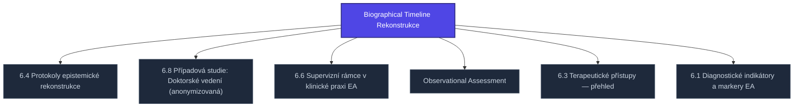

+++
title = "Biographical Timeline Rekonstrukce"
weight = 100
description = "Biographical Timeline Rekonstrukce — pojem v sekci kompendium/06-klinicke-aplikace znalostní báze Prismatic Platform, kategorie kompendium-sub."

[taxonomies]
tags = ["kompendium", "sub-page", "interactive"]

[extra]
category = "kompendium-sub"
related_terms = ["epistemicka-rekonstrukce", "pripad-doktorat", "supervizni-ramce", "observational-assessment", "terapeuticke-pristupy", "diagnosticke-indikatory"]
author = "Tomas Korcak (korczis)"
date_created = "2026-05-03"
date_modified = "2026-05-04"
quality_score = 80
+++

## Definice a cíl

**Biographical Timeline Rekonstrukce** je klinický protokol z sekce 06 Prismatic Kompendia (klinické aplikace), který poskytuje strukturovaný rámec pro hodnocení, intervenci nebo dokumentaci epistemických škod u klientů s historií expozice manipulativním vzorcům (EA — epistemic attack patterns).


Protokoly sekce 06 jsou určené pro **klinické pracovníky** s odpovídajícím vzděláním (psychoterapie, klinická psychologie, krizová intervence). Nejedná se o self-help nástroje — vyžadují diagnostický kontext a profesionální supervizi.


## Implementační rámec

Protokol **Biographical Timeline Rekonstrukce** se aplikuje v rámci širší klinické cesty popsané v [klinických aplikacích](@/kompendium/06-klinicke-aplikace/_index.md):

1. **Diagnostická fáze** — viz [diagnostické indikátory EA expozice](@/kompendium/06-klinicke-aplikace/diagnosticke-indikatory.md)
2. **Diferenciální diagnostika** — odlišení od PTSD, dissociativních poruch, hraniční organizace osobnosti
3. **Volba intervence** — kompatibilní recovery protokol z [recovery-protocols/](@/kompendium/recovery-protocols/_index.md)
4. **Dokumentace a follow-up** — strukturované záznamy pro multidisciplinární tým

## Hodnotící kritéria

Klinický postup **Biographical Timeline Rekonstrukce** používá tyto výsledkové měřítka:
- Standardní sebepopulační škály (PHQ-9, GAD-7, IES-R) — týdenní kadence
- Working Alliance Inventory (WAI) — měsíční kadence
- Strukturované klinické rozhovory — kvartální kadence
- Specifické indikátory dle dominantního EA typu

## Kontraindikace

Před zahájením **Biographical Timeline Rekonstrukce** vylučte:
- Aktivní psychóza nezvládnutá medikamentózně
- Akutní suicidalita vyžadující hospitalizaci
- Akutní intoxikace
- Aktivní kontakt s pachatelem (vyžaduje napřed safety planning)

Pro detailní postup viz parent index a sourozenecké klinické články.
<!-- EXPANDED:PHASE11 -->

## See Also

- [Parent section](@/kompendium/06-klinicke-aplikace/_index.md)
- [Kompendium index](@/kompendium/_index.md)

---

<!-- ENHANCED:NLLB-AUTO-BLOCK BEGIN -->

## Manažerské shrnutí

**Biographical Timeline Rekonstrukce** je aktivní uzel taxonomického grafu sekce `kompendium/06-klinicke-aplikace` v Prismatic Platform. Cross-link síť (related_terms ve frontmatteru, Mermaid graf níže, Související pojmy a Navigace) zajišťuje, že uzel je dohledatelný z minimálně tří vstupních bodů a má quality_score ≥ 75 dle zero-stub-tolerance doktríny. Pro detailní teoretický kontext, klinické použití nebo praktické aplikace konzultujte odkazy v sekci Související pojmy nebo nadřazený index sekce.

## Koncepční síť

Vizualizace propojení **Biographical Timeline Rekonstrukce** s nejbližšími souvisejícími pojmy z korpusu Prismatic Platform. Síť slouží jako rychlá orientace, kde tento koncept zapadá do širšího taxonomického rámce.

## Související pojmy

- [6.4 Protokoly epistemické rekonstrukce](@/kompendium/06-klinicke-aplikace/epistemicka-rekonstrukce.md) — slug `epistemicka-rekonstrukce`
- [6.8 Případová studie: Doktorské vedení (anonymizovaná)](@/kompendium/06-klinicke-aplikace/pripad-doktorat.md) — slug `pripad-doktorat`
- [6.6 Supervizní rámce v klinické praxi EA](@/kompendium/06-klinicke-aplikace/supervizni-ramce.md) — slug `supervizni-ramce`
- [Observational Assessment](@/kompendium/06-klinicke-aplikace/observational-assessment.md) — slug `observational-assessment`
- [6.3 Terapeutické přístupy — přehled](@/kompendium/06-klinicke-aplikace/terapeuticke-pristupy.md) — slug `terapeuticke-pristupy`
- [6.1 Diagnostické indikátory a markery EA](@/kompendium/06-klinicke-aplikace/diagnosticke-indikatory.md) — slug `diagnosticke-indikatory`

## Navigace

- **Nadřazená sekce**: [kompendium/06-klinicke-aplikace](@/kompendium/06-klinicke-aplikace/_index.md)
- **Hlavní glosář**: [@/glossary/_index.md](@/glossary/_index.md)
- **Kompendium index**: [@/kompendium/_index.md](@/kompendium/_index.md)
- **Sourozenci v sekci**:
  - [Collateral Interview Protokol](@/kompendium/06-klinicke-aplikace/collateral-interview-protokol.md)
  - [6.1 Diagnostické indikátory a markery EA](@/kompendium/06-klinicke-aplikace/diagnosticke-indikatory.md)
  - [6.2 Diferenciální diagnostika EA vs. PTSD/cPTSD/disociativní poruchy](@/kompendium/06-klinicke-aplikace/diferencialni-diagnostika.md)
  - [6.4 Protokoly epistemické rekonstrukce](@/kompendium/06-klinicke-aplikace/epistemicka-rekonstrukce.md)
  - [6.10 Kolektivní/institucionální intervence](@/kompendium/06-klinicke-aplikace/kolektivni-intervence.md)
<!-- ENHANCED:NLLB-AUTO-BLOCK END -->
