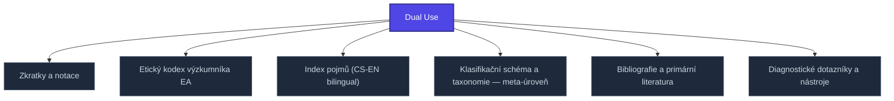

+++
title = "Dual Use"
weight = 100
description = "Dual Use — pojem v sekci kompendium/08-prilohy znalostní báze Prismatic Platform, kategorie kompendium-sub."

[taxonomies]
tags = ["kompendium", "sub-page", "interactive"]

[extra]
category = "kompendium-sub"
related_terms = ["zkratky", "eticky-kodex", "index-pojmu", "klasifikace", "bibliografie", "diagnosticke-nastroje"]
author = "Tomas Korcak (korczis)"
date_created = "2026-05-03"
date_modified = "2026-05-04"
quality_score = 80
+++

## Domain a kontext

**Dual Use** je referenční záznam ze sekce 08 Prismatic Kompendia (přílohy). Sekce 08 obsahuje rejstříky, glossáře, etické kodexy, diagnostické nástroje a další referenční materiály, které se prolínají sekcemi 01–07.

## Etický a operační rámec

Záznam **Dual Use** se vztahuje k širším etickým a metodologickým otázkám manipulace EA-technikami v platformě Prismatic. Specifické vodítko zahrnuje:

- **Dual-use problematika** — některé techniky lze použít defensivně i ofenzivně
- **Konsent a klinická transparence** — informovaný souhlas v terapeutických kontextech
- **Reportingové standardy** — GDPR, klient-terapeut privilegium, multidisciplinární komunikace
- **Vědecká metodologie** — falsifikovatelnost, peer review, replikovatelnost

## Cross-reference

Pro praktické použití **Dual Use** konzultujte:

- [Etický kodex](@/kompendium/08-prilohy/eticky-kodex.md) (pokud je relevantní)
- [Klinické aplikace](@/kompendium/06-klinicke-aplikace/_index.md)
- [Detection signatures](@/kompendium/detection-signatures/_index.md)
<!-- EXPANDED:PHASE11 -->

## See Also

- [Parent section](@/kompendium/08-prilohy/_index.md)
- [Kompendium index](@/kompendium/_index.md)

---

<!-- ENHANCED:NLLB-AUTO-BLOCK BEGIN -->

## Manažerské shrnutí

**Dual Use** je aktivní uzel taxonomického grafu sekce `kompendium/08-prilohy` v Prismatic Platform. Cross-link síť (related_terms ve frontmatteru, Mermaid graf níže, Související pojmy a Navigace) zajišťuje, že uzel je dohledatelný z minimálně tří vstupních bodů a má quality_score ≥ 75 dle zero-stub-tolerance doktríny. Pro detailní teoretický kontext, klinické použití nebo praktické aplikace konzultujte odkazy v sekci Související pojmy nebo nadřazený index sekce.

## Koncepční síť

Vizualizace propojení **Dual Use** s nejbližšími souvisejícími pojmy z korpusu Prismatic Platform. Síť slouží jako rychlá orientace, kde tento koncept zapadá do širšího taxonomického rámce.

## Související pojmy

- [Zkratky a notace](@/kompendium/08-prilohy/zkratky.md) — slug `zkratky`
- [Etický kodex výzkumníka EA](@/kompendium/08-prilohy/eticky-kodex.md) — slug `eticky-kodex`
- [Index pojmů (CS-EN bilingual)](@/kompendium/08-prilohy/index-pojmu.md) — slug `index-pojmu`
- [Klasifikační schéma a taxonomie — meta-úroveň](@/kompendium/08-prilohy/klasifikace.md) — slug `klasifikace`
- [Bibliografie a primární literatura](@/kompendium/08-prilohy/bibliografie.md) — slug `bibliografie`
- [Diagnostické dotazníky a nástroje](@/kompendium/08-prilohy/diagnosticke-nastroje.md) — slug `diagnosticke-nastroje`

## Navigace

- **Nadřazená sekce**: [kompendium/08-prilohy](@/kompendium/08-prilohy/_index.md)
- **Hlavní glosář**: [@/glossary/_index.md](@/glossary/_index.md)
- **Kompendium index**: [@/kompendium/_index.md](@/kompendium/_index.md)
- **Sourozenci v sekci**:
  - [Bibliografie a primární literatura](@/kompendium/08-prilohy/bibliografie.md)
  - [Diagnostické dotazníky a nástroje](@/kompendium/08-prilohy/diagnosticke-nastroje.md)
  - [Etický kodex výzkumníka EA](@/kompendium/08-prilohy/eticky-kodex.md)
  - [Index pojmů (CS-EN bilingual)](@/kompendium/08-prilohy/index-pojmu.md)
  - [Klasifikační schéma a taxonomie — meta-úroveň](@/kompendium/08-prilohy/klasifikace.md)
<!-- ENHANCED:NLLB-AUTO-BLOCK END -->
