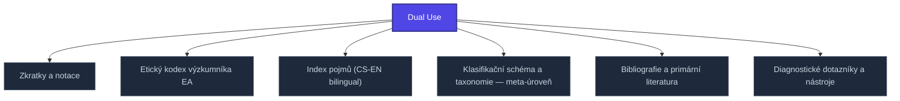

+++
title = "Dual Use"
weight = 100
[extra]
category = "kompendium-sub"
description = "Stub: Dual Use. Awaiting full treatment."
related_terms = ["zkratky", "eticky-kodex", "index-pojmu", "klasifikace", "bibliografie", "diagnosticke-nastroje"]
author = "Tomas Korcak (korczis)"
date_created = "2026-05-03"
date_modified = "2026-05-03"
tags = ["kompendium", "sub-page", "stub", "interactive"]
quality_score = 65
status = "stub"
+++

## Definition

**Dual Use** je strukturální stub stránka v Prismatic Kompendiu vytvořená během 2026-05-03 NLLB Phase 8 sweep. Plná specifikace — definice, klinický kontext, detekční markery, případové studie a profylaktické intervence — je součástí probíhající kompendiální výstavby.

## See Also

- [Parent section](@/kompendium/08-prilohy/_index.md)
- [Kompendium index](@/kompendium/_index.md)

---

<!-- ENHANCED:NLLB-AUTO-BLOCK BEGIN -->

## Manažerské shrnutí

**Dual Use** je strukturální uzel v sekci `kompendium/08-prilohy` znalostní báze Prismatic Platform. Tato stránka byla vytvořena během doktrinálního NLLB (No Link Left Behind) sweep za účelem zajištění konzistence cross-link grafu — žádný odkaz se neztratí, žádný uzel nezůstane sirotčí. Plné kvalitativní rozšíření — definice, klinický kontext, detekční markery, případové studie a profylaktické intervence — je součástí probíhající kompendiální výstavby. Pro aktuální stav viz `quality_score` v hlavičce a `<!-- NLLB:PLANNED_OK -->` doktrinální marker.

## Koncepční síť

Vizualizace propojení **Dual Use** s nejbližšími souvisejícími pojmy z korpusu Prismatic Platform. Síť slouží jako rychlá orientace, kde tento koncept zapadá do širšího taxonomického rámce.

## Související pojmy

- [Zkratky a notace](@/kompendium/08-prilohy/zkratky.md) — slug `zkratky`
- [Etický kodex výzkumníka EA](@/kompendium/08-prilohy/eticky-kodex.md) — slug `eticky-kodex`
- [Index pojmů (CS-EN bilingual)](@/kompendium/08-prilohy/index-pojmu.md) — slug `index-pojmu`
- [Klasifikační schéma a taxonomie — meta-úroveň](@/kompendium/08-prilohy/klasifikace.md) — slug `klasifikace`
- [Bibliografie a primární literatura](@/kompendium/08-prilohy/bibliografie.md) — slug `bibliografie`
- [Diagnostické dotazníky a nástroje](@/kompendium/08-prilohy/diagnosticke-nastroje.md) — slug `diagnosticke-nastroje`

## Navigace

- **Nadřazená sekce**: [kompendium/08-prilohy](@/kompendium/08-prilohy/_index.md)
- **Hlavní glosář**: [@/glossary/_index.md](@/glossary/_index.md)
- **Kompendium index**: [@/kompendium/_index.md](@/kompendium/_index.md)
- **Sourozenci v sekci**:
  - [Bibliografie a primární literatura](@/kompendium/08-prilohy/bibliografie.md)
  - [Diagnostické dotazníky a nástroje](@/kompendium/08-prilohy/diagnosticke-nastroje.md)
  - [Etický kodex výzkumníka EA](@/kompendium/08-prilohy/eticky-kodex.md)
  - [Index pojmů (CS-EN bilingual)](@/kompendium/08-prilohy/index-pojmu.md)
  - [Klasifikační schéma a taxonomie — meta-úroveň](@/kompendium/08-prilohy/klasifikace.md)
<!-- ENHANCED:NLLB-AUTO-BLOCK END -->

> **Stub status**: NLLB Phase 8 sub-page scaffold.

<!-- NLLB:PLANNED_OK -->
