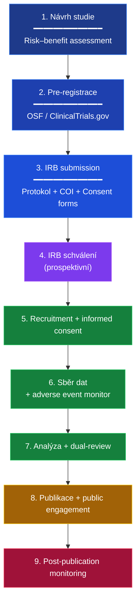

+++
title = "Etický kodex výzkumníka EA"
description = "12-bodový etický kodex pro výzkumníky epistemické anihilace adaptovaný z norem APA, IRB, Helsinské deklarace a Belmont Report — operacionalizace pro vědecký a klinický výzkum, který zkoumá manipulaci, manipulátory a zranitelné subjekty."
weight = 5
sort_by = "weight"

[extra]
related_terms = ["diagnosticke-nastroje", "dual-use", "index-pojmu", "klasifikace"]
kompendium = ["08-prilohy"]
prilohy = ["etika", "kodex", "irb"]
section_icon = "⚖️"
toc = true
insert_anchor_links = "right"
parent = "kompendium-08-prilohy"
access_level = "L1-L4"
status = "complete"
+++

# Etický kodex výzkumníka EA

> **12-bodový kodex výzkumné a klinické etiky** pro doménu epistemické a kognitivní anihilace. Adaptováno ze standardů APA Ethics Code, Belmont Report (1979), Helsinské deklarace (rev. 2013) a institucionálních IRB norem. Slouží jako referenční rámec pro institucionální etický přezkum a pro samotné výzkumníky.

## Preambule

Výzkum epistemické anihilace zkoumá **techniky destrukce poznávání**. Subjekt výzkumu je často:

1. **Zranitelný** — pacient po expozici, oběť kultu, traumatizovaný jedinec.
2. **Kompromitovaný v kapacitě informovaného souhlasu** — důsledek samotných technik, které se zkoumají.
3. **Stigmatizovaný** — externí prostředí může výzkumný kontakt interpretovat negativně.

Současně výzkumník zkoumá **techniky, které lze zneužít**. Existuje tedy trvalé napětí mezi:

- **Veřejným zájmem** na poznání těchto technik (defenzivní motivace).
- **Rizikem zneužití** zveřejněného poznání (ofenzivní zneužití).

Tento kodex operacionalizuje cestu mezi těmito riziky. Není to seznam pravidel — je to **závazek vůči etické praxi**.

---

## 12 bodů kodexu

### 1. Primum non nocere

> **Především neškodit.** Žádný výzkum, žádná intervence, žádná publikace, která by mohla pacientovi/subjektu/čtenáři způsobit *předvídatelnou* škodu, nesmí být provedena. Pokud existuje pochybnost, převažuje princip neškození.

**Operacionalizace**:
- Pre-registr výzkumu zahrnuje **risk assessment** s explicitními kategoriemi rizik.
- Každá publikace prochází **dual-review** — vědecký + etický recenzent.
- Per-technique články kompendia obsahují **defensive framing** (detekce, ne návod).

### 2. Informovaný souhlas

> **Plné porozumění a dobrovolný souhlas** všech zúčastněných. Souhlas musí být explicitní, písemný, kdykoliv odvolatelný, a musí pokrývat: účel výzkumu, použité metody, předvídatelná rizika, alternativy, právo na odstoupení bez následků.

**Operacionalizace**:
- Souhlas je **dvoustupňový**: obecný (vstup do výzkumu) + specifický (každá rizikovější procedura).
- U pacientů s narušenou kapacitou souhlasu (vážná disociace, psychotické symptomy) je výzkum **odložen** nebo prováděn **jen pro účely klinické péče**, ne pro výzkumné publikace.
- **Re-konsensus**: po stabilizaci pacient potvrzuje, že souhlasí se zveřejněním dat získaných během fáze, kdy mohl mít narušenou kapacitu.

### 3. Epistemická integrita subjektů

> **Ochrana kognitivních kapacit a autonomie** subjektů výzkumu. Výzkum *o manipulaci* nesmí *manipulovat*. Žádné deceptivní elementy, žádné indukce kognitivních biasů, žádné induced state experimenty bez nezávislé etické revize.

**Operacionalizace**:
- **Zákaz indukčních experimentů** mimo přísně kontrolované adversariální simulace ([Color Teams](@/glossary/color-teams.md)) s placebo-kontrolou a okamžitou debrífáží.
- Pokud je deception nezbytný (vzácné, vyžaduje IRB schválení): **debriefing** musí být úplný, okamžitý, a doprovázený nabídkou klinické podpory.

### 4. Transparentní limitace

> **Explicitní hranice** legitimního využití. Výzkumník musí znát a komunikovat limity svých závěrů: vzorek, metoda, kontext, kulturně-specifické faktory. Žádná univerzalizace bez evidence.

**Operacionalizace**:
- Každá publikace obsahuje sekci **"Limitations"** s minimálně 5 explicitními limitacemi.
- Per-technique články uvádějí **kontextovou validitu** (kde technika působí, kde ne).

### 5. Defenzivní orientace publikace

> **Veškeré publikované poznání slouží defenzivnímu, diagnostickému a edukativnímu účelu** — nikoliv jako návod k aplikaci. Tento princip není rétorický — je strukturální. Texty jsou psány s důrazem na **detekci**, **neutralizaci** a **rezilienci**, ne na **provedení**.

**Operacionalizace**:
- Každá technika obsahuje **detekční markery** (≥ 3) a **neutralizační strategie** (≥ 2).
- Per-technique články obsahují **diagnostické indikátory**, ne **operační návody**.
- Technika je publikována, **až když** je publikována i její neutralizace.

### 6. Anonymizace a důvěrnost

> **Plná anonymizace** všech klinických a výzkumných případů. Identifikační údaje (jméno, lokace, charakteristické biografické detaily) nahrazeny pseudonymy nebo agregovány. Souhlas s publikací jednotlivého případu vyžaduje **revoluční stupeň souhlasu** a periodické re-konzensus.

**Operacionalizace**:
- Datová pipeline využívá **k-anonymity** (k ≥ 5) a **differential privacy** technik.
- Případové studie kombinují více reálných případů do **prototypických scénářů**, které jsou klinicky pravdivé, ale nereferují k jednotlivci.

### 7. Konflikty zájmů

> **Plné disclosure** finančních, institucionálních a osobních konfliktů zájmů. Žádný výzkumník s aktivní vazbou na high-control skupinu nebo na komerční zájem na výsledku nesmí být primárním investigatorem v souvisejícím výzkumu.

**Operacionalizace**:
- COI deklarace je součástí každé publikace.
- Granty a financování explicitně uvedeny.
- Recenzenti deklarují potenciální COI před přijetím recenzního závazku.

### 8. Respekt k subjektu jako celku

> **Respekt k osobnostní integritě** subjektů. Pacient/subjekt není **datový bod** — je osoba s vlastní biografií, hodnotami, vztahy. Výzkum nesmí redukovat osobu na proměnné.

**Operacionalizace**:
- Klinický výzkum vyžaduje **kvalitativní složku** (interview, narativ) doprovázející kvantitativní data.
- Pacient má právo na **kopii vlastních dat** a na vysvětlení interpretace.
- **Restorativní kontakt**: Po skončení výzkumu pacient dostává shrnutí ve čtenářsky srozumitelné formě.

### 9. Spravedlivý výběr účastníků

> **Spravedlivý výběr** subjektů — žádné nadměrné zatížení zranitelných populací. Nábor se nesoustředí na jediný demografický segment, pokud výzkumná otázka neodůvodňuje opak.

**Operacionalizace**:
- Stratifikované sampling rámce.
- Dokumentace procesu náboru a důvody pro inkluzi/exkluzi.
- Periodický audit demografického profilu studovaných populací.

### 10. Bezpečnost, riziko a IRB dohled

> **Externí etický dohled** institucionální revizní komisí (IRB / Etický komitét). Výzkumník nemůže být sám sobě etickým arbitrem. Veškerý výzkum přesahující rutinní klinickou praxi vyžaduje **prospektivní** IRB schválení a **periodický** monitoring.

**Operacionalizace**:
- IRB protokol pre-registrován.
- Adverse events nahlášeny do **48 hodin** od zjištění.
- **Roční review** všech aktivních protokolů.
- **DSMB (Data Safety Monitoring Board)** pro výzkumy s vyšším rizikem.

### 11. Odpovědnost za zveřejnění

> **Odpovědnost přesahuje publikaci.** Výzkumník nese odpovědnost za to, jak je jeho práce čtena, citována a používána. To zahrnuje aktivní práci s rizikem dezinterpretace.

**Operacionalizace**:
- **Press release** doprovázející publikaci je formulován s důrazem na defenzivní rámec.
- **Erratum** publikováno v případě zneužití nebo dezinterpretace.
- **Public engagement** (přednášky, vzdělávání) doplňuje pasivní zveřejnění.

### 12. Sebereflexe a pokora

> **Permanentní sebereflexe.** Výzkumník epistemické anihilace zkoumá fenomén, kterého **sám není imunní**. Vlastní paradigma, instituce, identifikace — vše může být vektor zkreslení. Pokora je strukturní podmínka tohoto výzkumu, ne ozdoba.

**Operacionalizace**:
- **Peer supervision** (≥ měsíčně) s nezávislým kolegou.
- **Reflexivní deník** výzkumníka jako součást metodologie.
- **Ochota k revizi**: výzkumník publikuje **změny vlastního názoru** s plnou transparentností.

---

## Operativní rámec — workflow IRB

## Sankce za porušení kodexu

| Stupeň porušení | Sankce |
|-----------------|--------|
| **Drobné** (formální chyba, opomenutí v COI) | Erratum + edukativní intervence |
| **Středně závažné** (nedostatečný informovaný souhlas) | Pozastavení výzkumu + IRB review |
| **Závažné** (deceptivní postupy, ignorování adverse events) | Ukončení výzkumu + institucionální sankce |
| **Kritické** (ofenzivní použití technik mimo výzkumný rámec) | Trestní oznámení + profesní zákaz |

## Vztah k jiným etickým rámcům

Tento kodex je **kompatibilní s** a **rozšiřuje** následující rámce:

- **APA Ethics Code** (American Psychological Association)
- **Belmont Report** (1979) — Respect for Persons, Beneficence, Justice
- **Helsinská deklarace** (WMA, rev. 2013)
- **CIOMS Guidelines** for International Health Research
- **GDPR** (EU 2016/679) — pro datovou ochranu
- **Etické směrnice ČR** (Český národní etický komitét)

## Cross-referencing s dalšími přílohami

- [Bibliografie](@/kompendium/08-prilohy/bibliografie.md) — primární prameny pro etické rámce.
- [Diagnostické nástroje](@/kompendium/08-prilohy/diagnosticke-nastroje.md) — etické předpoklady použití instrumentů.
- [Klasifikační schéma](@/kompendium/08-prilohy/klasifikace.md) — dimenze rizika ovlivňující IRB klasifikaci.
- [Rejstřík technik](@/kompendium/08-prilohy/rejstrik-technik.md) — úrovně přístupu (L1–L4) a etické předpoklady per kapitola.

## Platformový kontext

- [Color Teams](@/glossary/color-teams.md) — Red Team adversariální simulace operuje pod tímto kodexem.
- {{ cross_link(path="/hub/dd/decisions/", text="Decision Engine") }} — kalibrace důvěry respektuje epistemické autonomie.
- [NABLA Infinity](@/glossary/nabla-infinity.md) — L11–L13 epistemic pipeline implementuje epistemic integrity.
- [Philosophy: Epistemic Integrity](@/philosophy/epistemic-integrity.md) — filozofický základ tohoto kodexu.

## ⚡ Kritický krok

**Tato příloha je referenční nástroj** — není k četbě od začátku do konce.
Místo lineární četby:

1. Identifikuj **konkrétní termín / techniku / nástroj**, který právě potřebuješ
2. Použij vyhledávání (Cmd+F / Ctrl+F) v této stránce
3. Pokud nenajdeš, zkontroluj [glossary](@/glossary/_index.md) a [rejstřík technik](@/kompendium/08-prilohy/rejstrik-technik.md)

> **Mandatorní akce**: použití přílohy bez konkrétní otázky je obvykle
> formou prokrastinace. Definuj si nejprve, **co hledáš**, teprve pak
> otevři přílohu.

## 🔗 Křížové odkazy

### V této sekci

- [Bibliografie a primární literatura](@/kompendium/08-prilohy/bibliografie.md)
- [Diagnostické dotazníky a nástroje](@/kompendium/08-prilohy/diagnosticke-nastroje.md)
- [Index pojmů (CS-EN bilingual)](@/kompendium/08-prilohy/index-pojmu.md)
- [Klasifikační schéma a taxonomie — meta-úroveň](@/kompendium/08-prilohy/klasifikace.md)
- [Kompletní rejstřík technik (master index)](@/kompendium/08-prilohy/rejstrik-technik.md)

### Klíčové orientační body

- [Hub kompendia](@/kompendium/_index.md) — návrat na úvodní rozcestník
- [Glossary](@/glossary/_index.md) — terminologický slovník
- [Bibliografie](@/kompendium/08-prilohy/bibliografie.md) — primární zdroje
- [Etický kodex](@/kompendium/08-prilohy/eticky-kodex.md) — povinné rámce použití

---

## Connect & Contribute

**Created by [Tomáš Korcak (korczis)](https://github.com/korczis)** | Open Source under [GHL](https://github.com/korczis/prismatic-platform/blob/main/LICENSE)

- [GitHub](https://github.com/korczis/prismatic-platform) | [GitLab](https://gitlab.com/korczis/prismatic-platform) | [LinkedIn](https://linkedin.com/in/korczis) | [Contact](mailto:[e-mail odstraněn])
- [Hub kompendia](@/kompendium/_index.md) | [Přílohy](@/kompendium/08-prilohy/_index.md) | [Předmluva](@/kompendium/01-predmluva/_index.md) | [Glossary](@/glossary/_index.md) | [Philosophy](@/philosophy/_index.md) | [Developer Portal](@/developers/_index.md)
