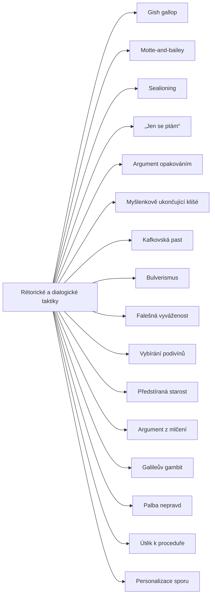

+++
title = "Rétorické a dialogické taktiky"
description = "Rodina taktik, které nekazí úsudek, ale rozhovor: zahlcení, vyhýbání se závazku, zneplatnění osoby a zkreslení obrazu sporu. Jak je poznat a jak na ně odpovědět."
weight = 7
sort_by = "weight"
template = "kompendium/section.html"
page_template = "kompendium/page.html"
insert_anchor_links = "right"

[extra]
tags = ["fauly", "fauly-dialekticke-taktiky"]
categories = ["academic"]
toc = true
lang = "cs"
keywords = ["Rétorické a dialogické taktiky", "Rhetorical and dialogical tactics", "Argumentační fauly"]
schema_type = "DefinedTermSet"
catalog = "fauly"
catalog_schema = 1
catalog_export = "data/fauly-katalog.json"
catalog_family = "dialekticke-taktiky"
catalog_code = "07"
catalog_en = "Rhetorical and dialogical tactics"
catalog_size = 16
catalog_members = ["gish-gallop", "motte-and-bailey", "sealioning", "jen-se-ptam", "argument-opakovanim", "myslenkove-ukoncujici-klise", "kafkapast", "bulverismus", "falesna-vyvazenost", "vybirani-podivinu", "predstirana-starost", "argument-z-mlceni", "galileuv-gambit", "palba-nepravd", "odvedeni-k-procedure", "personalizace-sporu"]
catalog_types = ["informal", "tactic"]
catalog_sources = ["bentham-1824", "boykoff-boykoff-2004", "cook-lewandowsky-ecker-2017", "hamblin-1970", "hasher-1977", "lifton-1961", "paul-matthews-2016", "roozenbeek-2022", "walton-1995", "eemeren-grootendorst-1992", "eemeren-grootendorst-2004"]
+++

# Rétorické a dialogické taktiky

## Co rodina zahrnuje

Rodina Rétorické a dialogické taktiky shromažďuje fauly, u kterých chyba neleží v jednom
úsudku, ale v tom, jak se v rozhovoru zachází s druhou stranou, s důkazním břemenem a s
publikem. [Formální klam](@/kompendium/argumentacni-fauly/formalni/formalni-klam.md) lze ukázat na jediném sylogismu a klam relevance na jediném
odstavci. Taktiky této rodiny se zpravidla ukážou až na sledu tahů: na tom, co mluvčí udělá s
odpovědí, kterou dostal, kolik prostoru nechá oponentovi a jak se změní jeho stanovisko, když přijde
námitka. Pragmatická teorie klamu proto posuzuje každý tah v souvislosti s tahy, které mu v dialogu
předcházejí a následují (Walton 1995). Proto jsou to také fauly, které se nejhůře zachycují v citátu
a nejsnáze se
popírají. Kdo je použije, může téměř vždy tvrdit, že se jen ptal, jen opakoval, jen upozornil
nebo jen vyjádřil starost.

Pro přehled lze rodinu rozdělit do čtyř okruhů. První okruh tvoří taktiky zahlcení a
vyčerpání, které využívají nepoměru mezi cenou tvrzení a cenou jeho prověření: [Gish
gallop](@/glossary/gish-gallop.md), [sealioning](@/glossary/sealioning.md), [argument
opakováním](@/kompendium/argumentacni-fauly/dialekticke-taktiky/argument-opakovanim.md) a na
úrovni celých kampaní
[palba nepravd](@/kompendium/argumentacni-fauly/dialekticke-taktiky/palba-nepravd.md). Model palby
nepravd popisuje právě tento nepoměr: velký objem rychle a opakovaně šířených sdělení, u nichž se
nedbá na pravdivost ani na soudržnost (Paul a Matthews 2016). Druhý okruh
tvoří taktiky vyhýbání se závazku, kdy mluvčí sdělí víc, než je ochoten obhájit:
[motte-and-bailey](@/glossary/motte-and-bailey.md), [„jen se
ptám“](@/kompendium/argumentacni-fauly/dialekticke-taktiky/jen-se-ptam.md), [předstíraná
starost](@/kompendium/argumentacni-fauly/dialekticke-taktiky/predstirana-starost.md) a útěk k
proceduře. Třetí okruh tvoří taktiky zneplatnění osoby a její pochybnosti:
[bulverismus](@/kompendium/argumentacni-fauly/dialekticke-taktiky/bulverismus.md),
[kafkovská past](@/kompendium/argumentacni-fauly/dialekticke-taktiky/kafkapast.md),
[myšlenkově ukončující
klišé](@/kompendium/argumentacni-fauly/dialekticke-taktiky/myslenkove-ukoncujici-klise.md) a
personalizace sporu. Čtvrtý okruh tvoří taktiky, které zkreslují obraz sporu samotného, tedy
to, kdo v něm stojí proti komu a s jakou vahou důkazů: [falešná
vyváženost](@/kompendium/argumentacni-fauly/dialekticke-taktiky/falesna-vyvazenost.md),
[vybírání podivínů](@/kompendium/argumentacni-fauly/dialekticke-taktiky/vybirani-podivinu.md),
[argument z mlčení](@/kompendium/argumentacni-fauly/dialekticke-taktiky/argument-z-mlceni.md)
a [Galileův gambit](@/kompendium/argumentacni-fauly/dialekticke-taktiky/galileuv-gambit.md).
Tři hesla, totiž Gish gallop, motte-and-bailey a sealioning, mají v knize už stránku v
glosáři, a katalog proto odkazuje na ni, aby pro jeden pojem nevznikly dvě stránky. Úplný
přehled hesel s jejich identifikátory podává tabulka na konci této stránky.

## Proč samostatná rodina

Mnohé taktiky této rodiny by šlo zařadit jinam. Bulverismus je podobou útoku na osobu,
kafkovská past podobou nefalzifikovatelného tvrzení, „jen se ptám“ příbuzným [sugestivní otázky](@/kompendium/nlp-vzorce/jazykove-vzorce/otazky-misto-tvrzeni.md).
Důvodem pro samostatnou rodinu je, že tyto fauly mají společné to, co jejich logické
příbuzné nemají: fungují jako tahy v dialogu a jejich škodlivost se dá popsat jen s ohledem
na to, k čemu dialog slouží. Tento posun pohledu prosadil Hamblin, který ukázal, že tradiční
učebnicový výklad klamů jako chybných úsudků je neúplný, a navrhl zkoumat klamy v rámci
formální dialektiky, kde mají účastníci závazky a pravidla výměny (Hamblin 1970). Walton na to
navázal pragmatickou teorií klamu, podle níž je klam argumentační technika použitá tak, že
brání dosažení cíle dialogu, a stejný tah může být v jednom typu rozhovoru legitimní a v
jiném klamný (Walton 1995). [Pragma-dialektika](@/kompendium/argumentacni-fauly/teorie-argumentace/pragma-dialektika.md) z toho vyvodila soustavu pravidel kritické
diskuse, jejichž porušení lze u každé taktiky této rodiny ukázat: pravidlo svobody, pravidlo
důkazního břemene, [pravidlo stanoviska](@/kompendium/argumentacni-fauly/teorie-argumentace/pravidlo-stanoviska.md), [pravidlo relevance](@/kompendium/argumentacni-fauly/teorie-argumentace/pravidlo-relevance.md) a [pravidlo uzavření](@/kompendium/argumentacni-fauly/teorie-argumentace/pravidlo-uzavreni.md) (van Eemeren a
Grootendorst 1992). Rodina proto úzce souvisí s rodinou [Principy kritické diskuse a teorie
argumentace](@/kompendium/argumentacni-fauly/teorie-argumentace/_index.md), která tato
pravidla popisuje samostatně, například [pravidlo
svobody](@/kompendium/argumentacni-fauly/teorie-argumentace/pravidlo-svobody.md).

Druhý důvod je praktický. Čtenáři kompendia se s těmito taktikami setkávají v prostředích, kde
na rozhovoru něco závisí: v soudní síni, ve vyšetřování, v terapeutické místnosti, v
recenzním řízení, ve veřejné debatě o zdraví. Tam nestačí poznat, že úsudek je chybný; je
třeba poznat, že rozhovor byl převeden na jinou kolej, a vědět, jak ho vrátit zpět. Walton takový
posun popisuje jako nepřípustný přechod od jednoho typu dialogu k jinému, například od kritické
diskuse k hádce nebo k vyjednávání (Walton 1995).

## Původ

Zájem o taktiky, které vyhrávají spor bez ohledu na pravdu, je starý jako rétorika.
Aristotelés v Sofistických vyvráceních popisoval triky, kterými se dosahuje zdánlivého
vítězství v rozhovoru. Arthur Schopenhauer v nedokončeném spisu o eristické dialektice sepsal
řadu takových obratů, a to s ironickým odstupem od snahy po pravdě; tento katalog postupuje
opačně, protože popisuje strukturu, podle které lze tah poznat, a odpověď, nikoli obrat sám.
Jeremy Bentham sestavil soupis klamů, jimiž se v parlamentní debatě zdržuje, odvádí nebo
umlčuje projednávání návrhů, a rozdělil je podle toho, zda se odvolávají na autoritu, šíří
obavy, způsobují odklad nebo vnášejí zmatek (Bentham 1824). Řada taktik této rodiny, zejména
útěk k proceduře a předstíraná starost, má v Benthamově soupisu své předchůdce.

Moderní názvy pocházejí převážně z posledních desetiletí a z prostředí veřejné debaty a
internetových diskusí. Gish gallop je pojmenován po kreacionistickém debatérovi,
motte-and-bailey po středověkém typu opevnění, sealioning podle webového komiksu a
kafkatrapping podle románu Franze Kafky. Bulverismus pojmenoval C. S. Lewis a myšlenkově
ukončující klišé psychiatr Robert Jay Lifton při studiu myšlenkové reformy (Lifton 1961). Tato
různorodost původu znamená, že názvy nejsou terminologií jedné školy. Katalog je proto
nepřebírá jako hotové kategorie, ale u každého hesla ukazuje, které pravidlo kritické diskuse
tah porušuje.

## Jak rodinu číst defenzivně

Rodina má nejvyšší riziko zneužití v celém katalogu, protože popisuje tahy, ne chyby, a tah
lze teoreticky provést. Kompendium se tomu brání tím, že žádné heslo nepodává taktiku jako
postup. Každé heslo popisuje strukturu, podle které ji pozorovatel pozná, detekční znaky,
odlišení od legitimní argumentace a odpověď. Odlišení vždy stojí na dvojici: tah, ve kterém
taktika působí, a tah, který se mu podobá, ale je legitimní. Tento
kontrast je podstatou defenzivního čtení. Téměř každá taktika této rodiny má poctivé dvojče:
kontrolní dotaz je dvojčetem otázky „jen se ptám“, upozornění na střet zájmů dvojčetem
bulverismu, připomenutí nevyřízené námitky dvojčetem argumentu opakováním, zúžení teze po kritice
dvojčetem ústupu do tvrze. Odpovídá to pragmatické teorii klamu, podle níž je tentýž typ tahu v
jednom užití rozumný a v jiném klamný (Walton 1995). Kdo pozná jen taktiku, ale ne její dvojče,
začne podezírat
každou otázku a každou opakovanou námitku, a tím sám poškodí rozhovor.

Druhou zásadou je posuzovat strukturu, nikoli úmysl. U většiny taktik nelze z jediného výroku
poznat, zda je mluvčí užívá záměrně, a pragmatická teorie klamu ukazuje, že na úmyslu pro
posouzení tahu ani nezáleží: rozhodující je, zda tah brání cíli dialogu (Walton 1995).
Odpověď, která pojmenuje strukturu, je proto silnější než odpověď, která obviňuje ze zlé
víry; ta by sama hrozila sklouznout k bulverismu.

## Stav poznání

Teoretický rámec rodiny je dobře propracovaný: dialogické pojetí klamů, pragmatická teorie a
pragma-dialektika poskytují kritéria, podle kterých lze každou taktiku posoudit (Hamblin
1970; Walton 1995; van Eemeren a Grootendorst 2004). Empirické poznání je nerovnoměrné.
Dobře doložené jsou mechanismy, o které se některé taktiky opírají, zejména efekt iluzorní
pravdy u opakování (Hasher, Goldstein a Toppino 1977) a zkreslující účinek vyvážené prezentace
u novinářského pokrytí vědeckých témat: analýza amerického tisku ukázala, že snaha dát oběma
stranám stejný prostor vedla k zobrazení vědecké shody o změně klimatu jako sporu (Boykoff a
Boykoff 2004). Analýza propagandistického modelu palby nepravd shrnuje, proč objem, rychlost a
opakování působí i bez vnitřní konzistence (Paul a Matthews 2016). Výzkum inokulace dokládá,
že vysvětlení struktury zavádějící techniky předem snižuje její vliv (Cook, Lewandowsky a
Ecker 2017), a to i v prostředí sociální sítě (Roozenbeek a kol. 2022). Pro řadu taktik,
například pro bulverismus, kafkovskou past nebo předstíranou starost, však chybějí přímé
studie a jejich popis stojí na analýze argumentace a na klinických a kvalitativních
pozorováních. Hesla to u každé taktiky výslovně rozlišují.

## Obrana

Obrana proti taktikám této rodiny má společné jádro, které se v jednotlivých heslech
konkretizuje. Prvním prvkem je vrátit rozhovor k závazkům: co přesně mluvčí tvrdí, zda je
ochoten to obhájit a co by tvrzení vyvrátilo. Tento krok odhalí motte-and-bailey, otázku „jen
se ptám“, kafkovskou past i myšlenkově ukončující klišé. Druhým prvkem je hlídat důkazní
břemeno: kdo tvrzení předložil, má ho obhájit, a počet tvrzení, otázek nebo opakování na
tomto rozdělení nic nemění (van Eemeren a Grootendorst 1992). Tento krok chrání před Gish
gallopem, sealioningem a argumentem opakováním. Třetím prvkem je symetrie: stejná měřítka
skepse, výkladu motivu a požadavků na doklady se mají uplatnit na všechny strany. Tento krok
odhalí bulverismus, vybírání podivínů a předstíranou starost. Čtvrtým prvkem je správný obraz
sporu: kolik nezávislých zdrojů a jaká váha důkazů stojí na které straně (Boykoff a Boykoff
2004).

Pro publikum, které výměnu sleduje, je nejúčinnější obranou vysvětlení struktury taktiky,
protože právě znalost struktury podle výzkumu inokulace snižuje její účinek (Cook, Lewandowsky
a Ecker 2017). Instituce se mohou bránit pravidly, která oddělují posouzení obsahu od
posouzení osoby, dávají každé straně prostor k odpovědi a nezaměňují mlčení za souhlas. A
lidé, na které byly taktiky této rodiny uplatňovány dlouhodobě, zejména v uzavřených
skupinách nebo v blízkých vztazích, potřebují víc než argument: prostředí, ve kterém mohou
znovu klást otázky a ve kterém je jejich výpověď brána vážně. Kompendium tento rozměr
rozebírá u [scénářů epistemické
delegitimizace](@/kompendium/03-zakladni-kategorie/kapitola-2.md) a v oddílu o [obraně a
kalibraci](@/kompendium/06-obrana/_index.md).

<!-- kompendium:katalog-vazby:begin (scripts/catalogs.py; neupravovat ručně) -->

## Hesla rodiny

| Kód | Heslo | Anglicky | Druh | Užití | Riziko |
|-----|-------|----------|------|-------|--------|
| `AF-07.01` | [Gish gallop](@/glossary/gish-gallop.md) | Gish gallop | rétorická taktika | převážně záměrná taktika | střední |
| `AF-07.02` | [Motte-and-bailey](@/glossary/motte-and-bailey.md) | Motte-and-bailey | rétorická taktika | chyba i taktika | střední |
| `AF-07.03` | [Sealioning](@/glossary/sealioning.md) | Sealioning | rétorická taktika | převážně záměrná taktika | střední |
| `AF-07.04` | [„Jen se ptám“](@/kompendium/argumentacni-fauly/dialekticke-taktiky/jen-se-ptam.md) | Just asking questions | rétorická taktika | převážně záměrná taktika | vysoké |
| `AF-07.05` | [Argument opakováním](@/kompendium/argumentacni-fauly/dialekticke-taktiky/argument-opakovanim.md) | Argument from repetition | rétorická taktika | chyba i taktika | vysoké |
| `AF-07.06` | [Myšlenkově ukončující klišé](@/kompendium/argumentacni-fauly/dialekticke-taktiky/myslenkove-ukoncujici-klise.md) | Thought-terminating cliché | rétorická taktika | chyba i taktika | vysoké |
| `AF-07.07` | [Kafkovská past](@/kompendium/argumentacni-fauly/dialekticke-taktiky/kafkapast.md) | Kafkatrapping | rétorická taktika | převážně záměrná taktika | vysoké |
| `AF-07.08` | [Bulverismus](@/kompendium/argumentacni-fauly/dialekticke-taktiky/bulverismus.md) | Bulverism | rétorická taktika | chyba i taktika | střední |
| `AF-07.09` | [Falešná vyváženost](@/kompendium/argumentacni-fauly/dialekticke-taktiky/falesna-vyvazenost.md) | False balance | rétorická taktika | chyba i taktika | vysoké |
| `AF-07.10` | [Vybírání podivínů](@/kompendium/argumentacni-fauly/dialekticke-taktiky/vybirani-podivinu.md) | Nutpicking | rétorická taktika | chyba i taktika | střední |
| `AF-07.11` | [Předstíraná starost](@/kompendium/argumentacni-fauly/dialekticke-taktiky/predstirana-starost.md) | Concern trolling | rétorická taktika | převážně záměrná taktika | střední |
| `AF-07.12` | [Argument z mlčení](@/kompendium/argumentacni-fauly/dialekticke-taktiky/argument-z-mlceni.md) | Argument from silence | neformální klam | chyba i taktika | střední |
| `AF-07.13` | [Galileův gambit](@/kompendium/argumentacni-fauly/dialekticke-taktiky/galileuv-gambit.md) | Galileo gambit | neformální klam | chyba i taktika | střední |
| `AF-07.14` | [Palba nepravd](@/kompendium/argumentacni-fauly/dialekticke-taktiky/palba-nepravd.md) | Firehose of falsehood | rétorická taktika | převážně záměrná taktika | vysoké |
| `AF-07.15` | [Útěk k proceduře](@/kompendium/argumentacni-fauly/dialekticke-taktiky/odvedeni-k-procedure.md) | Procedural diversion | rétorická taktika | převážně záměrná taktika | vysoké |
| `AF-07.16` | [Personalizace sporu](@/kompendium/argumentacni-fauly/dialekticke-taktiky/personalizace-sporu.md) | Personalising the dispute | rétorická taktika | chyba i taktika | střední |

## Mapa rodiny

Mapu odvozuje engine katalogů z vazeb „obecnější heslo“; uzel otevře heslo.

<!-- kompendium:katalog-vazby:end -->

## Literatura

- Bentham, J. (1824). *The Book of Fallacies*. London: John and H. L. Hunt.
- Boykoff, M. T., & Boykoff, J. M. (2004). Balance as bias: Global warming and the US prestige press. *Global Environmental Change*, 14(2), 125–136.
- Cook, J., Lewandowsky, S., & Ecker, U. K. H. (2017). Neutralizing misinformation through inoculation: Exposing misleading argumentation techniques reduces their influence. *PLoS ONE*, 12(5), e0175799.
- Hamblin, C. L. (1970). *Fallacies*. London: Methuen.
- Hasher, L., Goldstein, D., & Toppino, T. (1977). Frequency and the conference of referential validity. *Journal of Verbal Learning and Verbal Behavior*, 16(1), 107–112.
- Lifton, R. J. (1961). *Thought Reform and the Psychology of Totalism: A Study of „Brainwashing“ in China*. New York: W. W. Norton.
- Paul, C., & Matthews, M. (2016). *The Russian „Firehose of Falsehood“ Propaganda Model*. Santa Monica: RAND Corporation.
- Roozenbeek, J., van der Linden, S., Goldberg, B., Rathje, S., & Lewandowsky, S. (2022). Psychological inoculation improves resilience against misinformation on social media. *Science Advances*, 8(34), eabo6254.
- Walton, D. N. (1995). *A Pragmatic Theory of Fallacy*. Tuscaloosa: University of Alabama Press.
- van Eemeren, F. H., & Grootendorst, R. (1992). *Argumentation, Communication, and Fallacies: A Pragma-Dialectical Perspective*. Hillsdale: Lawrence Erlbaum.
- van Eemeren, F. H., & Grootendorst, R. (2004). *A Systematic Theory of Argumentation: The Pragma-Dialectical Approach*. Cambridge: Cambridge University Press.

<!-- kompendium:katalog-vazby:begin (scripts/catalogs.py; neupravovat ručně) -->

## Související

- [Argumentační fauly](@/kompendium/argumentacni-fauly/_index.md) – celý katalog a jeho rodiny
- [Klamy jazyka a dvojznačnosti](@/kompendium/argumentacni-fauly/jazykove-klamy/_index.md) – předchozí rodina katalogu
- [Klamy hodnot, přírody a vědy](@/kompendium/argumentacni-fauly/hodnoty-a-veda/_index.md) – další rodina katalogu

<!-- kompendium:katalog-vazby:end -->
