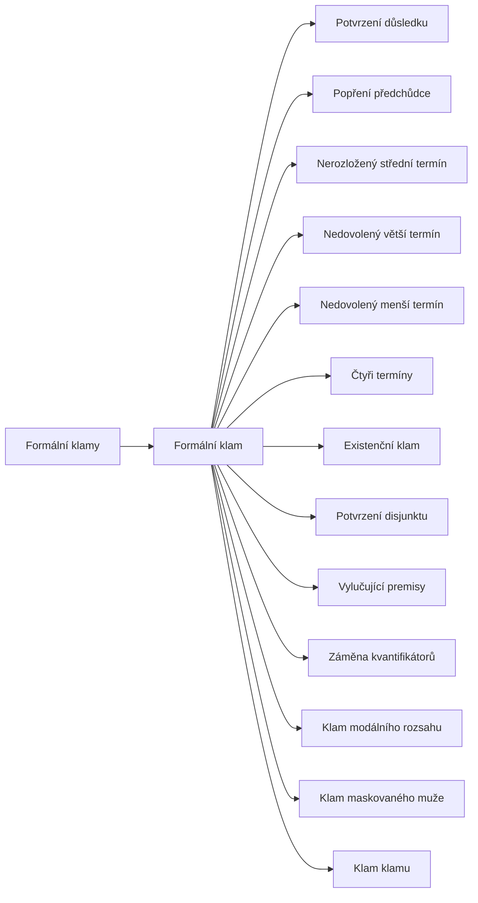

+++
title = "Formální klamy"
description = "Rodina klamů, v nichž závěr z premis neplyne kvůli stavbě úsudku: chyby podmíněných úsudků, sylogismů, kvantifikátorů a modalit, jejich rozpoznání a obrana."
weight = 1
sort_by = "weight"
template = "kompendium/section.html"
page_template = "kompendium/page.html"
insert_anchor_links = "right"

[extra]
tags = ["fauly", "fauly-formalni"]
categories = ["academic"]
toc = true
lang = "cs"
keywords = ["Formální klamy", "Formal fallacies", "Argumentační fauly"]
schema_type = "DefinedTermSet"
catalog = "fauly"
catalog_schema = 1
catalog_export = "data/fauly-katalog.json"
catalog_family = "formalni"
catalog_code = "01"
catalog_en = "Formal fallacies"
catalog_size = 14
catalog_members = ["formalni-klam", "potvrzeni-dusledku", "popreni-predchudce", "nerozlozeny-stredni-termin", "nedovoleny-vetsi-termin", "nedovoleny-mensi-termin", "ctyri-terminy", "existencni-klam", "potvrzeni-disjunktu", "vylucujici-premisy", "zamena-kvantifikatoru", "klam-modalniho-rozsahu", "klam-maskovaneho-muze", "klam-klamu"]
catalog_types = ["concept", "formal"]
catalog_sources = ["cook-lewandowsky-ecker-2017", "copi-cohen-mcmahon-2014", "grice-1975", "hahn-oaksford-2007", "hamblin-1970", "johnson-blair-1977", "kahneman-2011", "mercier-sperber-2011", "mill-1843", "nickerson-1998", "stanovich-west-2000", "whately-1826", "eemeren-grootendorst-2004"]
+++

# Formální klamy

## Co rodinu spojuje

Formální klamy jsou úsudky, jejichž vada leží ve stavbě, a ne v obsahu. Pokud se z nich
odstraní konkrétní slova a ponechá se jen kostra, tedy logické spojky, kvantifikátory a místa
pro termíny, ukáže se, že tatáž kostra může vést od pravdivých premis k nepravdivému závěru.
Úsudek takové formy proto nic nezaručuje, ať je jeho obsah jakkoli věrohodný (Copi, Cohen a
McMahon 2014). Rodina se tím liší od všech ostatních rodin katalogu. U klamů relevance,
předpokladu, kauzality nebo jazyka rozhoduje o chybě obsah a kontext: stejná úvaha může být v
jedné situaci rozumná a v jiné klamavá. U formálních klamů lze vadu prokázat bez znalosti
tématu, protože stačí najít jediný protipříklad stejné formy. Úvodní heslo
[Formální klam](@/kompendium/argumentacni-fauly/formalni/formalni-klam.md) vymezuje pojem a
vysvětluje, proč neplatnost úsudku neznamená, že je jeho závěr nepravdivý. Toto rozlišení
prochází celou rodinou a kompendium ho opakuje záměrně, protože z něj plyne celá obrana:
formální klam odhaluje špatné zdůvodnění, nikoli špatný závěr, a odpověď na něj se proto
týká důvodů, ne osoby ani tématu.

## Výrokové úsudky

První větev rodiny tvoří chyby úsudků se spojkami „jestliže, pak“ a „nebo“. Jejich
společným jádrem je obrácení vztahu, který podmínka nebo disjunkce vyjadřuje.
[Potvrzení důsledku](@/kompendium/argumentacni-fauly/formalni/potvrzeni-dusledku.md) usuzuje
od výskytu důsledku na předchůdce, a stojí tak za mnoha úvahami typu „to přesně sedí“ v
diagnostice, ve vyšetřování a v konspiračním výkladu událostí.
[Popření předchůdce](@/kompendium/argumentacni-fauly/formalni/popreni-predchudce.md) usuzuje
od nepřítomnosti postačující podmínky na nepřítomnost důsledku a zaměňuje postačující
podmínku za nutnou; v praxi se projevuje tím, že se nejnápadnější podoba jevu vydává za jeho
jedinou podobu. [Potvrzení disjunktu](@/kompendium/argumentacni-fauly/formalni/potvrzeni-disjunktu.md)
vyvozuje z platnosti jedné možnosti, že druhá neplatí, ačkoli disjunkce nebyla míněna jako
vylučovací. Všechny tři chyby mají platné protějšky, od nichž se liší jen tím, který člen
vztahu se potvrzuje nebo popírá. Právě tato blízkost je důvodem, proč působí přirozeně.
Pragmatika jazyka k tomu přidává další vysvětlení: v rozhovoru se podmínky a disjunkce často
rozumějí silněji, než jak je logika čte, a posluchač si z nich vyvozuje víc, než bylo
řečeno (Grice 1975). Chyba tedy často vzniká přenesením rozumného čtení z běžného rozhovoru
do situace, kde se rozhoduje o důkazu.

## Kategorické sylogismy

Druhá větev rodiny se týká sylogismů, v nichž se tři termíny spojují přes střední termín.
Platnost tu závisí na rozložení, tedy na tom, zda výrok mluví o všech prvcích třídy, nebo jen
o některých. [Nerozložený střední termín](@/kompendium/argumentacni-fauly/formalni/nerozlozeny-stredni-termin.md)
spojuje dvě třídy jen proto, že sdílejí vlastnost, a je formální kostrou viny asociací.
[Nedovolený větší termín](@/kompendium/argumentacni-fauly/formalni/nedovoleny-vetsi-termin.md)
a [nedovolený menší termín](@/kompendium/argumentacni-fauly/formalni/nedovoleny-mensi-termin.md)
rozšiřují v závěru krajní termín na celou třídu, o níž premisy mluvily jen zčásti; druhý z
nich je formální kostrou stereotypu vytvořeného z vybraného vzorku.
[Čtyři termíny](@/kompendium/argumentacni-fauly/formalni/ctyri-terminy.md) popisují úsudek,
jehož klíčové slovo změní mezi premisami význam, takže sylogismus spojuje věci, které spolu
nesouvisejí. [Existenční klam](@/kompendium/argumentacni-fauly/formalni/existencni-klam.md)
vyvozuje z obecných premis existenci něčeho, o čem premisy nemluví, a
[vylučující premisy](@/kompendium/argumentacni-fauly/formalni/vylucujici-premisy.md) se
pokoušejí vyvodit závěr ze dvou záporných premis, které spolu nemají společný bod. Tradiční
logika tyto chyby uspořádala do soustavy pravidel sylogismu, kterou učebnice předávají dodnes
(Copi, Cohen a McMahon 2014).

## Kvantifikátory, modality a nahraditelnost

Třetí větev se týká chyb, které tradiční sylogistika nezachytila a které popsala až moderní
logika. [Záměna kvantifikátorů](@/kompendium/argumentacni-fauly/formalni/zamena-kvantifikatoru.md)
přehazuje pořadí výroků „pro každé“ a „existuje“, takže z toho, že každý má nějakou příčinu,
se vyvodí, že existuje jedna příčina všeho. Učebnice logiky vykládají teorii kvantifikace jako
rozšíření, které zachycuje i vícenásobně obecné výroky, na něž sylogistika nestačí
(Copi, Cohen a McMahon 2014).
[Klam modálního rozsahu](@/kompendium/argumentacni-fauly/formalni/klam-modalniho-rozsahu.md)
zaměňuje nutnost vztahu mezi premisou a závěrem za nutnost samotného závěru.
[Klam maskovaného muže](@/kompendium/argumentacni-fauly/formalni/klam-maskovaneho-muze.md)
zachází s výroky o tom, co kdo ví nebo čemu věří, jako by v nich šlo libovolně nahrazovat
výrazy se stejným odkazem. Rodinu uzavírá
[klam klamu](@/kompendium/argumentacni-fauly/formalni/klam-klamu.md), tedy úsudek, že závěr je nepravdivý,
protože argument pro něj byl klamný. Toto heslo spojuje formální rodinu s ostatními: ukazuje,
že znalost klamů sama může sloužit jako nástroj sporu, když se z odhalené chyby vyvozuje víc,
než z ní plyne.

## Původ a proměna pojmu

Studium formálních klamů začíná u Aristotela, jehož sylogistika a seznam sofistických
vyvrácení určily rámec logiky na dvě tisíciletí. Novověké učebnice rozlišily klamy logické,
viditelné na formě, od klamů materiálních, které leží v obsahu (Whately 1826). Mill zařadil
chyby sylogismu mezi klamy vyvozování a zároveň namítl, že sylogismus je jen tak dobrý, jak
dobré je zobecnění, na němž stojí jeho obecná premisa (Mill 1843). Ve dvacátém století se
pojem klamu dostal pod kritiku. Hamblin ukázal, že ustálený výklad klamů je nesoudržný a že
formální logika sama nestačí k posouzení skutečných argumentů (Hamblin 1970). Neformální
logika a [pragma-dialektika](@/kompendium/argumentacni-fauly/teorie-argumentace/pragma-dialektika.md) z toho vyvodily, že formální platnost je jen jedno z měřítek
dobrého argumentu; v pravidlech kritické diskuse se objevuje jako [pravidlo platnosti](@/kompendium/argumentacni-fauly/teorie-argumentace/pravidlo-platnosti.md), které
platí pro úsudky předložené jako závazné (van Eemeren a Grootendorst 2004). Formální klamy
tak v moderní teorii argumentace zaujímají zvláštní místo: jsou nejlépe definovanou rodinou
klamů, ale zároveň rodinou, jejíž čisté podoby se v živém sporu vyskytují zřídka a jež je
třeba nejdřív rekonstruovat z neúplných vět (Johnson a Blair 1977).

## Proč formální klamy přesvědčují

Psychologie usuzování ukazuje, že lidé formální chyby nedělají náhodně, ale v předvídatelných
vzorcích. Při ověřování podmínek hledají potvrzující případy a přehlížejí vyvracející; tento
sklon patří do širšího souboru jevů, které Nickerson shrnul pod sklon k potvrzování (Nickerson
1998). Při hodnocení sylogismů posuzují platnost podle věrohodnosti závěru, takže věrohodný
závěr zakryje vadu formy; Kahneman tento jev uvádí jako příklad situace, kdy kontrolující
myšlení nechá intuitivní soud projít bez prověření (Kahneman 2011). Stanovich a West doložili,
že schopnost takovým chybám odolat se mezi lidmi liší a souvisí s kognitivními schopnostmi i s
myšlenkovými dispozicemi (Stanovich a West 2000). Mercier a Sperber nabízejí výklad, proč
lidé v diskusi chyby nacházejí snáz než v osamění: usuzování podle nich slouží především
hodnocení cizích argumentů (Mercier a Sperber 2011). Z toho plyne poznatek, který je pro
obranný rámec knihy podstatný. Formální klam nejlépe funguje tam, kde chybí druhý hlas: v
uzavřeném prostředí, pod časovým tlakem, při únavě a citové zátěži, a tam, kde závěr
odpovídá tomu, co už posluchač předtím chtěl slyšet.

## Jak rodinu číst defenzivně

Formální klamy v manipulaci zřídka stojí samostatně. Obvykle jsou jedním krokem delšího
řetězce, v němž ostatní kroky platné jsou, a právě proto neplatný krok zapadne. Technika
[logické diskontinuity](@/kompendium/techniques/ea-5-1-5-logicka-diskontinuita.md) popisuje
situaci, kdy jednotlivé kroky úvahy působí v izolaci platně, ale celek nedrží. Pro čtenáře
z toho plyne, že hesla rodiny nejsou seznamem chyb k memorování, ale souborem otázek, které
lze položit kterémukoli úsudku: Platí podmínka oběma směry? Mluví premisa o celé třídě, nebo
jen o části? Znamená klíčové slovo v obou větách totéž? Vyplývá ze zjištěné chyby opravdu
nepravdivost závěru? Hahn a Oaksford připomínají opačné riziko: mnohé úvahy, které tradice
označuje za klamy, mohou být za určitých podmínek racionální, a mechanické označování klamů je
proto samo chybou (Hahn a Oaksford 2007). Každé heslo rodiny proto obsahuje oddíl o odlišení od
platné argumentace, které ukazuje platný úsudek podobné formy.

## Obrana

Obrana proti formálním klamům má výhodu, kterou ostatní rodiny nemají: lze ji vést bez sporu
o téma. Protipříklad stejné formy ukáže vadu úsudku, aniž by bylo třeba rozhodnout, kdo má v
původním sporu pravdu. Vyslovení chybějící premisy přesune spor k věcnému tvrzení, které lze
ověřit. Oddělení platnosti od pravdivosti brání tomu, aby se z odhalené chyby vyvodilo víc,
než z ní plyne. Výzkum inokulace naznačuje, že předem poznaná struktura zavádějícího argumentu
ztrácí část své přesvědčivosti (Cook, Lewandowsky a Ecker 2017), a stránka každého hesla proto
popisuje strukturu klamu vedle platného úsudku, který se mu podobá.

<!-- kompendium:katalog-vazby:begin (scripts/catalogs.py; neupravovat ručně) -->

## Hesla rodiny

| Kód | Heslo | Anglicky | Druh | Užití | Riziko |
|-----|-------|----------|------|-------|--------|
| `AF-01.01` | [Formální klam](@/kompendium/argumentacni-fauly/formalni/formalni-klam.md) | Formal fallacy | pojem a princip | výkladový pojem | nízké |
| `AF-01.02` | [Potvrzení důsledku](@/kompendium/argumentacni-fauly/formalni/potvrzeni-dusledku.md) | Affirming the consequent | formální klam | chyba i taktika | střední |
| `AF-01.03` | [Popření předchůdce](@/kompendium/argumentacni-fauly/formalni/popreni-predchudce.md) | Denying the antecedent | formální klam | převážně chyba uvažování | nízké |
| `AF-01.04` | [Nerozložený střední termín](@/kompendium/argumentacni-fauly/formalni/nerozlozeny-stredni-termin.md) | Undistributed middle | formální klam | chyba i taktika | střední |
| `AF-01.05` | [Nedovolený větší termín](@/kompendium/argumentacni-fauly/formalni/nedovoleny-vetsi-termin.md) | Illicit major | formální klam | převážně chyba uvažování | nízké |
| `AF-01.06` | [Nedovolený menší termín](@/kompendium/argumentacni-fauly/formalni/nedovoleny-mensi-termin.md) | Illicit minor | formální klam | převážně chyba uvažování | střední |
| `AF-01.07` | [Čtyři termíny](@/kompendium/argumentacni-fauly/formalni/ctyri-terminy.md) | Four terms | formální klam | chyba i taktika | střední |
| `AF-01.08` | [Existenční klam](@/kompendium/argumentacni-fauly/formalni/existencni-klam.md) | Existential fallacy | formální klam | převážně chyba uvažování | nízké |
| `AF-01.09` | [Potvrzení disjunktu](@/kompendium/argumentacni-fauly/formalni/potvrzeni-disjunktu.md) | Affirming a disjunct | formální klam | chyba i taktika | střední |
| `AF-01.10` | [Vylučující premisy](@/kompendium/argumentacni-fauly/formalni/vylucujici-premisy.md) | Exclusive premises | formální klam | převážně chyba uvažování | nízké |
| `AF-01.11` | [Záměna kvantifikátorů](@/kompendium/argumentacni-fauly/formalni/zamena-kvantifikatoru.md) | Quantifier shift | formální klam | chyba i taktika | střední |
| `AF-01.12` | [Klam modálního rozsahu](@/kompendium/argumentacni-fauly/formalni/klam-modalniho-rozsahu.md) | Modal scope fallacy | formální klam | chyba i taktika | střední |
| `AF-01.13` | [Klam maskovaného muže](@/kompendium/argumentacni-fauly/formalni/klam-maskovaneho-muze.md) | Masked-man fallacy | formální klam | převážně chyba uvažování | střední |
| `AF-01.14` | [Klam klamu](@/kompendium/argumentacni-fauly/formalni/klam-klamu.md) | Argument from fallacy | formální klam | chyba i taktika | střední |

## Mapa rodiny

Mapu odvozuje engine katalogů z vazeb „obecnější heslo“; uzel otevře heslo.

<!-- kompendium:katalog-vazby:end -->

## Literatura

- Cook, J., Lewandowsky, S., & Ecker, U. K. H. (2017). Neutralizing misinformation through inoculation: Exposing misleading argumentation techniques reduces their influence. *PLoS ONE*, 12(5), e0175799.
- Copi, I. M., Cohen, C., & McMahon, K. (2014). *Introduction to Logic* (14. vyd.). Harlow: Pearson.
- Grice, H. P. (1975). Logic and conversation. In P. Cole & J. L. Morgan (Eds.), *Syntax and Semantics 3: Speech Acts* (pp. 41–58). New York: Academic Press.
- Hahn, U., & Oaksford, M. (2007). The rationality of informal argumentation: A Bayesian approach to reasoning fallacies. *Psychological Review*, 114(3), 704–732.
- Hamblin, C. L. (1970). *Fallacies*. London: Methuen.
- Johnson, R. H., & Blair, J. A. (1977). *Logical Self-Defense*. Toronto: McGraw-Hill Ryerson.
- Kahneman, D. (2011). *Thinking, Fast and Slow*. New York: Farrar, Straus and Giroux.
- Mercier, H., & Sperber, D. (2011). Why do humans reason? Arguments for an argumentative theory. *Behavioral and Brain Sciences*, 34(2), 57–74.
- Mill, J. S. (1843). *A System of Logic, Ratiocinative and Inductive*. London: John W. Parker.
- Nickerson, R. S. (1998). Confirmation bias: A ubiquitous phenomenon in many guises. *Review of General Psychology*, 2(2), 175–220.
- Stanovich, K. E., & West, R. F. (2000). Individual differences in reasoning: Implications for the rationality debate? *Behavioral and Brain Sciences*, 23(5), 645–665.
- Whately, R. (1826). *Elements of Logic*. London: J. Mawman.
- van Eemeren, F. H., & Grootendorst, R. (2004). *A Systematic Theory of Argumentation: The Pragma-Dialectical Approach*. Cambridge: Cambridge University Press.

<!-- kompendium:katalog-vazby:begin (scripts/catalogs.py; neupravovat ručně) -->

## Související

- [Argumentační fauly](@/kompendium/argumentacni-fauly/_index.md) – celý katalog a jeho rodiny
- [Klamy relevance](@/kompendium/argumentacni-fauly/relevance/_index.md) – další rodina katalogu

<!-- kompendium:katalog-vazby:end -->
