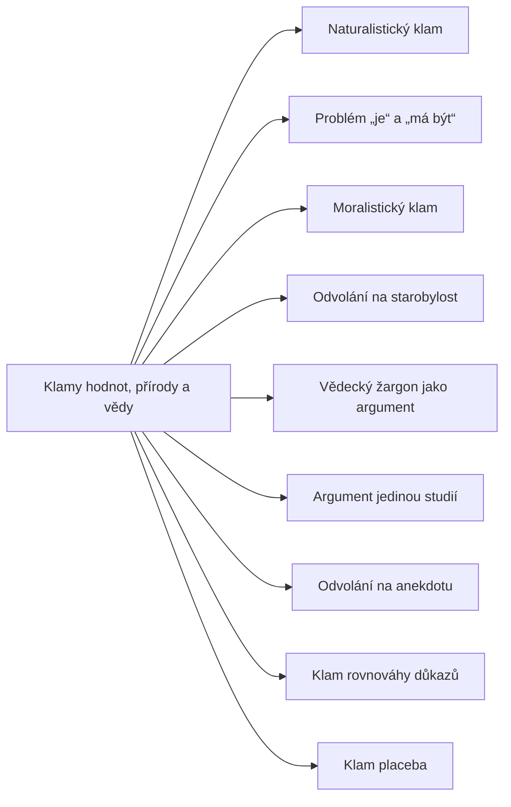

+++
title = "Klamy hodnot, přírody a vědy"
description = "Rodina klamů na hranici faktů a hodnot a v hodnocení vědeckých dokladů: od naturalistického klamu po jedinou studii, anekdotu a placebo."
weight = 8
sort_by = "weight"
template = "kompendium/section.html"
page_template = "kompendium/page.html"
insert_anchor_links = "right"

[extra]
tags = ["fauly", "fauly-hodnoty-a-veda"]
categories = ["academic"]
toc = true
lang = "cs"
keywords = ["Klamy hodnot, přírody a vědy", "Fallacies of value, nature and science", "Argumentační fauly"]
schema_type = "DefinedTermSet"
catalog = "fauly"
catalog_schema = 1
catalog_export = "data/fauly-katalog.json"
catalog_family = "hodnoty-a-veda"
catalog_code = "08"
catalog_en = "Fallacies of value, nature and science"
catalog_size = 9
catalog_members = ["naturalisticky-klam", "je-a-ma-byt", "moralisticky-klam", "odvolani-na-starobylost", "vedecky-zargon", "jeden-studie", "odvolani-na-anekdotu", "klam-rovnovahy-dukazu", "klam-placebo"]
catalog_types = ["concept", "informal", "tactic"]
catalog_sources = ["boykoff-boykoff-2004", "cook-lewandowsky-ecker-2017", "gilovich-1991", "hamblin-1970", "lilienfeld-2015", "mcguire-1964", "mill-1843", "moore-1903", "popper-1959", "tversky-kahneman-1974", "eemeren-grootendorst-1992"]
+++

# Klamy hodnot, přírody a vědy

## Co rodina zahrnuje

Rodina klamů hodnot, přírody a vědy sdružuje chyby, které vznikají na dvou citlivých hranicích
lidského uvažování. První hranice odděluje tvrzení o tom, jak věci jsou, od tvrzení o tom, jak by
být měly. Druhá hranice odděluje doklady, které o tvrzení skutečně něco vypovídají, od vnějších
znaků, které jen budí dojem podloženosti. Obě hranice se v běžné řeči snadno překračují, protože
jazyk faktů a jazyk hodnot se mísí a protože vědecká prestiž se dá napodobit, aniž by se
napodobily kontrolní mechanismy vědy. Klamy této rodiny proto nejsou výsadou neinformovaných;
dopouštějí se jich odborníci, instituce i média, a často v dobré víře.

Rodinu tvoří tři okruhy. Okruh hranice mezi fakty a hodnotami zahrnuje [problém „je“ a „má
být“](@/kompendium/argumentacni-fauly/hodnoty-a-veda/je-a-ma-byt.md), který slouží jako analytický
princip celé rodiny, [naturalistický
klam](@/kompendium/argumentacni-fauly/hodnoty-a-veda/naturalisticky-klam.md), který z přirozenosti
vyvozuje dobro, a jeho zrcadlo, [moralistický
klam](@/kompendium/argumentacni-fauly/hodnoty-a-veda/moralisticky-klam.md), který z hodnot
vyvozuje fakta. Okruh vypůjčené autority zahrnuje [odvolání na
starobylost](@/kompendium/argumentacni-fauly/hodnoty-a-veda/odvolani-na-starobylost.md), v němž
stáří učení zastupuje jeho ověření, a [vědecký žargon jako
argument](@/kompendium/argumentacni-fauly/hodnoty-a-veda/vedecky-zargon.md), v němž zvuk odborného
jazyka zastupuje doklady. Okruh vážení dokladů zahrnuje [argument jedinou
studií](@/kompendium/argumentacni-fauly/hodnoty-a-veda/jeden-studie.md), [odvolání na
anekdotu](@/kompendium/argumentacni-fauly/hodnoty-a-veda/odvolani-na-anekdotu.md), [klam rovnováhy
důkazů](@/kompendium/argumentacni-fauly/hodnoty-a-veda/klam-rovnovahy-dukazu.md) a [klam
placeba](@/kompendium/argumentacni-fauly/hodnoty-a-veda/klam-placebo.md). Tyto čtyři chyby spojuje
to, že doklad v nich existuje a bývá i pravdivý, ale přisuzuje se mu váha, kterou nemá. Úplný
přehled hesel s kódy podává tabulka na konci stránky.

## Původ a souvislosti

Rodina má dva historické kořeny. První vede k filozofické diskusi o vztahu faktů a hodnot. David
Hume ve třetí knize Pojednání o lidské přirozenosti upozornil, že autoři morálních soustav
nepozorovaně přecházejí od vět o tom, co je, k větám o tom, co má být, a že by tento přechod měl
být vysvětlen. John Stuart Mill později rozlišil vědu, která zjišťuje, co je a co z čeho plyne, od
umění praxe, které si stanoví cíl a od vědy přebírá jen poznání prostředků (Mill 1843). George
Edward Moore na začátku dvacátého století zavedl pojem naturalistického klamu pro každou definici
dobra přirozenou vlastností (Moore 1903). Tyto tři myšlenky nejsou totožné, ale společně tvoří
rámec, v němž lze rozpoznat argument, který normu propašuje v podobě faktu nebo fakt v podobě
normy.

Druhý kořen vede k metodologii vědy a k otázce, co dělá doklad dokladem. Francis Bacon a po něm
Mill upozorňovali, že úsudky z vybraných případů přehlížejí případy, které by je vyvrátily, a Mill
v Systému logiky popsal metody srovnání, na nichž dodnes stojí kontrolovaný experiment (Mill 1843).
Karl Popper postavil kritérium vědeckosti na tom, zda teorie zakazuje určitá pozorování, a trval
na tom, že vědecký význam mají jen opakovatelné účinky (Popper 1959). Ve druhé polovině dvacátého
století k tomu psychologie úsudku přidala empirické poznatky o tom, proč lidé tato kritéria
intuitivně porušují. Tversky a Kahneman popsali heuristiku dostupnosti, podle níž živé a snadno
vybavitelné případy ovlivňují odhad četnosti víc, než odpovídá jejich váze (Tversky a Kahneman 1974),
a Gilovich ukázal, jak tyto mechanismy udržují víru v neúčinné postupy (Gilovich 1991). Teorie
argumentace mezitím upozornila, že tradiční seznamy klamů často jen opakovaly staré příklady a
málo vysvětlovaly, proč je úsudek chybný (Hamblin 1970). Hesla této rodiny proto u každého klamu
rekonstruují skrytou premisu, a ne jen připojují nálepku.

## Jak rodinu číst defenzivně

Kompendium popisuje klamy jako vzorce, které má čtenář rozpoznat a umět na ně odpovědět, nikoli
jako techniky, které by měl používat. U této rodiny to má zvláštní význam, protože většina jejích
klamů se v praxi uplatňuje ve sporech o zdraví, o bezpečnost a o hodnotách skupin, tedy tam, kde
omyl nebo manipulace mají vážné následky. Klam placeba a odvolání na anekdotu se objevují v
marketingu neúčinných léčebných postupů, které mohou člověka odvést od léčby s prokázaným účinkem.
Klam rovnováhy důkazů a argument jedinou studií slouží ve veřejných sporech k vytváření dojmu, že
„věda neví“, a tím k odkladu rozhodnutí. Vědecký žargon a odvolání na starobylost se uplatňují ve
skupinách, které staví autoritu vůdce na údajně vědeckém nebo prastarém učení. Naturalistický a
moralistický klam se uplatňují tam, kde skupina přepisuje hodnotová měřítka svých členů nebo
popírá doložené zneužití jen proto, že neodpovídá jejímu obrazu o sobě.

Defenzivní čtení má dvě strany. Na jedné straně jde o to, aby čtenář poznal argument, který si
přisvojuje váhu, kterou nemá. Na druhé straně jde o to, aby kritika klamů sama nesloužila jako
zbraň. Kdo každou osobní výpověď odbude jako anekdotu, každý odkaz na hodnoty jako moralismus a
každé technické vysvětlení jako žargon, nepáchá o nic menší chybu než ten, koho kritizuje. Pro
kompendium je zvlášť důležité, že svědectví člověka o tom, co zažil, je legitimním dokladem o této
události; klamem je teprve zobecnění, které z něj vyvozuje víc, než nese. Každé heslo rodiny proto
obsahuje oddíl, který odlišuje klam od platné argumentace, a příklady v trenéru vždy zahrnují i
neškodný kontrast.

## Vztah k ostatním rodinám katalogu

Klamy této rodiny mají blízké příbuzné v jiných rodinách. Naturalistický klam se překrývá s
[odvoláním na přirozenost](@/kompendium/argumentacni-fauly/relevance/odvolani-na-prirozenost.md) a
odvolání na starobylost s [odvoláním na
tradici](@/kompendium/argumentacni-fauly/relevance/odvolani-na-tradici.md), které katalog řadí
mezi klamy relevance. Vědecký žargon je příbuzný [odvolání na nepatřičnou autoritu](@/kompendium/argumentacni-fauly/relevance/odvolani-na-autoritu.md). Argument
jedinou studií a odvolání na anekdotu stojí vedle ukvapeného zobecnění z rodiny klamů předpokladu
a vedle zákona malých čísel a zavádějící živosti z rodiny statistických klamů. Klam placeba je
zvláštním případem kauzálních klamů, zejména úsudku „[po tom, tedy kvůli tomu](@/kompendium/argumentacni-fauly/kauzalni/post-hoc.md)“ a klamu regrese.
Klam rovnováhy důkazů má protějšek ve falešné vyváženosti z rodiny rétorických a dialogických
taktik. Rozdíl mezi rodinami je v úhlu pohledu: tato rodina sdružuje klamy podle oblasti, ve které
vznikají, tedy podle hranice faktů a hodnot a podle hodnocení vědeckých dokladů, kdežto jiné
rodiny je třídí podle logické struktury chyby.

Pro pragmaticko-dialektickou teorii, kterou katalog rozebírá v rodině principů kritické diskuse,
jsou klamy této rodiny nejčastěji porušením pravidla relevance, pravidla nevyslovené premisy a
pravidla argumentačního schématu (van Eemeren a Grootendorst 1992). Moralistický klam hájí
faktické stanovisko argumentem, který se k němu nevztahuje. Naturalistický klam a nedovolený
přechod od „je“ k „má být“ stojí na nevyslovené premise, kterou by mluvčí po vyslovení nehájil.
Klamy vážení dokladů používají argumentační schémata, jako je argument z odborného názoru nebo ze
svědectví, mimo podmínky, za nichž jsou tato schémata oprávněná. Souvislosti s technikami
kompendia rozvádějí jednotlivá hesla; obecný filozofický rámec, z něhož kniha vychází, popisuje
kapitola [Filosofický rámec](@/kompendium/02-uvod/filosoficky-ramec.md).

## Stav poznání

Klamy této rodiny jsou prozkoumány nerovnoměrně. Hranice mezi fakty a hodnotami je předmětem
trvalého filozofického sporu, který nebyl rozhodnut a pravděpodobně ani nebude; pro posuzování
argumentů však stačí slabší požadavek, aby hodnotící premisa každého argumentu byla viditelná a
mohla být zpochybněna. Klamy vážení dokladů jsou naopak předmětem rozsáhlého empirického výzkumu.
Lilienfeld, Lynn a Lohr shrnuli varovné znaky pseudovědy v klinické psychologii, mezi které patří
spoléhání na svědectví a anekdoty, zatemňující jazyk, nadužívání pomocných hypotéz a nedostatek
sebekorekce (Lilienfeld, Lynn a Lohr 2015); řada hesel této rodiny je podrobným rozborem
jednotlivých znaků. Boykoff a Boykoff doložili, jak novinářská norma vyváženosti zkreslila obraz
vědeckého poznání o klimatu (Boykoff a Boykoff 2004), a Cook, Lewandowsky a Ecker experimentálně
ukázali, že vysvětlení techniky falešné vyváženosti čtenářům předem její účinek neutralizuje
(Cook, Lewandowsky a Ecker 2017). Tento výsledek navazuje na starší teorii inokulace, podle níž
předběžné seznámení s oslabeným argumentem a s jeho vyvrácením zvyšuje odolnost vůči pozdějšímu
přesvědčování (McGuire 1964). Pro rodinu jako celek z výzkumu plyne povzbudivý závěr: struktury,
které hesla popisují, se lze naučit rozpoznávat, a toto rozpoznání má měřitelný ochranný účinek.

## Obrana

Obrana proti klamům této rodiny stojí na několika otázkách, které se dají položit v rozhovoru, v
posudku i při čtení zprávy. U argumentů na hranici faktů a hodnot je to otázka po skryté premise:
co přesně spojuje popsaný stav s doporučením, nebo hodnotu s tvrzením o faktech? U argumentů
vypůjčené autority je to otázka po ověření: jakým způsobem bylo tvrzení testováno, nezávisle na
tom, jak staře nebo odborně zní? U argumentů vážení dokladů je to otázka po celku: jak tento
doklad zapadá do toho, co se o věci ví, s čím byl srovnán a kolik dalších dokladů ukazuje stejným
nebo opačným směrem? Tyto otázky nevyžadují odborné vzdělání v daném oboru a nezpochybňují
upřímnost toho, kdo argumentuje. Vyžadují jen to, aby se argument dal rozložit na části a aby se
každá část posoudila zvlášť.

V institucích, kde se rozhoduje o lidech, se obrana uplatňuje především požadavkem na oddělení
faktických zjištění od hodnotových kritérií a na výslovné uvedení, o jaké doklady se rozhodnutí
opírá. V klinické a poradenské praxi znamená obrana respekt ke zkušenosti člověka spojený s
poctivým vysvětlením, co z ní lze a nelze vyvodit. Pro čtenáře, který se setkal s prostředím, v
němž se fakta podřizovala ideálu skupiny nebo v němž se autorita opírala o neověřitelné učení,
může být užitečné vědět, že otázka „jak to víme?“ není projevem nedůvěry ani neúcty, ale základním
nástrojem poznání, ke kterému má právo každý. Hesla rodiny ukazují, jak tuto otázku formulovat u
jednotlivých klamů, a trenér rozpoznávání umožňuje procvičit ji na příkladech.

<!-- kompendium:katalog-vazby:begin (scripts/catalogs.py; neupravovat ručně) -->

## Hesla rodiny

| Kód | Heslo | Anglicky | Druh | Užití | Riziko |
|-----|-------|----------|------|-------|--------|
| `AF-08.01` | [Naturalistický klam](@/kompendium/argumentacni-fauly/hodnoty-a-veda/naturalisticky-klam.md) | Naturalistic fallacy | neformální klam | chyba i taktika | střední |
| `AF-08.02` | [Problém „je“ a „má být“](@/kompendium/argumentacni-fauly/hodnoty-a-veda/je-a-ma-byt.md) | Is–ought problem | pojem a princip | výkladový pojem | nízké |
| `AF-08.03` | [Moralistický klam](@/kompendium/argumentacni-fauly/hodnoty-a-veda/moralisticky-klam.md) | Moralistic fallacy | neformální klam | chyba i taktika | střední |
| `AF-08.04` | [Odvolání na starobylost](@/kompendium/argumentacni-fauly/hodnoty-a-veda/odvolani-na-starobylost.md) | Appeal to antiquity | neformální klam | chyba i taktika | střední |
| `AF-08.05` | [Vědecký žargon jako argument](@/kompendium/argumentacni-fauly/hodnoty-a-veda/vedecky-zargon.md) | Scientism by jargon | rétorická taktika | převážně záměrná taktika | vysoké |
| `AF-08.06` | [Argument jedinou studií](@/kompendium/argumentacni-fauly/hodnoty-a-veda/jeden-studie.md) | Single-study fallacy | neformální klam | chyba i taktika | střední |
| `AF-08.07` | [Odvolání na anekdotu](@/kompendium/argumentacni-fauly/hodnoty-a-veda/odvolani-na-anekdotu.md) | Anecdotal fallacy | neformální klam | chyba i taktika | střední |
| `AF-08.08` | [Klam rovnováhy důkazů](@/kompendium/argumentacni-fauly/hodnoty-a-veda/klam-rovnovahy-dukazu.md) | Balance-of-evidence fallacy | neformální klam | chyba i taktika | vysoké |
| `AF-08.09` | [Klam placeba](@/kompendium/argumentacni-fauly/hodnoty-a-veda/klam-placebo.md) | Placebo fallacy | neformální klam | chyba i taktika | vysoké |

## Mapa rodiny

Mapu odvozuje engine katalogů z vazeb „obecnější heslo“; uzel otevře heslo.

## Literatura

- Boykoff, M. T., & Boykoff, J. M. (2004). Balance as bias: Global warming and the US prestige press. *Global Environmental Change*, 14(2), 125–136.
- Cook, J., Lewandowsky, S., & Ecker, U. K. H. (2017). Neutralizing misinformation through inoculation: Exposing misleading argumentation techniques reduces their influence. *PLoS ONE*, 12(5), e0175799.
- Gilovich, T. (1991). *How We Know What Isn't So: The Fallibility of Human Reason in Everyday Life*. New York: Free Press.
- Hamblin, C. L. (1970). *Fallacies*. London: Methuen.
- Lilienfeld, S. O., Lynn, S. J., & Lohr, J. M. (Eds.) (2015). *Science and Pseudoscience in Clinical Psychology* (2. vyd.). New York: Guilford Press.
- McGuire, W. J. (1964). Inducing resistance to persuasion: Some contemporary approaches. In L. Berkowitz (Ed.), *Advances in Experimental Social Psychology* (Vol. 1, pp. 191–229). New York: Academic Press.
- Mill, J. S. (1843). *A System of Logic, Ratiocinative and Inductive*. London: John W. Parker.
- Moore, G. E. (1903). *Principia Ethica*. Cambridge: Cambridge University Press.
- Popper, K. R. (1959). *The Logic of Scientific Discovery*. London: Hutchinson.
- Tversky, A., & Kahneman, D. (1974). Judgment under uncertainty: Heuristics and biases. *Science*, 185(4157), 1124–1131.
- van Eemeren, F. H., & Grootendorst, R. (1992). *Argumentation, Communication, and Fallacies: A Pragma-Dialectical Perspective*. Hillsdale: Lawrence Erlbaum.

## Související

- [Argumentační fauly](@/kompendium/argumentacni-fauly/_index.md) – celý katalog a jeho rodiny
- [Rétorické a dialogické taktiky](@/kompendium/argumentacni-fauly/dialekticke-taktiky/_index.md) – předchozí rodina katalogu
- [Principy kritické diskuse a teorie argumentace](@/kompendium/argumentacni-fauly/teorie-argumentace/_index.md) – další rodina katalogu
- [Trenér rozpoznávání](@/kompendium/trener.md) – procvičení rozpoznání hesel této rodiny

<!-- kompendium:katalog-vazby:end -->
