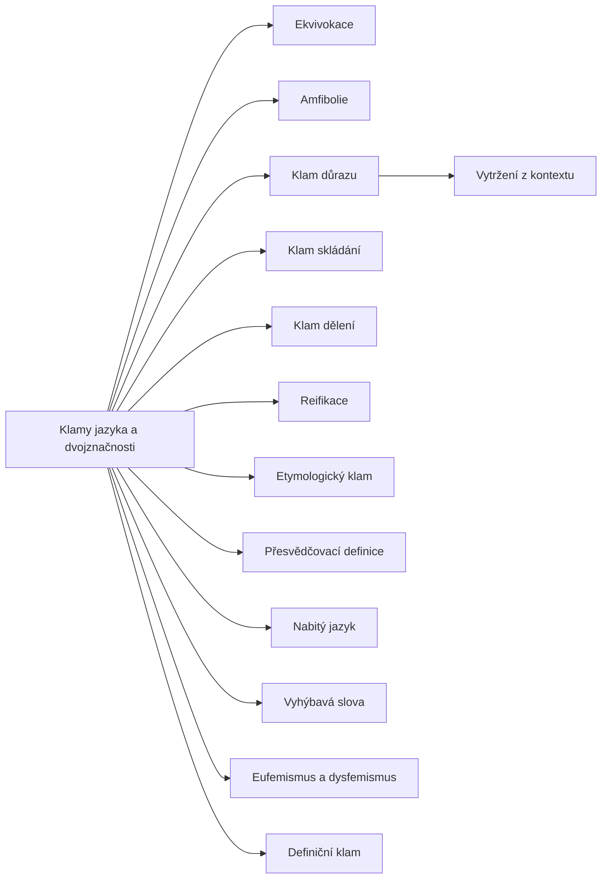

+++
title = "Klamy jazyka a dvojznačnosti"
description = "Rodina klamů, v nichž argument stojí na dvojznačnosti, důrazu, vztahu částí a celku nebo na volbě slov: společná struktura, dějiny, skupiny a obrana."
weight = 6
sort_by = "weight"
template = "kompendium/section.html"
page_template = "kompendium/page.html"
insert_anchor_links = "right"

[extra]
tags = ["fauly", "fauly-jazykove-klamy"]
categories = ["academic"]
toc = true
lang = "cs"
keywords = ["Klamy jazyka a dvojznačnosti", "Fallacies of language and ambiguity", "Argumentační fauly"]
schema_type = "DefinedTermSet"
catalog = "fauly"
catalog_schema = 1
catalog_export = "data/fauly-katalog.json"
catalog_family = "jazykove-klamy"
catalog_code = "06"
catalog_en = "Fallacies of language and ambiguity"
catalog_size = 13
catalog_members = ["ekvivokace", "amfibolie", "klam-duraznu", "klam-skladani", "klam-deleni", "reifikace", "etymologicky-klam", "presvedcovaci-definice", "nabity-jazyk", "vyhybava-slova", "eufemismus-a-dysfemismus", "vytrzeni-z-kontextu", "definicni-klam"]
catalog_types = ["informal", "tactic"]
catalog_sources = ["bandler-grinder-1975b", "bentham-1824", "copi-cohen-mcmahon-2014", "damer-2009", "grice-1975", "hahn-oaksford-2007", "hamblin-1970", "lakoff-johnson-1980", "loftus-palmer-1974", "mill-1843", "robinson-1950", "roozenbeek-2022", "tversky-kahneman-1981", "walton-1995", "eemeren-grootendorst-1992"]
+++

# Klamy jazyka a dvojznačnosti

## Co spojuje klamy jazyka

Klamy této rodiny mají společné to, že jejich síla nepochází z faktů ani z formy úsudku, ale
z jazyka, kterým je argument vysloven. Slovo může mít dva významy, věta dvě skladby,
zdůrazněná část výroku může naznačit, co výrok netvrdí, a označení skupiny může zakrýt, zda
se mluví o celku, nebo o každém jejím členu. V každém z těchto případů vypadá argument
platně jen proto, že jazyk dovoluje vyslovit dvě různé myšlenky stejnými slovy, nebo
vyvolat dojem, který žádná věta výslovně neobsahuje. Učebnice logiky je tradičně
shrnují jako klamy dvojznačnosti a řadí k nim
[ekvivokaci](@/kompendium/argumentacni-fauly/jazykove-klamy/ekvivokace.md),
[amfibolii](@/kompendium/argumentacni-fauly/jazykove-klamy/amfibolie.md),
[klam důrazu](@/kompendium/argumentacni-fauly/jazykove-klamy/klam-duraznu.md),
[klam skládání](@/kompendium/argumentacni-fauly/jazykove-klamy/klam-skladani.md) a
[klam dělení](@/kompendium/argumentacni-fauly/jazykove-klamy/klam-deleni.md) (Copi, Cohen a
McMahon 2014). Kompendium rodinu rozšiřuje o klamy, v nichž jazyk nese hodnocení nebo
zakrývá aktéra: o [reifikaci](@/kompendium/argumentacni-fauly/jazykove-klamy/reifikace.md),
[etymologický klam](@/kompendium/argumentacni-fauly/jazykove-klamy/etymologicky-klam.md),
přesvědčovací a definiční klamy, nabitý jazyk, vyhýbavá slova, eufemismy a vytržení z
kontextu. Všechny tyto jevy spojuje otázka, kterou si čtenář může u každého argumentu
položit: obstál by závěr, kdyby se tytéž myšlenky vyslovily jednoznačně, bez zvýraznění a
neutrálními slovy?

## Od Aristotela ke standardnímu výkladu

Rozlišení klamů závislých na jazyce a klamů na jazyce nezávislých pochází od Aristotela,
který ve spisu o sofistických vyvráceních uvedl šest jazykových zdrojů zdánlivých
vyvrácení: stejnozvučnost slov, dvojznačnou skladbu, spojování, rozdělování, přízvuk a
podobu výrazu. Hamblin podrobně sledoval, jak se tento seznam přenášel středověkou logikou do
novověkých učebnic a jak se během té cesty proměňoval jeho obsah; dnešní klam skládání nebo
klam důrazu proto nejsou totožné s tím, co měl na mysli Aristotelés (Hamblin 1970). Hamblin
zároveň kritizoval to, co nazval standardním výkladem klamů: učebnice podle něj přejímaly
seznam bez teorie, ilustrovaly ho umělými příklady a nevysvětlovaly, proč je daný argument
chybný. Na tuto kritiku navázala moderní teorie argumentace. Mill v devatenáctém století
řadil dvojznačnost termínů ke klamům zmatení, tedy k chybám, které vznikají z nejasného
pojetí toho, o čem se mluví (Mill 1843). Bentham ve své knize o politických klamech
upozornil na slova, která v sobě nesou hodnocení a vydávají ho za popis, i na jména
institucí, která zakrývají konkrétní lidi (Bentham 1824). [Pragma-dialektika](@/kompendium/argumentacni-fauly/teorie-argumentace/pragma-dialektika.md) pak klamy
jazyka spojila s jedním pravidlem kritické diskuse, pravidlem užívání jazyka, podle něhož
strany nesmějí užívat formulace nedostatečně jasné nebo matoucí a mají formulace druhé
strany vykládat co nejpřesněji (van Eemeren a Grootendorst 1992).

## Tři skupiny hesel

Hesla rodiny lze pro orientaci rozdělit do tří skupin. První skupinu tvoří klamy
dvojznačnosti v užším smyslu. Ekvivokace posouvá význam jednoho slova, amfibolie stojí na
dvojí skladbě věty a klam důrazu na tom, která část výroku je zvýrazněna. Společné jim je, že
argument přechází mezi dvěma čteními téhož textu. Pragmatika vysvětluje, proč jsou tak
účinné: posluchač předpokládá, že mluvčí spolupracuje a vyjadřuje se jasně, a proto si
víceznačnosti rychle a bez vědomí vyřeší jedním čtením (Grice 1975). Druhou skupinu tvoří
klamy vztahu části a celku. Skládání přenáší vlastnost z částí na celek, dělení z celku na
části, a oba vycházejí ze záměny kolektivního a distributivního užití výrazu. Tyto klamy
mají blízké statistické příbuzné v ekologickém klamu a v Simpsonově paradoxu, kde se vztahy
mezi proměnnými mění při přechodu mezi úrovněmi agregace (Robinson 1950). Dělení je přitom
v rodině nejrizikovější, protože jeho nejzávažnější podoba, přenášení vlastností skupiny na
jednotlivce, stojí za stereotypy a kolektivní vinou.

Třetí skupinu tvoří klamy vztahu slova k věci a k hodnocení. Reifikace zachází s abstrakcí
jako s věcí nebo jednající bytostí. Etymologický klam vyvozuje dnešní význam a normu z
původu slova. Přesvědčovací a definiční klamy mění definici tak, aby předem rozhodla spor.
Nabitý jazyk, eufemismy a dysfemismy vkládají hodnocení do volby slov, takže posluchač
přijímá hodnocení spolu s popisem. Vyhýbavá slova vytvářejí dojem tvrzení, které mluvčí
nemusí obhajovat, a vytržení z kontextu mění smysl citace tím, co vynechává. Kognitivní
lingvistika ukázala, že volba metafory a pojmenování zvýrazňuje některé stránky věci a jiné
skrývá, a to i tam, kde si toho mluvčí ani posluchač nejsou vědomi (Lakoff a Johnson 1980).
Výzkum rámování doložil, že logicky rovnocenné popisy téže situace vedou k odlišným
rozhodnutím (Tversky a Kahneman 1981).

## Chyba, nebo taktika

Klamy jazyka se vyskytují ve dvou podobách, které je pro čtenáře kompendia důležité
rozlišovat. V první podobě jde o bezděčnou chybu: autor posudku si nevšimne, že slovo
„normální“ užil jednou ve statistickém a jednou v hodnotícím smyslu, nebo pisatel smlouvy
nedomyslí, že věta připouští dvě skladby. V druhé podobě jde o taktiku, která na
dvojznačnosti nebo na zabarvení slov staví záměrně a spoléhá na to, že posluchač si posun
nevšimne. Walton tento rozdíl zachycuje rozlišením mezi chybou uvažování a sofistickou
taktikou, která argument užívá v rozhovoru způsobem, jenž brání jeho cíli (Walton 1995).
Pro odpověď na klam je rozlišení podstatné méně, než by se mohlo zdát. V obou případech je
nejlepší odpovědí vyjasnění: pojmenovat oba významy, obě skladby nebo celý kontext a ukázat,
že závěr v jednoznačném znění neobstojí. Rozdíl se projeví teprve v tom, co následuje.
Kdo se dopustil chyby, vyjasnění přijme a argument opraví. Kdo užívá taktiku, vyjasnění
odmítá, mění téma nebo se k dvojznačnosti vrací. Opakované odmítání jednoznačné formulace je
proto samo o sobě detekčním znakem, který kompendium u řady hesel uvádí. Damer řadí klamy
jazykového zmatení mezi porušení kritéria přijatelnosti premis, což dobře vystihuje jejich
povahu: premisa je přijatelná jen v jednom čtení, závěr potřebuje čtení jiné (Damer 2009).

Pro klinickou, forenzní a právní praxi mají klamy jazyka zvláštní význam, protože v těchto
oborech se z textů vyvozují důsledky pro lidi, kteří u jejich vzniku nebyli. Lékařská zpráva
čtená laikem, záznam výpovědi čtený soudcem nebo posudek čtený úřadem ztrácejí kontext, v
němž vznikly, a víceznačnost, kterou by v rozhovoru rozptýlila jediná otázka, se v psaném
textu stává trvalou. Výzkum svědecké paměti navíc ukázal, že volba jediného slova v otázce
může změnit odpověď svědka i jeho pozdější vzpomínku (Loftus a Palmer 1974). Jasnost
formulace proto v těchto oborech není stylistickou ctností, ale podmínkou spravedlivého
rozhodování.

Kniha se jazykovým mechanismům věnuje i mimo tento katalog. Katalog NLP vzorců popisuje
záměrnou dvojznačnost v takzvaném Milton-modelu, kde se
[syntaktická dvojznačnost](@/kompendium/nlp-vzorce/milton-model/syntakticka-dvojznacnost.md)
nebo [nominalizace](@/kompendium/nlp-vzorce/meta-model/nominalizace.md) užívají k navození
neurčitosti (Bandler a Grinder 1975b), a kapitola o technikách epistemické anihilace popisuje
[narušování stability významů](@/kompendium/techniques/ea-4-3-3-semantic-stability-disruption.md)
jako dlouhodobou strategii, při níž oběť ztrácí jistotu, co slova znamenají. Hesla této
rodiny popisují tytéž jevy z hlediska teorie argumentace: jako vady, které lze v konkrétním
argumentu najít, pojmenovat a odstranit.

## Jak číst hesla rodiny

Každé heslo rodiny popisuje strukturu klamu, jeho detekční znaky, odlišení od platné
argumentace, stav poznání a obranu. Odlišení od platné argumentace je u klamů jazyka zvlášť
důležité, protože přirozený jazyk je víceznačný vždy a všude. Kdo by za klam pokládal každé
víceznačné slovo, každé zdůraznění nebo každou metaforu, nemohl by mluvit vůbec. Teorie
argumentace se proto shoduje, že klamem není víceznačnost sama, ale argument, jehož
přesvědčivost na víceznačnosti závisí (Walton 1995). Bayesovské pojetí neformálních
klamů k tomu dodává, že argumenty stejné podoby se mohou lišit silou podle obsahu a
kontextu, takže posouzení vyžaduje úsudek, nikoli mechanické přiřazení nálepky (Hahn a
Oaksford 2007).

Pro praxi z hesel vyplývá několik obecných zásad. U písemných textů, které budou
vykládat jiní, je prevencí jednoznačná formulace: definovaný klíčový termín, krátké věty s
výslovným činitelem, uvedení relativních i absolutních údajů a citace v úplném znění. U
mluvené argumentace je odpovědí žádost o vyjasnění, převedení naznačeného do výslovné
podoby a návrat k původní tezi. U institucionálních záznamů, jako jsou zdravotnická
dokumentace, protokoly výslechů a znalecké posudky, je obranou věcný styl, který odděluje
pozorování od hodnocení. Výzkum psychologické inokulace ukázal, že lidé, kteří se předem
seznámí s typickými manipulativními postupy, včetně emočně zabarveného jazyka, je pak
spolehlivěji rozpoznávají v nových situacích (Roozenbeek a kol. 2022). Smyslem této rodiny
hesel je právě taková příprava: naučit se vidět, kde argument stojí na slovech místo na
důvodech, a umět to klidně a věcně pojmenovat.

<!-- kompendium:katalog-vazby:begin (scripts/catalogs.py; neupravovat ručně) -->

## Hesla rodiny

| Kód | Heslo | Anglicky | Druh | Užití | Riziko |
|-----|-------|----------|------|-------|--------|
| `AF-06.01` | [Ekvivokace](@/kompendium/argumentacni-fauly/jazykove-klamy/ekvivokace.md) | Equivocation | neformální klam | chyba i taktika | střední |
| `AF-06.02` | [Amfibolie](@/kompendium/argumentacni-fauly/jazykove-klamy/amfibolie.md) | Amphiboly | neformální klam | chyba i taktika | střední |
| `AF-06.03` | [Klam důrazu](@/kompendium/argumentacni-fauly/jazykove-klamy/klam-duraznu.md) | Fallacy of accent | neformální klam | převážně záměrná taktika | střední |
| `AF-06.04` | [Klam skládání](@/kompendium/argumentacni-fauly/jazykove-klamy/klam-skladani.md) | Fallacy of composition | neformální klam | převážně chyba uvažování | střední |
| `AF-06.05` | [Klam dělení](@/kompendium/argumentacni-fauly/jazykove-klamy/klam-deleni.md) | Fallacy of division | neformální klam | chyba i taktika | vysoké |
| `AF-06.06` | [Reifikace](@/kompendium/argumentacni-fauly/jazykove-klamy/reifikace.md) | Reification | neformální klam | chyba i taktika | střední |
| `AF-06.07` | [Etymologický klam](@/kompendium/argumentacni-fauly/jazykove-klamy/etymologicky-klam.md) | Etymological fallacy | neformální klam | chyba i taktika | nízké |
| `AF-06.08` | [Přesvědčovací definice](@/kompendium/argumentacni-fauly/jazykove-klamy/presvedcovaci-definice.md) | Persuasive definition | neformální klam | převážně záměrná taktika | střední |
| `AF-06.09` | [Nabitý jazyk](@/kompendium/argumentacni-fauly/jazykove-klamy/nabity-jazyk.md) | Loaded language | rétorická taktika | převážně záměrná taktika | střední |
| `AF-06.10` | [Vyhýbavá slova](@/kompendium/argumentacni-fauly/jazykove-klamy/vyhybava-slova.md) | Weasel words | rétorická taktika | převážně záměrná taktika | střední |
| `AF-06.11` | [Eufemismus a dysfemismus](@/kompendium/argumentacni-fauly/jazykove-klamy/eufemismus-a-dysfemismus.md) | Euphemism and dysphemism | rétorická taktika | převážně záměrná taktika | vysoké |
| `AF-06.12` | [Vytržení z kontextu](@/kompendium/argumentacni-fauly/jazykove-klamy/vytrzeni-z-kontextu.md) | Quoting out of context | rétorická taktika | převážně záměrná taktika | vysoké |
| `AF-06.13` | [Definiční klam](@/kompendium/argumentacni-fauly/jazykove-klamy/definicni-klam.md) | Definist fallacy | neformální klam | chyba i taktika | nízké |

## Mapa rodiny

Mapu odvozuje engine katalogů z vazeb „obecnější heslo“; uzel otevře heslo.

<!-- kompendium:katalog-vazby:end -->

## Literatura

- Bandler, R., & Grinder, J. (1975b). *Patterns of the Hypnotic Techniques of Milton H. Erickson, M.D., Volume 1*. Cupertino: Meta Publications.
- Bentham, J. (1824). *The Book of Fallacies*. London: John and H. L. Hunt.
- Copi, I. M., Cohen, C., & McMahon, K. (2014). *Introduction to Logic* (14. vyd.). Harlow: Pearson.
- Damer, T. E. (2009). *Attacking Faulty Reasoning: A Practical Guide to Fallacy-Free Arguments* (6. vyd.). Belmont: Wadsworth.
- Grice, H. P. (1975). Logic and conversation. In P. Cole & J. L. Morgan (Eds.), *Syntax and Semantics 3: Speech Acts* (pp. 41–58). New York: Academic Press.
- Hahn, U., & Oaksford, M. (2007). The rationality of informal argumentation: A Bayesian approach to reasoning fallacies. *Psychological Review*, 114(3), 704–732.
- Hamblin, C. L. (1970). *Fallacies*. London: Methuen.
- Lakoff, G., & Johnson, M. (1980). *Metaphors We Live By*. Chicago: University of Chicago Press.
- Loftus, E. F., & Palmer, J. C. (1974). Reconstruction of automobile destruction: An example of the interaction between language and memory. *Journal of Verbal Learning and Verbal Behavior*, 13(5), 585–589.
- Mill, J. S. (1843). *A System of Logic, Ratiocinative and Inductive*. London: John W. Parker.
- Robinson, W. S. (1950). Ecological correlations and the behavior of individuals. *American Sociological Review*, 15(3), 351–357.
- Roozenbeek, J., van der Linden, S., Goldberg, B., Rathje, S., & Lewandowsky, S. (2022). Psychological inoculation improves resilience against misinformation on social media. *Science Advances*, 8(34), eabo6254.
- Tversky, A., & Kahneman, D. (1981). The framing of decisions and the psychology of choice. *Science*, 211(4481), 453–458.
- Walton, D. N. (1995). *A Pragmatic Theory of Fallacy*. Tuscaloosa: University of Alabama Press.
- van Eemeren, F. H., & Grootendorst, R. (1992). *Argumentation, Communication, and Fallacies: A Pragma-Dialectical Perspective*. Hillsdale: Lawrence Erlbaum.

<!-- kompendium:katalog-vazby:begin (scripts/catalogs.py; neupravovat ručně) -->

## Související

- [Argumentační fauly](@/kompendium/argumentacni-fauly/_index.md) – celý katalog a jeho rodiny
- [Statistické a pravděpodobnostní klamy](@/kompendium/argumentacni-fauly/statisticke/_index.md) – předchozí rodina katalogu
- [Rétorické a dialogické taktiky](@/kompendium/argumentacni-fauly/dialekticke-taktiky/_index.md) – další rodina katalogu
- [Trenér rozpoznávání](@/kompendium/trener.md) – procvičení rozpoznání hesel této rodiny

<!-- kompendium:katalog-vazby:end -->
