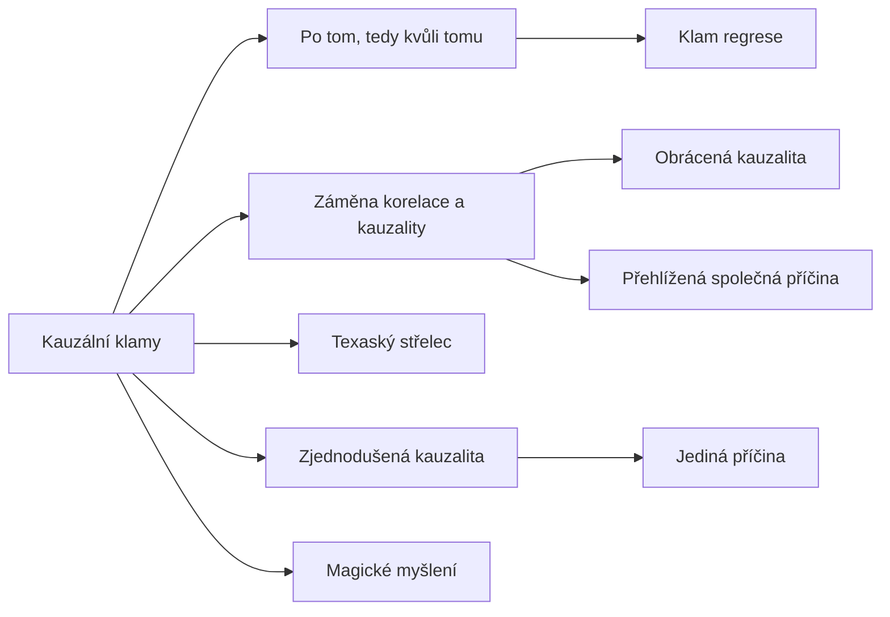

+++
title = "Kauzální klamy"
description = "Rodina klamů, které chybně usuzují na příčinu: posloupnost, souběh, směr, společná příčina, shluk, regrese, zjednodušení a magické působení, s obranou proti nim."
weight = 4
sort_by = "weight"
template = "kompendium/section.html"
page_template = "kompendium/page.html"
insert_anchor_links = "right"

[extra]
tags = ["fauly", "fauly-kauzalni"]
categories = ["academic"]
toc = true
lang = "cs"
keywords = ["Kauzální klamy", "Causal fallacies", "Argumentační fauly"]
schema_type = "DefinedTermSet"
catalog = "fauly"
catalog_schema = 1
catalog_export = "data/fauly-katalog.json"
catalog_family = "kauzalni"
catalog_code = "04"
catalog_en = "Causal fallacies"
catalog_size = 9
catalog_members = ["post-hoc", "korelace-a-kauzalita", "jedina-pricina", "obracena-kauzalita", "prehlizena-spolecna-pricina", "texasky-strelec", "klam-regrese", "zjednodusena-kauzalita", "magicke-mysleni"]
catalog_types = ["concept", "informal"]
catalog_sources = ["bandler-grinder-1975", "bandler-grinder-1975b", "cook-lewandowsky-ecker-2017", "gilovich-1991", "herman-1992", "huff-1954", "kahneman-2011", "kunda-1990", "lifton-1961", "lilienfeld-2015", "mercier-sperber-2011", "mill-1843", "popper-1959", "robinson-1950", "simpson-1951", "tversky-kahneman-1974", "watzlawick-1967", "whately-1826"]
+++

# Kauzální klamy

## Co rodina zahrnuje

Kauzální klamy jsou chyby a taktiky, které z pozorování vyvozují příčinný vztah, jejž
pozorování nenese. Patří k nejčastějším vadám každodenní argumentace, protože otázka „proč se
to stalo“ provází téměř každé rozhodnutí: o léčbě, o vině, o politickém opatření, o tom, komu
důvěřovat. Příčinné tvrzení má navíc praktickou sílu, kterou jiná tvrzení nemají. Kdo určí
příčinu, určuje také, co je třeba změnit a kdo nese odpovědnost. Proto se kauzální klamy
vyskytují jak jako poctivé omyly, tak jako nástroje vlivu, a rodina je v katalogu zařazena
samostatně.

Hesla rodiny lze uspořádat do tří okruhů. První okruh tvoří klamy, které zaměňují souvislost s
působením. Klam [po tom, tedy kvůli tomu](@/kompendium/argumentacni-fauly/kauzalni/post-hoc.md)
vyvozuje příčinu z časové posloupnosti, [záměna korelace a
kauzality](@/kompendium/argumentacni-fauly/kauzalni/korelace-a-kauzalita.md) ze souběhu. Dvě
hesla pak popisují nejčastější způsoby, jimiž se souběh mylně vykládá: [obrácená
kauzalita](@/kompendium/argumentacni-fauly/kauzalni/obracena-kauzalita.md) zaměňuje směr vztahu a
[přehlížená společná
příčina](@/kompendium/argumentacni-fauly/kauzalni/prehlizena-spolecna-pricina.md) pomíjí třetí
okolnost, která působí na oba jevy. Druhý okruh tvoří klamy, které zaměňují náhodu s příčinou.
[Texaský střelec](@/kompendium/argumentacni-fauly/kauzalni/texasky-strelec.md) vybírá shluk až po
pohledu na data a [klam regrese](@/kompendium/argumentacni-fauly/kauzalni/klam-regrese.md)
připisuje zásahu návrat extrémních hodnot k průměru. Třetí okruh tvoří klamy, které zkreslují
stavbu příčinného vysvětlení. [Jediná
příčina](@/kompendium/argumentacni-fauly/kauzalni/jedina-pricina.md) stahuje vysvětlení do
jednoho bodu, [zjednodušená
kauzalita](@/kompendium/argumentacni-fauly/kauzalni/zjednodusena-kauzalita.md) redukuje síť
podmínek na lineární řetěz a [magické
myšlení](@/kompendium/argumentacni-fauly/kauzalni/magicke-mysleni.md) připisuje příčinné působení
myšlenkám, přáním a symbolům. Poslední heslo je v katalogu vedeno jako pojem, protože
zastřešuje několik chybných úsudků najednou a má vlastní vývojovou a klinickou historii. Úplný
přehled hesel s jejich kódy podává tabulka na konci této stránky.

## Původ

Logické zkoumání kauzálních klamů je staré jako logika sama. Školská tradice znala klamy post
hoc ergo propter hoc a non causa pro causa a učebnice logiky raného devatenáctého století je
zařazovaly do soustavných výčtů chyb usuzování (Whately 1826). Rozhodující krok však učinila
induktivní logika. Mill formuloval metody experimentálního zkoumání, metodu shody, metodu
rozdílu, metodu zbytků a metodu souběžných změn, a ukázal tím, co je třeba k tomu, aby bylo
možné o příčině oprávněně mluvit (Mill 1843). Zároveň rozebral okolnosti, které usuzování na
příčinu komplikují: mnohost příčin, kdy tentýž následek vzniká různými cestami, a prolínání
účinků, kdy více příčin působí současně. Jeho pojetí příčiny jako souhrnu podmínek, z nichž běžná
řeč vybírá jednu, dodnes slouží jako filozofický základ kritiky jediné příčiny a zjednodušené
kauzality.

Ve dvacátém století přinesla statistika nástroje, které rozlišení mezi souvislostí a působením
zpřesnily: korelační počet, rozdělení dat podle třetí proměnné a náhodné rozdělení do skupin v
experimentu. Dvě klasické práce ukázaly, že i správně spočítaná souvislost může být zavádějící,
pokud se pomine úroveň analýzy nebo třetí proměnná (Robinson 1950; Simpson 1951). Huffova
popularizace představila tyto problémy široké veřejnosti a věnovala klamu post hoc samostatnou
kapitolu (Huff 1954). V sedmdesátých letech pak psychologie úsudku doložila, že kauzální klamy
nejsou jen nedostatkem logického vzdělání, ale soustavným rysem intuitivního myšlení. Tversky a
Kahneman ukázali, že lidé přehlížejí regresi k průměru, vidí iluzorní souvislosti a pro
odchylky v datech vymýšlejí příčinná vysvětlení (Tversky a Kahneman 1974). Gilovich shrnul, jak
tyto mechanismy vytvářejí a udržují pevná, ale nepodložená přesvědčení v každodenním životě
(Gilovich 1991).

## Společná struktura

Všechny klamy rodiny mají společné jádro. Vycházejí ze skutečného pozorování, například z
posloupnosti, souběhu, shluku nebo změny, a vyvozují z něj tvrzení o působení, aniž by vyloučily
alternativní vysvětlení. Alternativ je omezený počet a vyplatí se je znát: náhoda, včetně
regrese k průměru a náhodných shluků; obrácený směr vztahu; společná příčina; výběr, kterým
vznikla data; a souběh více příčin, z nichž byla jmenována jen jedna. Každé heslo rodiny
odpovídá pomíjení jedné nebo několika z těchto alternativ. Proto se i obrana proti nim opírá o
stejnou sadu otázek. Co se stalo tam, kde domnělá příčina chyběla? Mohl vztah vést opačným
směrem? Co dalšího mají případy společné? Jak byla data vybrána a kolik míst se prohledalo? Jaké
další podmínky musely být přítomny? Tyto otázky v podstatě opakují Millovy metody vylučování v
podobě, kterou lze použít v rozhovoru (Mill 1843).

Druhým společným rysem je přesvědčivost příběhu. Kauzální výklad dává událostem smysl a pořadí,
a intuitivní myšlení hodnotí vysvětlení podle koherence, nikoli podle toho, kolik alternativ
vyloučilo. Kahneman popsal, že mysl konstruuje nejlepší možný příběh z toho, co má k dispozici,
a nevnímá, co chybí (Kahneman 2011). Čím jednodušší a ucelenější je příběh, tím silnější je
pocit porozumění. To vysvětluje, proč jsou kauzální klamy tak odolné vůči opravě: oprava
nabízí místo příběhu nejistotu a místo jedné příčiny síť podmínek.

## Jak rodinu číst defenzivně

Pro účely kompendia mají kauzální klamy zvláštní význam ve třech oblastech. První je
legitimizace metod a skupin. Terapeutické, výcvikové a duchovní nabídky se opírají o svědectví
lidí, kterým se po užití metody ulevilo, a pomíjejí přirozený průběh potíží, regresi k průměru a
výběr těch, kdo do programu vstupují. Klinická psychologie proto zdůrazňuje kontrolované srovnání
jako jediný spolehlivý způsob, jak účinek odlišit od těchto vlivů (Lilienfeld, Lynn a Lohr
2015). Druhou oblastí je přesun odpovědnosti ve vztazích. Obrácená kauzalita, jediná příčina a
zjednodušené řetězy se používají k tomu, aby reakce člověka na škodlivé jednání byla vydávána za
jeho příčinu; kompendium tuto soustavnou podobu popisuje jako [kauzální
inverzi](@/kompendium/techniques/ea-5-1-12-kauzalni-inverze.md). Pragmatická teorie komunikace
ukázala, že spory o to, „kdo začal“, vyplývají z odlišné interpunkce sledu událostí a že uvnitř
dvojice je nelze rozhodnout (Watzlawick, Beavin a Jackson 1967); v mocensky nerovném vztahu
však taková nerozhodnutelnost obvykle prospívá silnější straně. Třetí oblastí je uzavřený
výkladový systém. Magické myšlení a nevyvratitelné výklady umožňují skupině nebo autoritě
vysvětlit jakoukoli událost v souladu s doktrínou a připsat neúspěch pochybnostem člena; Lifton
tento rys totalistického prostředí popsal jako nadřazení doktríny osobní zkušenosti (Lifton
1961).

Ve všech třech oblastech je rozhodující, kdo má moc určit příčinu. Kauzální tvrzení, které
pronese autorita, terapeut, vůdce skupiny nebo dominantní partner, má větší váhu než tvrzení
toho, koho se týká, a proto se defenzivní čtení rodiny neomezuje na logický rozbor. Ptá se také,
kdo z výkladu těží, které podmínky z něj vypadly a zda ten, na koho se výklad vztahuje, má
možnost ho zpochybnit. Kunda ukázala, že lidé přijímají vysvětlení, která odpovídají jejich
přáním, pokud je dokáží před sebou obhájit; totéž platí pro toho, kdo výklad nabízí (Kunda 1990).

## Vztah k jiným rodinám a katalogům

Kauzální klamy úzce sousedí se [statistickými a pravděpodobnostními
klamy](@/kompendium/argumentacni-fauly/statisticke/_index.md). [Zkreslený výběr](@/kompendium/argumentacni-fauly/statisticke/zkresleny-vyber.md), zákon malých
čísel, [Simpsonův paradox](@/kompendium/argumentacni-fauly/statisticke/simpsonuv-paradox.md) nebo [ekologický klam](@/kompendium/argumentacni-fauly/statisticke/ekologicky-klam.md) popisují, jak vznikají zavádějící souvislosti v
datech; kauzální klamy popisují, jak se z takových souvislostí vyvozují příčiny. Rodina má
také přímé protějšky v katalogu NLP vzorců. [Meta-model](@/kompendium/nlp-vzorce/meta-model/meta-model.md) zachycuje výroky typu „ty mě nutíš“ jako
kategorii [příčina a následek](@/kompendium/nlp-vzorce/meta-model/pricina-a-nasledek.md)
(Bandler a Grinder 1975) a [Milton-model](@/kompendium/nlp-vzorce/milton-model/milton-model.md) popisuje, jak spojky vytvářejí dojem příčinnosti mezi
pravdivými popisy a žádaným závěrem (Bandler a Grinder 1975b); podrobnosti podává heslo [spojky a implikovaná
příčinnost](@/kompendium/nlp-vzorce/milton-model/spojky-a-implikovana-pricinnost.md). Heuristiky,
které kauzální klamy živí, shrnuje stránka [Tversky a Kahneman:
heuristiky](@/kompendium/techniques/ea-7-3-2-tversky-heuristics.md).

## Obrana

Obrana proti kauzálním klamům nevyžaduje statistické vzdělání, ale návyk klást několik otázek
dřív, než se příčinné tvrzení přijme nebo odmítne. Kde je k dispozici srovnání s případy bez
domnělé příčiny? Bylo pořadí událostí ověřeno? Které další okolnosti se měnily současně? Byla
hypotéza stanovena před pohledem na data? Proč byl zásah nasazen právě v tomto okamžiku? Připouští
výklad výsledek, který by ho vyvrátil (Popper 1959)? Výzkum argumentace ukazuje, že lidé lépe
odhalují slabiny v cizích zdůvodněních než ve vlastních, a že diskuse s lidmi jiného názoru
zlepšuje kvalitu společného úsudku (Mercier a Sperber 2011). Výzkum inokulace naznačuje, že
předem vysvětlená zavádějící technika ztrácí část své přesvědčivosti (Cook, Lewandowsky a Ecker
2017). Obranou je tedy jak vlastní pozornost, tak prostředí, které umožňuje příčinné výklady
klidně zpochybnit. U lidí, na které byl kauzální výklad dlouhodobě uplatňován k přesunu viny,
je obrana zároveň součástí zotavení: znovu získat časovou osu událostí, oddělit vlastní reakce
od jejich příčin a obnovit důvěru ve vlastní úsudek o tom, co co způsobilo (Herman 1992).
Procvičit rozpoznávání jednotlivých hesel na příkladech výroků umožňuje [trenér
rozpoznávání](@/kompendium/trener.md).

<!-- kompendium:katalog-vazby:begin (scripts/catalogs.py; neupravovat ručně) -->

## Hesla rodiny

| Kód | Heslo | Anglicky | Druh | Užití | Riziko |
|-----|-------|----------|------|-------|--------|
| `AF-04.01` | [Po tom, tedy kvůli tomu](@/kompendium/argumentacni-fauly/kauzalni/post-hoc.md) | Post hoc ergo propter hoc | neformální klam | chyba i taktika | střední |
| `AF-04.02` | [Záměna korelace a kauzality](@/kompendium/argumentacni-fauly/kauzalni/korelace-a-kauzalita.md) | Cum hoc ergo propter hoc | neformální klam | chyba i taktika | střední |
| `AF-04.03` | [Jediná příčina](@/kompendium/argumentacni-fauly/kauzalni/jedina-pricina.md) | Fallacy of the single cause | neformální klam | chyba i taktika | střední |
| `AF-04.04` | [Obrácená kauzalita](@/kompendium/argumentacni-fauly/kauzalni/obracena-kauzalita.md) | Reverse causation | neformální klam | chyba i taktika | vysoké |
| `AF-04.05` | [Přehlížená společná příčina](@/kompendium/argumentacni-fauly/kauzalni/prehlizena-spolecna-pricina.md) | Ignoring a common cause | neformální klam | chyba i taktika | střední |
| `AF-04.06` | [Texaský střelec](@/kompendium/argumentacni-fauly/kauzalni/texasky-strelec.md) | Texas sharpshooter | neformální klam | chyba i taktika | střední |
| `AF-04.07` | [Klam regrese](@/kompendium/argumentacni-fauly/kauzalni/klam-regrese.md) | Regression fallacy | neformální klam | převážně chyba uvažování | střední |
| `AF-04.08` | [Zjednodušená kauzalita](@/kompendium/argumentacni-fauly/kauzalni/zjednodusena-kauzalita.md) | Causal oversimplification | neformální klam | chyba i taktika | střední |
| `AF-04.09` | [Magické myšlení](@/kompendium/argumentacni-fauly/kauzalni/magicke-mysleni.md) | Magical thinking | pojem a princip | chyba i taktika | vysoké |

## Mapa rodiny

Mapu odvozuje engine katalogů z vazeb „obecnější heslo“; uzel otevře heslo.

## Literatura

- Bandler, R., & Grinder, J. (1975). *The Structure of Magic I: A Book about Language and Therapy*. Palo Alto: Science and Behavior Books.
- Bandler, R., & Grinder, J. (1975b). *Patterns of the Hypnotic Techniques of Milton H. Erickson, M.D., Volume 1*. Cupertino: Meta Publications.
- Cook, J., Lewandowsky, S., & Ecker, U. K. H. (2017). Neutralizing misinformation through inoculation: Exposing misleading argumentation techniques reduces their influence. *PLoS ONE*, 12(5), e0175799.
- Gilovich, T. (1991). *How We Know What Isn't So: The Fallibility of Human Reason in Everyday Life*. New York: Free Press.
- Herman, J. L. (1992). *Trauma and Recovery*. New York: Basic Books.
- Huff, D. (1954). *How to Lie with Statistics*. New York: W. W. Norton.
- Kahneman, D. (2011). *Thinking, Fast and Slow*. New York: Farrar, Straus and Giroux.
- Kunda, Z. (1990). The case for motivated reasoning. *Psychological Bulletin*, 108(3), 480–498.
- Lifton, R. J. (1961). *Thought Reform and the Psychology of Totalism: A Study of „Brainwashing“ in China*. New York: W. W. Norton.
- Lilienfeld, S. O., Lynn, S. J., & Lohr, J. M. (Eds.) (2015). *Science and Pseudoscience in Clinical Psychology* (2. vyd.). New York: Guilford Press.
- Mercier, H., & Sperber, D. (2011). Why do humans reason? Arguments for an argumentative theory. *Behavioral and Brain Sciences*, 34(2), 57–74.
- Mill, J. S. (1843). *A System of Logic, Ratiocinative and Inductive*. London: John W. Parker.
- Popper, K. R. (1959). *The Logic of Scientific Discovery*. London: Hutchinson.
- Robinson, W. S. (1950). Ecological correlations and the behavior of individuals. *American Sociological Review*, 15(3), 351–357.
- Simpson, E. H. (1951). The interpretation of interaction in contingency tables. *Journal of the Royal Statistical Society, Series B*, 13(2), 238–241.
- Tversky, A., & Kahneman, D. (1974). Judgment under uncertainty: Heuristics and biases. *Science*, 185(4157), 1124–1131.
- Watzlawick, P., Beavin, J. H., & Jackson, D. D. (1967). *Pragmatics of Human Communication*. New York: W. W. Norton.
- Whately, R. (1826). *Elements of Logic*. London: J. Mawman.

## Související

- [Argumentační fauly](@/kompendium/argumentacni-fauly/_index.md) – celý katalog a jeho rodiny
- [Klamy předpokladu](@/kompendium/argumentacni-fauly/predpoklady-argumentu/_index.md) – předchozí rodina katalogu
- [Statistické a pravděpodobnostní klamy](@/kompendium/argumentacni-fauly/statisticke/_index.md) – další rodina katalogu
- [Trenér rozpoznávání](@/kompendium/trener.md) – procvičení rozpoznání hesel této rodiny

<!-- kompendium:katalog-vazby:end -->
