+++
title = "Klamy předpokladu"
description = "Rodina klamů, jejichž vada leží v neoprávněně přijatém výchozím bodě: skryté předpoklady otázek, zobecnění, výběru dokladů a důkazního břemene. Jak je poznat a jak na ně odpovědět."
weight = 3
sort_by = "weight"
template = "kompendium/section.html"
page_template = "kompendium/page.html"
insert_anchor_links = "right"

[extra]
tags = ["fauly", "fauly-predpoklady-argumentu"]
categories = ["academic"]
toc = true
lang = "cs"
keywords = ["Klamy předpokladu", "Fallacies of presumption", "Argumentační fauly"]
schema_type = "DefinedTermSet"
catalog = "fauly"
catalog_schema = 1
catalog_export = "data/fauly-katalog.json"
catalog_family = "predpoklady-argumentu"
catalog_code = "03"
catalog_en = "Fallacies of presumption"
catalog_size = 20
catalog_members = ["kruhovy-argument", "sugestivni-otazka", "falesne-dilema", "slozena-otazka", "zadny-pravy-skot", "zvlastni-vyjimka", "ukvapene-zobecneni", "prilis-siroke-zobecneni", "vyber-tresnicek", "falesna-ekvivalence", "zamlceni-dukazu", "falesny-kompromis", "nefalzifikovatelnost", "posouvani-branek", "presun-dukazniho-bremene", "nirvana-klam", "argument-z-neuveritelnosti", "kluzky-svah", "klam-utopenych-nakladu", "dokaz-tvrzenim"]
catalog_types = ["informal", "tactic"]
catalog_sources = ["cook-lewandowsky-ecker-2017", "copi-cohen-mcmahon-2014", "damer-2009", "hahn-oaksford-2007", "hamblin-1970", "johnson-blair-1977", "nickerson-1998", "popper-1959", "roozenbeek-2022", "tversky-kahneman-1974", "walton-1995", "eemeren-grootendorst-1992", "eemeren-grootendorst-2004"]
+++

# Klamy předpokladu

## Co rodina zahrnuje

Klamy předpokladu jsou argumenty, jejichž slabina neleží v logické formě ani v tom, že by
premisy nesouvisely se závěrem, ale v tom, že argument mlčky přijímá něco, co přijato nebylo.
Premisy mohou být pravdivé a úsudek formálně správný, a přesto závěr nestojí, protože
spočívá na předpokladu, který by při výslovném vyslovení neobstál nebo by ho druhá strana
odmítla. Učebnicová tradice tuto skupinu vymezuje právě takto a řadí do ní klamy, jako je
složená otázka, kruhový argument a klam nahodilosti, tedy chybné uplatnění obecného pravidla
(Copi, Cohen a McMahon 2014). Katalog kompendia skupinu chápe šířeji. Patří do ní všechny tahy,
v nichž se do argumentu vkládá nedoložený výchozí bod: v podobě otázky, která něco
předpokládá, výčtu možností, který se vydává za úplný, srovnání, které předpokládá rovnocennost,
zobecnění, které předpokládá reprezentativnost vzorku, výběru dokladů, který předpokládá jejich
úplnost, nebo rozdělení důkazního břemene, které předpokládá, že dokazovat má druhá strana.
Společným jmenovatelem je skrytý obsah, nikoli chyba v úsudku.

Rodina se dělí do několika volných skupin. První tvoří klamy otázek a alternativ:
[sugestivní otázka](@/kompendium/argumentacni-fauly/predpoklady-argumentu/sugestivni-otazka.md),
[složená otázka](@/kompendium/argumentacni-fauly/predpoklady-argumentu/slozena-otazka.md) a
[falešné dilema](@/kompendium/techniques/ea-1-2-1-falesne-dilema.md), které má v knize
kanonickou stránku mezi technikami. Druhou tvoří klamy, jimiž se tvrzení chrání před
vyvrácením: [kruhový argument](@/glossary/cirkularni-argumentace.md), jehož kanonickým
místem je heslo glosáře o cirkulární argumentaci,
[Žádný pravý Skot](@/kompendium/argumentacni-fauly/predpoklady-argumentu/zadny-pravy-skot.md),
[zvláštní výjimka](@/kompendium/argumentacni-fauly/predpoklady-argumentu/zvlastni-vyjimka.md),
[nefalzifikovatelné tvrzení](@/kompendium/argumentacni-fauly/predpoklady-argumentu/nefalzifikovatelnost.md)
a [posouvání branek](@/kompendium/argumentacni-fauly/predpoklady-argumentu/posouvani-branek.md).
Společný mechanismus této skupiny, záchranu tvrzení před vyvrácením dodatečnými hypotézami nebo
změnou definic, popsala filozofie vědy (Popper 1959).
Třetí skupinu tvoří klamy zobecnění a výběru:
[ukvapené zobecnění](@/kompendium/argumentacni-fauly/predpoklady-argumentu/ukvapene-zobecneni.md),
[příliš široké zobecnění](@/kompendium/argumentacni-fauly/predpoklady-argumentu/prilis-siroke-zobecneni.md),
[výběr třešniček](@/kompendium/argumentacni-fauly/predpoklady-argumentu/vyber-tresnicek.md) a
[zamlčení důkazů](@/kompendium/argumentacni-fauly/predpoklady-argumentu/zamlceni-dukazu.md).
Čtvrtou tvoří klamy srovnání a rozhodování, mezi nimi
[falešná ekvivalence](@/kompendium/techniques/ea-1-2-2-falesna-ekvivalence.md), opět s
kanonickou stránkou mezi technikami, a
[falešný kompromis](@/kompendium/argumentacni-fauly/predpoklady-argumentu/falesny-kompromis.md).
Pátou tvoří klamy důkazního břemene, například
[přesun důkazního břemene](@/kompendium/argumentacni-fauly/predpoklady-argumentu/presun-dukazniho-bremene.md).
Úplný seznam hesel s identifikátory sestavuje engine katalogu pod tímto textem.

## Proč samostatná rodina

Rozlišení klamů předpokladu od klamů relevance a od formálních klamů má praktický význam.
[Formální klam](@/kompendium/argumentacni-fauly/formalni/formalni-klam.md) se odhalí rozborem struktury úsudku a relevance se posuzuje otázkou, zda premisa
vůbec souvisí se závěrem. U klamů předpokladu obě tyto zkoušky selhávají: úsudek je formálně v
pořádku a premisy se k věci vztahují. Vadu odhalí teprve otázka, co argument přijímá, aniž by
to řekl, a zda by to druhá strana přijala, kdyby to bylo vysloveno. Damer pro tento typ vad
používá kritéria přijatelnosti a dostatečnosti: premisa, kterou by rozumný posuzovatel
nepřijal, nebo soubor premis, který k závěru nestačí, činí argument vadným i tehdy, když je
jinak správně postaven (Damer 2009). Johnson a Blair v témže duchu rozlišují relevanci,
dostatečnost a přijatelnost jako tři samostatné zkoušky dobrého argumentu (Johnson a Blair
1977). Klamy předpokladu jsou tedy rodinou těch argumentů, které neprojdou druhou nebo třetí
zkouškou, a jejich rozpoznání vyžaduje jinou pozornost než rozpoznání formální chyby: nečte
se to, co je řečeno, ale to, co se mlčky předpokládá. Proto také patří k nejúčinnějším
nástrojům manipulace, protože posluchač nemůže napadnout tvrzení, které nezaznělo.

## Původ

Několik klamů této rodiny popsal již Aristotelés v Sofistických vyvráceních: spojení více
otázek do jedné, předpoklad toho, co se má dokázat, a záměnu toho, co platí obecně, s tím, co
platí jen v určitém ohledu. Středověká logika je pojmenovala latinskými názvy, které se v
učebnicích užívají dodnes (plurium interrogationum, petitio principii, secundum quid).
Novověká tradice je zařazovala do různě pojatých přehledů a teprve učebnice dvacátého století
z nich vytvořily ustálenou skupinu klamů předpokladu. Hamblin v roce 1970 tento takzvaný
standardní výklad podrobil zásadní kritice a ukázal, že mnohé z klamů nelze pochopit jako
chybné úsudky, ale jen jako vadné tahy v dialogu, v němž strany přijímají a odmítají závazky
(Hamblin 1970). Na tuto kritiku navázaly dva hlavní proudy současné teorie argumentace.
[Pragma-dialektika](@/kompendium/argumentacni-fauly/teorie-argumentace/pragma-dialektika.md) vykládá klamy jako porušení pravidel kritické diskuse; klamy předpokladu
odpovídají zejména porušení pravidla východiska, podle něhož strana nesmí nic falešně vydávat
za přijaté východisko, a pravidla důkazního břemene (van Eemeren a Grootendorst 2004).
Pragmatická teorie klamů posuzuje, zda tah v daném typu dialogu a v dané fázi napomáhá jeho
cíli, nebo ho maří (Walton 1995). Oba proudy kompendium popisuje v rodině
[Principy kritické diskuse a teorie argumentace](@/kompendium/argumentacni-fauly/teorie-argumentace/_index.md).

## Jak rodinu číst defenzivně

Hesla této rodiny popisují strukturu skrytých předpokladů tak, aby je čtenář dokázal v
konkrétní výpovědi najít a vyslovit. To je i jádro obrany: skrytý předpoklad ztrácí
přesvědčivou sílu ve chvíli, kdy je vyslovený a podrobený posouzení. Pro klinika to znamená
všímat si otázek a zobecnění, jimiž klient popisuje sebe a své vztahy, a rozlišovat, které z
nich pocházejí z jeho zkušenosti a které mu byly vnuceny. Pro vyšetřovatele a soudce to
znamená oddělovat to, co vypovídající osoba skutečně uvedla, od obsahu, který do výpovědi
vnesly otázky; souvislosti s výslechem kompendium rozebírá v hesle
[Presupozice ve výslechu a svědectví](@/kompendium/nlp-vzorce/presupozice/presupozice-ve-vyslechu.md).
Pro výzkumníka to znamená ptát se, zda soubor dokladů byl sestaven nezávisle na výsledku a
zda zobecnění odpovídá vzorku. Pro všechny čtenáře platí, že klamy předpokladu nejsou vždy
úmyslné. Kruhový argument, ukvapené zobecnění i výběr dokladů vznikají často spontánně z přesvědčení
mluvčího; u výběru dokladů popisuje psychologie úsudku právě takovou neuvědomělou selektivitu při
hledání a hodnocení důkazů (Nickerson 1998). Hesla proto rozlišují chybu uvažování od taktiky.
Rozlišení má význam
pro odpověď: na chybu stačí upozornit, kdežto taktika se obvykle vrací v jiné podobě a vyžaduje
trvalejší pozornost. Každé heslo odlišuje klam od platné argumentace, protože otázky s
předpoklady, zobecnění i výběr dokladů jsou v rozumném rozhovoru nezbytné a klamem se stávají
jen za určitých podmínek.

## Stav poznání

Teorie argumentace se v posledních desetiletích shoduje, že klamy předpokladu nelze posoudit
podle formy, ale jen podle kontextu, v němž zazněly. Bayesovský přístup k neformálním klamům
ukázal na kruhových argumentech a dalších příkladech, že síla úsudku závisí na obsahu premis a
na předchozích znalostech posluchače a že některé argumenty, které vypadají jako klamy, mohou
být za určitých podmínek rozumné (Hahn a Oaksford 2007). Psychologie úsudku doložila zdroje
několika klamů rodiny: zobecňování z malých vzorků, spoléhání na snadno vybavitelné případy a
úsudky podle podobnosti s typickým případem (Tversky a Kahneman 1974), stejně jako sklon
vyhledávat a hodnotit doklady ve prospěch již přijatého přesvědčení (Nickerson 1998). Výzkum
psychologické inokulace naznačuje, že vysvětlení struktury zavádějících argumentů předem
snižuje jejich účinek (Cook, Lewandowsky a Ecker 2017) a že krátká vysvětlující videa o
technikách, mezi nimiž bylo i falešné dilema, zlepšila schopnost lidí takové techniky
rozpoznat (Roozenbeek a kol. 2022). Jednotlivé klamy rodiny však byly empiricky zkoumány
nerovnoměrně: zobecnění a výběr dokladů velmi podrobně, klamy otázek a redefinic převážně
pojmově. Hesla tuto nerovnováhu uvádějí v oddílech o stavu poznání.

## Obrana

Obrana proti klamům předpokladu má společné jádro: vyslovit to, co argument předpokládá, a
posoudit to samostatně. U otázek to znamená oddělit předpoklad od otázky a odpovědět nejprve na
něj. U výčtů možností znamená ptát se, zda jsou úplné. U zobecnění se ptát po vzorku a po
výjimkách, u výběru dokladů po celku, z něhož byly vybrány, a u výjimek a redefinic po
kritériu, které platilo předtím, než zazněl protipříklad. U důkazního břemene znamená vrátit
povinnost dokládat tomu, kdo tvrzení předložil. Pragma-dialektika tyto odpovědi chápe jako
návrat k pravidlům kritické diskuse, nikoli jako protiútok: strana, která odmítne nepřijatý
předpoklad, nekazí rozhovor, ale chrání jeho podmínky (van Eemeren a Grootendorst 1992). V
nerovných vztazích, ve výslechu, v terapii nebo v uzavřené skupině, je obrana obtížnější,
protože odmítnutí předpokladu může mít pro slabší stranu následky. Odpovědnost proto nese
především ten, kdo rozhovor vede: tazatel, který neklade [sugestivní otázky](@/kompendium/nlp-vzorce/jazykove-vzorce/otazky-misto-tvrzeni.md), posuzovatel, který
neuplatňuje skupinové zobecnění na jednotlivce, a autor přehledu, který stanoví kritéria výběru
dřív, než zná výsledky. Stránka každého hesla popisuje rozpoznání a odpověď vždy spolu
s neškodným kontrastem, který ukazuje platné užití téhož tvaru.

<!-- kompendium:katalog-vazby:begin (scripts/catalogs.py; neupravovat ručně) -->

## Hesla rodiny

| Kód | Heslo | Anglicky | Druh | Užití | Riziko |
|-----|-------|----------|------|-------|--------|
| `AF-03.01` | [Kruhový argument](@/glossary/cirkularni-argumentace.md) | Begging the question | neformální klam | chyba i taktika | střední |
| `AF-03.02` | [Sugestivní otázka](@/kompendium/argumentacni-fauly/predpoklady-argumentu/sugestivni-otazka.md) | Loaded question | neformální klam | chyba i taktika | vysoké |
| `AF-03.03` | [Falešné dilema](@/kompendium/techniques/ea-1-2-1-falesne-dilema.md) | False dilemma | neformální klam | chyba i taktika | vysoké |
| `AF-03.04` | [Složená otázka](@/kompendium/argumentacni-fauly/predpoklady-argumentu/slozena-otazka.md) | Complex question | neformální klam | chyba i taktika | střední |
| `AF-03.05` | [Žádný pravý Skot](@/kompendium/argumentacni-fauly/predpoklady-argumentu/zadny-pravy-skot.md) | No true Scotsman | neformální klam | chyba i taktika | střední |
| `AF-03.06` | [Zvláštní výjimka](@/kompendium/argumentacni-fauly/predpoklady-argumentu/zvlastni-vyjimka.md) | Special pleading | neformální klam | chyba i taktika | střední |
| `AF-03.07` | [Ukvapené zobecnění](@/kompendium/argumentacni-fauly/predpoklady-argumentu/ukvapene-zobecneni.md) | Hasty generalisation | neformální klam | převážně chyba uvažování | střední |
| `AF-03.08` | [Příliš široké zobecnění](@/kompendium/argumentacni-fauly/predpoklady-argumentu/prilis-siroke-zobecneni.md) | Sweeping generalisation | neformální klam | převážně chyba uvažování | střední |
| `AF-03.09` | [Výběr třešniček](@/kompendium/argumentacni-fauly/predpoklady-argumentu/vyber-tresnicek.md) | Cherry picking | neformální klam | chyba i taktika | vysoké |
| `AF-03.10` | [Falešná ekvivalence](@/kompendium/techniques/ea-1-2-2-falesna-ekvivalence.md) | False equivalence | neformální klam | chyba i taktika | vysoké |
| `AF-03.11` | [Zamlčení důkazů](@/kompendium/argumentacni-fauly/predpoklady-argumentu/zamlceni-dukazu.md) | Suppressed evidence | neformální klam | chyba i taktika | vysoké |
| `AF-03.12` | [Falešný kompromis](@/kompendium/argumentacni-fauly/predpoklady-argumentu/falesny-kompromis.md) | Argument to moderation | neformální klam | chyba i taktika | střední |
| `AF-03.13` | [Nefalzifikovatelné tvrzení](@/kompendium/argumentacni-fauly/predpoklady-argumentu/nefalzifikovatelnost.md) | Unfalsifiability | neformální klam | chyba i taktika | vysoké |
| `AF-03.14` | [Posouvání branek](@/kompendium/argumentacni-fauly/predpoklady-argumentu/posouvani-branek.md) | Moving the goalposts | neformální klam | chyba i taktika | střední |
| `AF-03.15` | [Přesun důkazního břemene](@/kompendium/argumentacni-fauly/predpoklady-argumentu/presun-dukazniho-bremene.md) | Shifting the burden of proof | neformální klam | chyba i taktika | vysoké |
| `AF-03.16` | [Klam nirvány](@/kompendium/argumentacni-fauly/predpoklady-argumentu/nirvana-klam.md) | Nirvana fallacy | neformální klam | chyba i taktika | střední |
| `AF-03.17` | [Argument z neuvěřitelnosti](@/kompendium/argumentacni-fauly/predpoklady-argumentu/argument-z-neuveritelnosti.md) | Argument from incredulity | neformální klam | převážně chyba uvažování | střední |
| `AF-03.18` | [Kluzký svah](@/kompendium/argumentacni-fauly/predpoklady-argumentu/kluzky-svah.md) | Slippery slope | neformální klam | chyba i taktika | střední |
| `AF-03.19` | [Klam utopených nákladů](@/kompendium/argumentacni-fauly/predpoklady-argumentu/klam-utopenych-nakladu.md) | Sunk cost fallacy | neformální klam | chyba i taktika | vysoké |
| `AF-03.20` | [Důkaz tvrzením](@/kompendium/argumentacni-fauly/predpoklady-argumentu/dokaz-tvrzenim.md) | Proof by assertion | rétorická taktika | převážně záměrná taktika | střední |

## Mapa rodiny

Mapu odvozuje engine katalogů z vazeb „obecnější heslo“; uzel otevře heslo.

```mermaid
flowchart LR
  F["Klamy předpokladu"]
  click F "@/kompendium/argumentacni-fauly/predpoklady-argumentu/_index.md"
  n1["Kruhový argument"]
  n2["Sugestivní otázka"]
  n3["Falešné dilema"]
  n4["Složená otázka"]
  n5["Žádný pravý Skot"]
  n6["Zvláštní výjimka"]
  n7["Ukvapené zobecnění"]
  n8["Příliš široké zobecnění"]
  n9["Výběr třešniček"]
  n10["Falešná ekvivalence"]
  n11["Zamlčení důkazů"]
  n12["Falešný kompromis"]
  n13["Nefalzifikovatelné tvrzení"]
  n14["Posouvání branek"]
  n15["Přesun důkazního břemene"]
  n16["Klam nirvány"]
  n17["Argument z neuvěřitelnosti"]
  n18["Kluzký svah"]
  n19["Klam utopených nákladů"]
  n20["Důkaz tvrzením"]
  F --> n1
  F --> n2
  F --> n3
  F --> n4
  F --> n5
  F --> n6
  F --> n7
  F --> n8
  F --> n9
  F --> n10
  F --> n11
  F --> n12
  F --> n13
  F --> n14
  F --> n15
  F --> n16
  F --> n17
  F --> n18
  F --> n19
  F --> n20
  click n1 "@/glossary/cirkularni-argumentace.md"
  click n2 "@/kompendium/argumentacni-fauly/predpoklady-argumentu/sugestivni-otazka.md"
  click n3 "@/kompendium/techniques/ea-1-2-1-falesne-dilema.md"
  click n4 "@/kompendium/argumentacni-fauly/predpoklady-argumentu/slozena-otazka.md"
  click n5 "@/kompendium/argumentacni-fauly/predpoklady-argumentu/zadny-pravy-skot.md"
  click n6 "@/kompendium/argumentacni-fauly/predpoklady-argumentu/zvlastni-vyjimka.md"
  click n7 "@/kompendium/argumentacni-fauly/predpoklady-argumentu/ukvapene-zobecneni.md"
  click n8 "@/kompendium/argumentacni-fauly/predpoklady-argumentu/prilis-siroke-zobecneni.md"
  click n9 "@/kompendium/argumentacni-fauly/predpoklady-argumentu/vyber-tresnicek.md"
  click n10 "@/kompendium/techniques/ea-1-2-2-falesna-ekvivalence.md"
  click n11 "@/kompendium/argumentacni-fauly/predpoklady-argumentu/zamlceni-dukazu.md"
  click n12 "@/kompendium/argumentacni-fauly/predpoklady-argumentu/falesny-kompromis.md"
  click n13 "@/kompendium/argumentacni-fauly/predpoklady-argumentu/nefalzifikovatelnost.md"
  click n14 "@/kompendium/argumentacni-fauly/predpoklady-argumentu/posouvani-branek.md"
  click n15 "@/kompendium/argumentacni-fauly/predpoklady-argumentu/presun-dukazniho-bremene.md"
  click n16 "@/kompendium/argumentacni-fauly/predpoklady-argumentu/nirvana-klam.md"
  click n17 "@/kompendium/argumentacni-fauly/predpoklady-argumentu/argument-z-neuveritelnosti.md"
  click n18 "@/kompendium/argumentacni-fauly/predpoklady-argumentu/kluzky-svah.md"
  click n19 "@/kompendium/argumentacni-fauly/predpoklady-argumentu/klam-utopenych-nakladu.md"
  click n20 "@/kompendium/argumentacni-fauly/predpoklady-argumentu/dokaz-tvrzenim.md"
```

<!-- kompendium:katalog-vazby:end -->

## Literatura

- Cook, J., Lewandowsky, S., & Ecker, U. K. H. (2017). Neutralizing misinformation through inoculation: Exposing misleading argumentation techniques reduces their influence. *PLoS ONE*, 12(5), e0175799.
- Copi, I. M., Cohen, C., & McMahon, K. (2014). *Introduction to Logic* (14. vyd.). Harlow: Pearson.
- Damer, T. E. (2009). *Attacking Faulty Reasoning: A Practical Guide to Fallacy-Free Arguments* (6. vyd.). Belmont: Wadsworth.
- Hahn, U., & Oaksford, M. (2007). The rationality of informal argumentation: A Bayesian approach to reasoning fallacies. *Psychological Review*, 114(3), 704–732.
- Hamblin, C. L. (1970). *Fallacies*. London: Methuen.
- Johnson, R. H., & Blair, J. A. (1977). *Logical Self-Defense*. Toronto: McGraw-Hill Ryerson.
- Nickerson, R. S. (1998). Confirmation bias: A ubiquitous phenomenon in many guises. *Review of General Psychology*, 2(2), 175–220.
- Popper, K. R. (1959). *The Logic of Scientific Discovery*. London: Hutchinson.
- Roozenbeek, J., van der Linden, S., Goldberg, B., Rathje, S., & Lewandowsky, S. (2022). Psychological inoculation improves resilience against misinformation on social media. *Science Advances*, 8(34), eabo6254.
- Tversky, A., & Kahneman, D. (1974). Judgment under uncertainty: Heuristics and biases. *Science*, 185(4157), 1124–1131.
- Walton, D. N. (1995). *A Pragmatic Theory of Fallacy*. Tuscaloosa: University of Alabama Press.
- van Eemeren, F. H., & Grootendorst, R. (1992). *Argumentation, Communication, and Fallacies: A Pragma-Dialectical Perspective*. Hillsdale: Lawrence Erlbaum.
- van Eemeren, F. H., & Grootendorst, R. (2004). *A Systematic Theory of Argumentation: The Pragma-Dialectical Approach*. Cambridge: Cambridge University Press.

<!-- kompendium:katalog-vazby:begin (scripts/catalogs.py; neupravovat ručně) -->

## Související

- [Argumentační fauly](@/kompendium/argumentacni-fauly/_index.md) – celý katalog a jeho rodiny
- [Klamy relevance](@/kompendium/argumentacni-fauly/relevance/_index.md) – předchozí rodina katalogu
- [Kauzální klamy](@/kompendium/argumentacni-fauly/kauzalni/_index.md) – další rodina katalogu

<!-- kompendium:katalog-vazby:end -->
