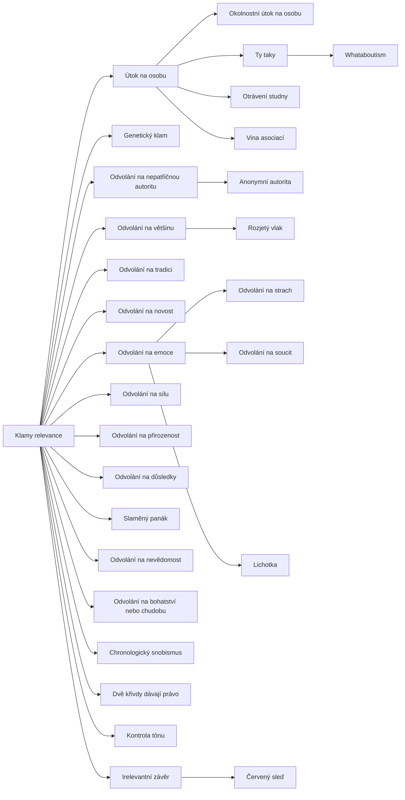

+++
title = "Klamy relevance"
description = "Rodina klamů, jejichž premisy mohou být pravdivé, ale se závěrem nesouvisejí: útoky na osobu, náhražky autority a počtu, apely na emoce a odvádění od tématu."
weight = 2
sort_by = "weight"
template = "kompendium/section.html"
page_template = "kompendium/page.html"
insert_anchor_links = "right"

[extra]
tags = ["fauly", "fauly-relevance"]
categories = ["academic"]
toc = true
lang = "cs"
keywords = ["Klamy relevance", "Fallacies of relevance", "Argumentační fauly"]
schema_type = "DefinedTermSet"
catalog = "fauly"
catalog_schema = 1
catalog_export = "data/fauly-katalog.json"
catalog_family = "relevance"
catalog_code = "02"
catalog_en = "Fallacies of relevance"
catalog_size = 28
catalog_members = ["ad-hominem", "okolnostni-ad-hominem", "tu-quoque", "genetic-klam", "otraveni-studny", "vina-asociaci", "odvolani-na-autoritu", "anonymni-autorita", "ad-populum", "rozjety-vlak", "odvolani-na-tradici", "odvolani-na-novost", "odvolani-na-emoce", "odvolani-na-strach", "odvolani-na-soucit", "odvolani-na-silu", "odvolani-na-prirozenost", "odvolani-na-dusledky", "cerveny-sled", "slameny-panak", "whataboutism", "odvolani-na-nevedomost", "lichotka", "odvolani-na-bohatstvi", "chronologicky-snobismus", "dve-kriva-jedno-pravo", "kontrola-tonu", "irelevantni-zaver"]
catalog_types = ["informal", "tactic"]
catalog_sources = ["bentham-1824", "cialdini-2009", "cook-lewandowsky-ecker-2017", "copi-cohen-mcmahon-2014", "damer-2009", "hahn-oaksford-2007", "hamblin-1970", "johnson-blair-1977", "kahneman-2011", "kunda-1990", "mercier-sperber-2011", "petty-cacioppo-1986", "roozenbeek-2022", "walton-1995", "walton-reed-macagno-2008", "whately-1826", "eemeren-grootendorst-1992"]
+++

# Klamy relevance

## Co rodina zahrnuje

Klamy relevance jsou úvahy, ve kterých premisy, jež se předkládají na podporu závěru, s tímto
závěrem logicky nesouvisejí, ačkoli psychologicky mohou působit velmi silně. Premisa může být
pravdivá, posluchač ji může snadno přijmout a může v něm vyvolat souhlas, strach nebo soucit,
a přesto neříká nic o tom, zda je závěr pravdivý nebo zda je navrhovaný krok správný.
Učebnice logiky tuto rodinu tradičně vymezují právě rozdílem mezi logickou a psychologickou
relevancí: klam vzniká tam, kde se psychologická síla premisy vydává za její důkazní sílu
(Copi, Cohen a McMahon 2014). Rodina je v katalogu nejpočetnější, protože odvedení od věci je
nejlevnější a nejuniverzálnější způsob, jak se vyhnout posouzení důvodů. Nevyžaduje nepravdu
ani složitou konstrukci, stačí změnit, o čem se mluví.

Hesla rodiny lze uspořádat do pěti okruhů. První okruh tvoří útoky na zdroj, které místo
tvrzení posuzují toho, kdo ho vyslovil. Jeho jádrem je
[útok na osobu](@/kompendium/argumentacni-fauly/relevance/ad-hominem.md) s podobami, které
katalog popisuje samostatně: [okolnostní útok na
osobu](@/kompendium/argumentacni-fauly/relevance/okolnostni-ad-hominem.md), který napadá zájem
nebo postavení mluvčího, námitka [ty taky](@/kompendium/argumentacni-fauly/relevance/tu-quoque.md),
která napadá jeho nekonzistenci, [otrávení
studny](@/kompendium/argumentacni-fauly/relevance/otraveni-studny.md), které ho diskredituje
předem, a [vina asociací](@/kompendium/argumentacni-fauly/relevance/vina-asociaci.md), která ho
hodnotí podle toho, s kým je spojen. Obecnějším příbuzným tohoto okruhu je
[genetický klam](@/kompendium/argumentacni-fauly/relevance/genetic-klam.md), který hodnotí
jakoukoli myšlenku, metodu nebo instituci podle jejího původu.

Druhý okruh tvoří náhražky důvodů, které místo posouzení věci nabízejí vnější znak její
správnosti. Patří sem [odvolání na nepatřičnou
autoritu](@/kompendium/argumentacni-fauly/relevance/odvolani-na-autoritu.md) a jeho zvláštní
případ, [anonymní autorita](@/kompendium/argumentacni-fauly/relevance/anonymni-autorita.md),
dále [odvolání na většinu](@/kompendium/argumentacni-fauly/relevance/ad-populum.md) a
[rozjetý vlak](@/kompendium/argumentacni-fauly/relevance/rozjety-vlak.md), které místo důvodů
počítají stoupence, a dvojice protikladných časových apelů, [odvolání na
tradici](@/kompendium/argumentacni-fauly/relevance/odvolani-na-tradici.md) a [odvolání na
novost](@/kompendium/argumentacni-fauly/relevance/odvolani-na-novost.md). K nim se řadí
[chronologický
snobismus](@/kompendium/argumentacni-fauly/relevance/chronologicky-snobismus.md), který odmítá
myšlenky kvůli jejich stáří, a [odvolání na bohatství nebo
chudobu](@/kompendium/argumentacni-fauly/relevance/odvolani-na-bohatstvi.md), které hodnotí
tvrzení podle majetkových poměrů mluvčího.

Třetí okruh tvoří apely na emoce a na sílu. Obecné [odvolání na
emoce](@/kompendium/argumentacni-fauly/relevance/odvolani-na-emoce.md) má několik zvláštních
podob: [odvolání na strach](@/kompendium/argumentacni-fauly/relevance/odvolani-na-strach.md),
[odvolání na soucit](@/kompendium/argumentacni-fauly/relevance/odvolani-na-soucit.md),
[lichotku](@/kompendium/argumentacni-fauly/relevance/lichotka.md) a v krajní podobě
[odvolání na sílu](@/kompendium/argumentacni-fauly/relevance/odvolani-na-silu.md), kde důvod
nahrazuje hrozba. Čtvrtý okruh tvoří úvahy, které místo pravdivosti posuzují něco jiného:
[odvolání na přirozenost](@/kompendium/argumentacni-fauly/relevance/odvolani-na-prirozenost.md),
[odvolání na důsledky](@/kompendium/argumentacni-fauly/relevance/odvolani-na-dusledky.md),
které pravdivost tvrzení odvozuje od toho, zda jsou jeho důsledky žádoucí, a [odvolání na
nevědomost](@/kompendium/argumentacni-fauly/relevance/odvolani-na-nevedomost.md), které z
nedostatku důkazu vyvozuje opak. Pátý okruh tvoří taktiky odvádění pozornosti, které spor
přesouvají jinam: červený sleď, slaměný panák,
[whataboutism](@/kompendium/argumentacni-fauly/relevance/whataboutism.md), [dvě křivdy dávají
právo](@/kompendium/argumentacni-fauly/relevance/dve-kriva-jedno-pravo.md), [kontrola
tónu](@/kompendium/argumentacni-fauly/relevance/kontrola-tonu.md) a obecný [irelevantní
závěr](@/kompendium/argumentacni-fauly/relevance/irelevantni-zaver.md), který dokazuje něco
jiného, než co bylo předmětem sporu. Úplný přehled hesel s jejich kódy podává tabulka na konci
stránky.

## Původ

Klamy relevance mají v dějinách logiky dlouhou tradici. Aristotelés v Sofistických vyvráceních
popsal klam, který latinská tradice nazvala ignoratio elenchi, neznalost vyvrácení: mluvčí
dokazuje něco jiného, než co měl dokázat, a vydává to za vyvrácení protivníka. Tento klam lze
chápat jako obecný vzor celé rodiny. John Locke v Eseji o lidském rozumu zavedl latinská jména
argumentů ad hominem, ad verecundiam a ad ignorantiam, která se pak stala základem
novověkých seznamů klamů, ačkoli je sám chápal jinak než pozdější učebnice. Richard Whately
rozebíral argument ad hominem i irelevantní závěr jako typické chyby veřejného sporu (Whately
1826) a Jeremy Bentham sestavil katalog klamů, jimiž se v parlamentní rozpravě obchází
posouzení návrhu, od dovolávání se autority předků po útoky na osobu navrhovatele (Bentham
1824).

Ve dvacátém století se klamy relevance staly pevnou součástí učebnic logiky, ale Hamblin v
kritice takzvaného standardního pojetí ukázal, že výklady jsou nejednotné, příklady
vymyšlené a hranice mezi klamem a rozumnou úvahou nejasné (Hamblin 1970). Na jeho kritiku
navázala neformální logika, která relevanci postavila mezi základní kritéria dobrého
argumentu. Johnson a Blair formulovali požadavek, aby premisy byly relevantní, přijatelné a
dostatečné, a klamy relevance chápali jako selhání prvního z nich (Johnson a Blair 1977).
Damer rozpracoval kritérium relevance do podrobného přehledu klamů, které ho porušují (Damer
2009). [Pragma-dialektika](@/kompendium/argumentacni-fauly/teorie-argumentace/pragma-dialektika.md) přidala dialogický pohled: klamy relevance porušují pravidla kritické
diskuse, zejména [pravidlo svobody](@/kompendium/argumentacni-fauly/teorie-argumentace/pravidlo-svobody.md), podle něhož strany nesmějí bránit druhé straně v
předložení nebo zpochybnění stanoviska, a [pravidlo relevance](@/kompendium/argumentacni-fauly/teorie-argumentace/pravidlo-relevance.md), podle něhož se stanovisko smí
hájit jen argumentací, která se k němu vztahuje (van Eemeren a Grootendorst 1992).

## Kdy úvaha klamem není

Nejdůležitějším poznatkem současné teorie je, že většina klamů relevance je kontextová.
Stejná struktura může být v jednom sporu klamem a v jiném rozumnou úvahou. Námitka k osobě
je klamem, když se z vlastnosti mluvčího vyvozuje nepravdivost věcného tvrzení, ale je
legitimní, když tvrzení stojí na jeho svědectví. Odvolání na odborníka je klamem, když
odborník mluví mimo svůj obor, ale je nezbytnou součástí každodenního poznání, když mluví o
svém oboru a jeho tvrzení je dohledatelné. Odvolání na většinu je klamem u faktických otázek,
ale je přímo rozhodující u otázek, co si společenství přeje. Walton proto popisuje tyto úvahy
jako argumentační schémata s kritickými otázkami a klam chápe jako jejich zneužití v
konkrétním dialogu, ne jako chybnou formu (Walton 1995; Walton, Reed a Macagno 2008).
Bayesovské pojetí k tomu dodává, že informace o zdroji, o shodě ostatních nebo o
důsledcích může legitimně měnit odhad pravděpodobnosti tvrzení a že klam vzniká přeceněním
její váhy, ne jejím použitím (Hahn a Oaksford 2007).

Z toho plyne praktický důsledek pro čtenáře katalogu. Pojmenování klamu není vyvrácením.
Kdo na každou námitku k osobě odpoví „to je ad hominem“, dopouští se vlastní chyby, protože
přeskakuje otázku, zda je napadaná vlastnost relevantní. Hesla rodiny proto vždy obsahují
oddíl o odlišení od platné argumentace a trenér vedle chybných výroků nabízí i neškodné
kontrasty, které je třeba rozpoznat jako platné.

## Proč klamy relevance působí

Psychologický výzkum vysvětluje, proč jsou klamy relevance tak účinné, ačkoli jejich logická
slabina je po rozložení zřejmá. Model pravděpodobnosti zpracování ukazuje, že když posluchač
nemá motivaci nebo kapacitu argument podrobně zkoumat, rozhoduje podle periferních vodítek,
k nimž patří důvěryhodnost a sympatie zdroje, počet lidí, kteří souhlasí, a emoční ladění
sdělení (Petty a Cacioppo 1986). Klamy relevance jsou z velké části právě taková vodítka,
vydávaná za důvody. Výzkum sociálního vlivu popisuje autoritu, sociální důkaz a sympatii jako
principy, které v běžném životě šetří čas, ale které lze snadno zneužít (Cialdini 2009).
Kahneman popisuje rychlé, asociativní myšlení, které vytváří soudržný dojem z dostupných
vodítek a nepátrá po tom, co chybí (Kahneman 2011). Výzkum motivovaného uvažování dodává, že
lidé snadno přijímají irelevantní důvody, když vedou k závěru, který si přejí, a přísně je
posuzují, když vedou k závěru opačnému (Kunda 1990).

## Obrana

Obrana proti klamům relevance má společné jádro: vrátit rozhovor k otázce, o kterou ve sporu
jde, a zeptat se, zda předložená premisa k ní má vztah. Taková otázka nevyžaduje znalost
latinských názvů, jen pozornost k tomu, zda se po odbočce k osobě, k počtu nebo k emoci
rozhovor vrátí k věci. Výzkum psychologické inokulace ukazuje, že předem poznaná struktura
klamavého argumentu ztrácí část své přesvědčivosti. Vysvětlení techniky falešných odborníků
oslabilo účinek dezinformace o vědecké shodě (Cook, Lewandowsky a Ecker 2017) a krátká výuková
videa o manipulačních technikách, mezi nimi o útoku na osobu, zlepšila jejich rozpoznávání i
v terénním testu na sociální síti (Roozenbeek a kol. 2022). [Argumentační teorie uvažování](@/kompendium/argumentacni-fauly/teorie-argumentace/argumentacni-teorie-uvazovani.md)
připomíná, že lidé jsou lepší v hodnocení cizích argumentů než vlastních a že skupina, ve
které se důvody skutečně vyměňují, chyby jednotlivců často opravuje (Mercier a Sperber 2011).
Obrana proti klamům relevance proto není jen individuální dovedností, ale i vlastností
prostředí, ve kterém se spor vede.

## Vztah ke kompendiu

V kompendiu epistemické a [kognitivní anihilace](@/glossary/kognitivni-anihilace.md) se klamy relevance objevují jako stavební
prvky rozsáhlejších technik. Útok na osobu a otrávení studny tvoří jádro technik, které
rozkládají pověst odborníka, svědka nebo oběti, například [útoku na
kvalifikaci](@/kompendium/techniques/ea-2-1-3-credentialing-attack.md). Odvolání na autoritu
a na většinu se objevují u technik, které vytvářejí zdání odborné shody nebo masové podpory,
jako je [vytváření pseudokonsenzu](@/kompendium/techniques/ea-2-1-9-pseudo-konsenzus-vytvoreni.md).
Taktiky odvádění pozornosti jsou základem [tematické
diverze](@/kompendium/techniques/ea-1-3-3-tematicka-diverze.md). Rozdíl mezi jednotlivým klamem
a technikou spočívá v soustavnosti: jednou vyslovený útok na osobu je chybou v rozhovoru,
soustavná kampaň téhož druhu je vzorcem, který mění prostředí, v němž se o pravdě rozhoduje.
Katalog popisuje jednotlivé stavební prvky, aby je čtenář poznal i tehdy, když jsou součástí
většího celku.

<!-- kompendium:katalog-vazby:begin (scripts/catalogs.py; neupravovat ručně) -->

## Hesla rodiny

| Kód | Heslo | Anglicky | Druh | Užití | Riziko |
|-----|-------|----------|------|-------|--------|
| `AF-02.01` | [Útok na osobu](@/kompendium/argumentacni-fauly/relevance/ad-hominem.md) | Ad hominem | neformální klam | chyba i taktika | vysoké |
| `AF-02.02` | [Okolnostní útok na osobu](@/kompendium/argumentacni-fauly/relevance/okolnostni-ad-hominem.md) | Circumstantial ad hominem | neformální klam | chyba i taktika | střední |
| `AF-02.03` | [Ty taky](@/kompendium/argumentacni-fauly/relevance/tu-quoque.md) | Tu quoque | neformální klam | chyba i taktika | střední |
| `AF-02.04` | [Genetický klam](@/kompendium/argumentacni-fauly/relevance/genetic-klam.md) | Genetic fallacy | neformální klam | převážně chyba uvažování | střední |
| `AF-02.05` | [Otrávení studny](@/kompendium/argumentacni-fauly/relevance/otraveni-studny.md) | Poisoning the well | neformální klam | převážně záměrná taktika | vysoké |
| `AF-02.06` | [Vina asociací](@/kompendium/argumentacni-fauly/relevance/vina-asociaci.md) | Guilt by association | neformální klam | chyba i taktika | vysoké |
| `AF-02.07` | [Odvolání na nepatřičnou autoritu](@/kompendium/argumentacni-fauly/relevance/odvolani-na-autoritu.md) | Appeal to authority | neformální klam | chyba i taktika | vysoké |
| `AF-02.08` | [Anonymní autorita](@/kompendium/argumentacni-fauly/relevance/anonymni-autorita.md) | Appeal to anonymous authority | neformální klam | chyba i taktika | střední |
| `AF-02.09` | [Odvolání na většinu](@/kompendium/argumentacni-fauly/relevance/ad-populum.md) | Appeal to popularity | neformální klam | chyba i taktika | střední |
| `AF-02.10` | [Rozjetý vlak](@/kompendium/argumentacni-fauly/relevance/rozjety-vlak.md) | Bandwagon | neformální klam | převážně záměrná taktika | střední |
| `AF-02.11` | [Odvolání na tradici](@/kompendium/argumentacni-fauly/relevance/odvolani-na-tradici.md) | Appeal to tradition | neformální klam | chyba i taktika | střední |
| `AF-02.12` | [Odvolání na novost](@/kompendium/argumentacni-fauly/relevance/odvolani-na-novost.md) | Appeal to novelty | neformální klam | chyba i taktika | střední |
| `AF-02.13` | [Odvolání na emoce](@/kompendium/argumentacni-fauly/relevance/odvolani-na-emoce.md) | Appeal to emotion | neformální klam | chyba i taktika | vysoké |
| `AF-02.14` | [Odvolání na strach](@/kompendium/argumentacni-fauly/relevance/odvolani-na-strach.md) | Appeal to fear | neformální klam | převážně záměrná taktika | vysoké |
| `AF-02.15` | [Odvolání na soucit](@/kompendium/argumentacni-fauly/relevance/odvolani-na-soucit.md) | Appeal to pity | neformální klam | chyba i taktika | střední |
| `AF-02.16` | [Odvolání na sílu](@/kompendium/argumentacni-fauly/relevance/odvolani-na-silu.md) | Appeal to force | neformální klam | převážně záměrná taktika | vysoké |
| `AF-02.17` | [Odvolání na přirozenost](@/kompendium/argumentacni-fauly/relevance/odvolani-na-prirozenost.md) | Appeal to nature | neformální klam | chyba i taktika | střední |
| `AF-02.18` | [Odvolání na důsledky](@/kompendium/argumentacni-fauly/relevance/odvolani-na-dusledky.md) | Appeal to consequences | neformální klam | chyba i taktika | střední |
| `AF-02.19` | [Červený sleď](@/kompendium/argumentacni-fauly/relevance/cerveny-sled.md) | Red herring | neformální klam | převážně záměrná taktika | střední |
| `AF-02.20` | [Slaměný panák](@/kompendium/argumentacni-fauly/relevance/slameny-panak.md) | Straw man | neformální klam | chyba i taktika | vysoké |
| `AF-02.21` | [Whataboutism](@/kompendium/argumentacni-fauly/relevance/whataboutism.md) | Whataboutism | neformální klam | převážně záměrná taktika | střední |
| `AF-02.22` | [Odvolání na nevědomost](@/kompendium/argumentacni-fauly/relevance/odvolani-na-nevedomost.md) | Appeal to ignorance | neformální klam | chyba i taktika | střední |
| `AF-02.23` | [Lichotka](@/kompendium/argumentacni-fauly/relevance/lichotka.md) | Appeal to flattery | neformální klam | převážně záměrná taktika | střední |
| `AF-02.24` | [Odvolání na bohatství nebo chudobu](@/kompendium/argumentacni-fauly/relevance/odvolani-na-bohatstvi.md) | Appeal to wealth or poverty | neformální klam | chyba i taktika | nízké |
| `AF-02.25` | [Chronologický snobismus](@/kompendium/argumentacni-fauly/relevance/chronologicky-snobismus.md) | Chronological snobbery | neformální klam | převážně chyba uvažování | nízké |
| `AF-02.26` | [Dvě křivdy dávají právo](@/kompendium/argumentacni-fauly/relevance/dve-kriva-jedno-pravo.md) | Two wrongs make a right | neformální klam | chyba i taktika | střední |
| `AF-02.27` | [Kontrola tónu](@/kompendium/argumentacni-fauly/relevance/kontrola-tonu.md) | Tone policing | rétorická taktika | převážně záměrná taktika | střední |
| `AF-02.28` | [Irelevantní závěr](@/kompendium/argumentacni-fauly/relevance/irelevantni-zaver.md) | Ignoratio elenchi | neformální klam | chyba i taktika | střední |

## Mapa rodiny

Mapu odvozuje engine katalogů z vazeb „obecnější heslo“; uzel otevře heslo.

## Literatura

- Bentham, J. (1824). *The Book of Fallacies*. London: John and H. L. Hunt.
- Cialdini, R. B. (2009). *Influence: Science and Practice* (5. vyd.). Boston: Pearson.
- Cook, J., Lewandowsky, S., & Ecker, U. K. H. (2017). Neutralizing misinformation through inoculation: Exposing misleading argumentation techniques reduces their influence. *PLoS ONE*, 12(5), e0175799.
- Copi, I. M., Cohen, C., & McMahon, K. (2014). *Introduction to Logic* (14. vyd.). Harlow: Pearson.
- Damer, T. E. (2009). *Attacking Faulty Reasoning: A Practical Guide to Fallacy-Free Arguments* (6. vyd.). Belmont: Wadsworth.
- Hahn, U., & Oaksford, M. (2007). The rationality of informal argumentation: A Bayesian approach to reasoning fallacies. *Psychological Review*, 114(3), 704–732.
- Hamblin, C. L. (1970). *Fallacies*. London: Methuen.
- Johnson, R. H., & Blair, J. A. (1977). *Logical Self-Defense*. Toronto: McGraw-Hill Ryerson.
- Kahneman, D. (2011). *Thinking, Fast and Slow*. New York: Farrar, Straus and Giroux.
- Kunda, Z. (1990). The case for motivated reasoning. *Psychological Bulletin*, 108(3), 480–498.
- Mercier, H., & Sperber, D. (2011). Why do humans reason? Arguments for an argumentative theory. *Behavioral and Brain Sciences*, 34(2), 57–74.
- Petty, R. E., & Cacioppo, J. T. (1986). *Communication and Persuasion: Central and Peripheral Routes to Attitude Change*. New York: Springer.
- Roozenbeek, J., van der Linden, S., Goldberg, B., Rathje, S., & Lewandowsky, S. (2022). Psychological inoculation improves resilience against misinformation on social media. *Science Advances*, 8(34), eabo6254.
- Walton, D. N. (1995). *A Pragmatic Theory of Fallacy*. Tuscaloosa: University of Alabama Press.
- Walton, D., Reed, C., & Macagno, F. (2008). *Argumentation Schemes*. Cambridge: Cambridge University Press.
- Whately, R. (1826). *Elements of Logic*. London: J. Mawman.
- van Eemeren, F. H., & Grootendorst, R. (1992). *Argumentation, Communication, and Fallacies: A Pragma-Dialectical Perspective*. Hillsdale: Lawrence Erlbaum.

## Související

- [Argumentační fauly](@/kompendium/argumentacni-fauly/_index.md) – celý katalog a jeho rodiny
- [Formální klamy](@/kompendium/argumentacni-fauly/formalni/_index.md) – předchozí rodina katalogu
- [Klamy předpokladu](@/kompendium/argumentacni-fauly/predpoklady-argumentu/_index.md) – další rodina katalogu
- [Trenér rozpoznávání](@/kompendium/trener.md) – procvičení rozpoznání hesel této rodiny

<!-- kompendium:katalog-vazby:end -->
